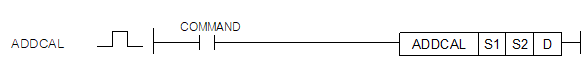
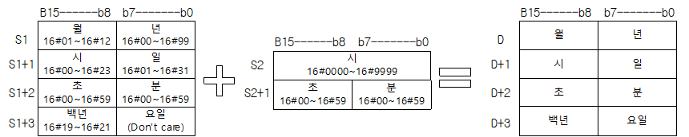

# ADDCAL

Manual section(s): 4.29.8. Original Korean notes below may cover the other variants on the same page; apply the widths and execution form of `ADDCAL`.

## Editing route

Use `get_ir` → `apply_patch` for this instruction edit. `insert_ladder_instruction` is the internal writer route, not a separate MCP tool. Preserve the exported revision and native constraints.
The writer mnemonic is `ADDCAL`; the catalog records opcode `1632` and `3` operands in order.
Inspect the CPU/project and target cells first. Use the inspected revision and positions, preserve expected values, dry-run when useful, then save and inspect the result. See the [editing skill](../../SKILL.md) and [ladder workflow](../ladder.md).

## Operands

| Order | Operand | Description (Korean manual) | Reviewed types | Device areas | Constant |
| --- | --- | --- | --- | --- | --- |
| 1 | S1 | 캘린더 데이터가 들어있는 디바이스 번호 | WORD | PMK, L, Z, D, R | Not allowed |
| 2 | S2 | 시계 데이터가 들어있는 디바이스 번호 | WORD | PMK, L, Z, D, R | Not allowed |
| 3 | D | 결과를 저장할 디바이스 번호 | WORD | PMK, L, Z, D, R | Not allowed |

These are the current library's reviewed operand rules. A shared type union is not a per-variant type choice; use the manual behavior to select the required width. Missing permissions stay unknown.

## CPU and acceptance

No separately reviewed CPU-model restriction is available in the current catalog; this means unknown, not universal compatibility.
Check the applicable model, firmware, modules and memory spans stated in the manual notes. Local parsing, writer validation and IL conversion do not prove native compilation or PLC behavior. Native acceptance requires XG5000 Open → Check Program → Save As → comparison.

## Manual flags

- ADDCAL (Add Calendar)
- S1으로 지정된 영역의 캘린더 데이터 값과 S2로 지정된 영역의 시간 데이터 값을 더해서 D영역에 저장합니다.
- S1+0, S1+1, S1+2, S1+3으로 지정된 영역의 시간 데이터 값을 설정합니다.
- 시간데이터 포맷은 시스템 플래그 F0053~F0056과 동일합니다.
- 모든 시간 데이터 값은 BCD 형태로 설정합니다.
- 요일 설명: 0-일요일, 1-월요일, 2-화요일, 3-수요일, 4-목요일, 5-금요일, 6-토요일
- 요일 데이터는 별도로 입력하지 않아도 결과 날짜에 따른 요일이 자동으로 출력됩니다.

| 플래그 | 내 용 | 디바이스 번호 |
| --- | --- | --- |
| 에러 | 1. S1 데이터가 RTC 데이터 범위를 벗어낫 경우 - RTC 데이터 범위: 1984-01-01 00:00:00 ~ 2163-06-06 23:59:59 - RTC 데이터 범위를 벗어나지 않더라도 유효하지 않은 날짜가 설정된 경우 (ex: 2019-11-31 10:57:30) - 요일 데이터의 유효성은 체크하지 않음(Don’t care) 2. S2의 데이터가 시간 데이터의 크기를 벗어날 경우 - 0000:00:00 ~ 9999:59:59 3. S1, S2의 값이 BCD형식이 아닌 경우 4. 연산결과가 RTC 데이터 범위를 벗어난 경우 5. 설정한 디바이스 번호가 영역을 넘어갈 경우 | F110 |

## Manual applicability and restrictions

- 적용 기종 : XGK, XGB(XBC-U, XBM-H/H2/HP)

## Manual flag and step matrix

The shared usage table marks affected flags with `O`, and `-` where it lists no effect. Native steps are the manual's instruction size, not the number of operand arguments. Conditions for setting/clearing flags are in the behavior notes.

| Manual instruction group | Native steps | 에러 (F110) | 제로 (F111) | 캐리 (F112) |
| --- | --- | --- | --- | --- |
| ADDCAL | 4~7 | O | - | - |

## Referenced manual figures

These figures belong to the shared source topic. Read the source corrections above before using variant-specific layouts or example values.

## Provenance

Source: `XGK(B)InstructionHelp_Kr_V3.5.chm`, SHA-256 `b866d589d800addcb039f9f09b182592464d6367faa55abf6dde9ac34a1580e0`.

- `4297addcal.htm` — §4.29.8; source SHA-256 `d9c328e28ce65b1c3290c4631527c364e57e5b58558a16584d096cf288353b46`.
- Additional behavior/operand evidence: `4297addcal.htm`.
