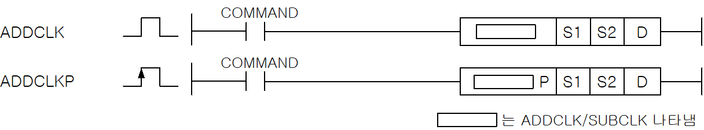
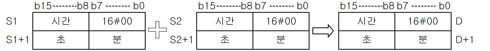
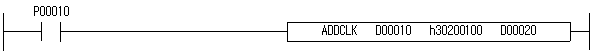
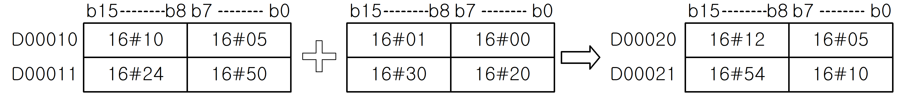
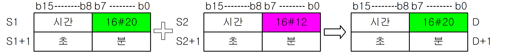

# ADDCLKP

Manual section(s): 4.29.4. Original Korean notes below may cover the other variants on the same page; apply the widths and execution form of `ADDCLKP`.

Execution form: the source explicitly pairs this command as `(P)`; `ADDCLKP` is the pulse-type P form. Manual §2.4.2 defines `P` as pulse-type notation. Select the paired forms deliberately and retain the instruction's actual execution conditions; unrelated mnemonics ending in P are not classified by suffix alone.

## Editing route

Use `insert_ladder_instruction` after calling `describe_operation` for its current schema.
The writer mnemonic is `ADDCLKP`; the catalog records opcode `778` and `3` operands in order.
Inspect the CPU/project and target cells first. Use the inspected revision and positions, preserve expected values, dry-run when useful, then save and inspect the result. See the [editing skill](../../SKILL.md) and [ladder workflow](../ladder.md).

## Operands

| Order | Operand | Description (Korean manual) | Reviewed types | Device areas | Constant |
| --- | --- | --- | --- | --- | --- |
| 1 | S1 | 시간 데이터가 들어있는 디바이스 번호 | DWORD | PMK, L, Z, U, N, D, R | Not allowed |
| 2 | S2 | 시간 데이터가 들어있는 디바이스 번호 | DWORD | PMK, L, Z, U, N, D, R | Allowed |
| 3 | D | 결과를 저장할 디바이스 번호 | DWORD | PMK, L, Z, U, N, D, R | Not allowed |

These are the current library's reviewed operand rules. A shared type union is not a per-variant type choice; use the manual behavior to select the required width. Missing permissions stay unknown.

## CPU and acceptance

No separately reviewed CPU-model restriction is available in the current catalog; this means unknown, not universal compatibility.
Check the applicable model, firmware, modules and memory spans stated in the manual notes. Local parsing, writer validation and IL conversion do not prove native compilation or PLC behavior. Native acceptance requires XG5000 Open → Check Program → Save As → comparison.

## Manual flags

- ADDCLK (Add Clock)
- S1으로 지정된 영역의 시간 데이터 값과 S2로 지정된 영역의 시간 데이터 값을 더해서 D, D+1에 저장합니다.
- 시간 데이터 값은 BCD값으로 입력해야 합니다. 예를 들어 D00010에 시간데이터가 있고, 이 시간에1시간 20분 30 초를 더해서 D00020에 넣고자 할 경우 다음과 같이 입력하면 됩니다.
- 만약, S2로 지정된 디바이스의 최하위 바이트의 값이 존재할 경우,그 위치의 값은 무처리됩니다.

| 플래그 | 내 용 | 디바이스 번호 |
| --- | --- | --- |
| 에러 | S1, S2의 데이터가 시간 데이터의 크기를 벗어날 경우 | F110 |

## Manual applicability and restrictions

- 적용 기종 : XGK, XGB

## Manual flag and step matrix

The shared usage table marks affected flags with `O`, and `-` where it lists no effect. Native steps are the manual's instruction size, not the number of operand arguments. Conditions for setting/clearing flags are in the behavior notes.

| Manual instruction group | Native steps | 에러 (F110) | 제로 (F111) | 캐리 (F112) |
| --- | --- | --- | --- | --- |
| ADDCLK(P) | 4~6 | O | - | - |

## Referenced manual figures

These figures belong to the shared source topic. Read the source corrections above before using variant-specific layouts or example values.

## Provenance

Source: `XGK(B)InstructionHelp_Kr_V3.5.chm`, SHA-256 `b866d589d800addcb039f9f09b182592464d6367faa55abf6dde9ac34a1580e0`.

- `4293addclkaddclkp.htm` — §4.29.4; source SHA-256 `3a2d4ab432e7a3f4829047bf512be0289f0be12172431a1c0b41573e82a24e54`.
- Additional behavior/operand evidence: `4293addclkaddclkp.htm`, `245.htm`.
