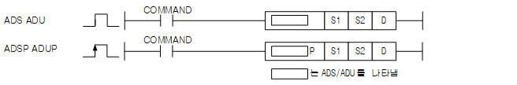
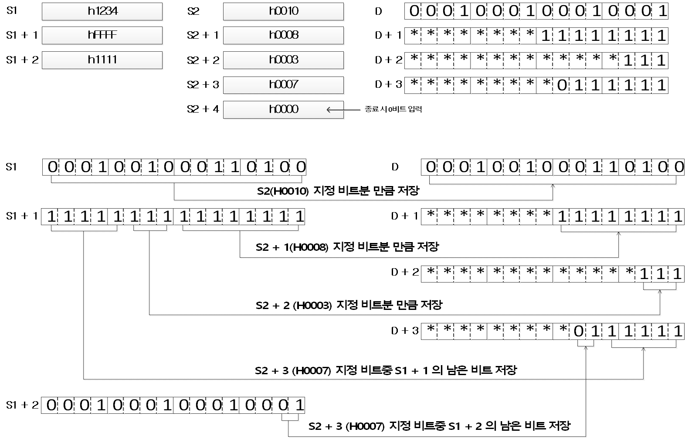
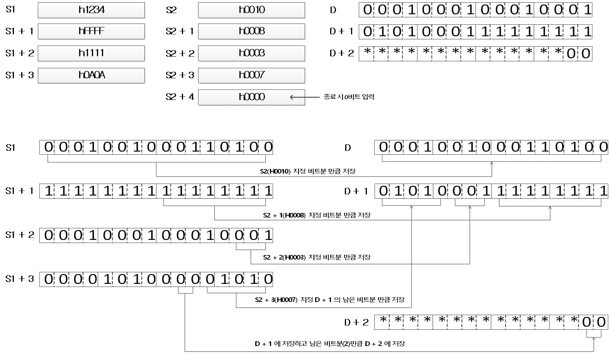

# ADSP

Manual section(s): 4.24.20. Original Korean notes below may cover the other variants on the same page; apply the widths and execution form of `ADSP`.

Execution form: the source explicitly pairs this command as `(P)`; `ADSP` is the pulse-type P form. Manual §2.4.2 defines `P` as pulse-type notation. Select the paired forms deliberately and retain the instruction's actual execution conditions; unrelated mnemonics ending in P are not classified by suffix alone.

## Editing route

Use `get_ir` → `apply_patch` for this instruction edit. `insert_ladder_instruction` is the internal writer route, not a separate MCP tool. Preserve the exported revision and native constraints.
The writer mnemonic is `ADSP`; the catalog records opcode `1543` and `3` operands in order.
Inspect the CPU/project and target cells first. Use the inspected revision and positions, preserve expected values, dry-run when useful, then save and inspect the result. See the [editing skill](../../SKILL.md) and [ladder workflow](../ladder.md).

## Operands

| Order | Operand | Description (Korean manual) | Reviewed types | Device areas | Constant |
| --- | --- | --- | --- | --- | --- |
| 1 | S1 | 분리/결합 할 데이터가 저장되어 있는 디바이스 번호 | WORD | PMK, L, Z, U, N, D, R | Not allowed |
| 2 | S2 | 분리/결합 할 단위를 저장하는 디바이스 번호 | WORD | PMK, L, Z, U, N, D, R | Not allowed |
| 3 | D | 분리/결합된 데이터를 저장하는 디바이스 번호 | WORD | PMK, D, R | Not allowed |

These are the current library's reviewed operand rules. A shared type union is not a per-variant type choice; use the manual behavior to select the required width. Missing permissions stay unknown.

## CPU and acceptance

No separately reviewed CPU-model restriction is available in the current catalog; this means unknown, not universal compatibility.
Check the applicable model, firmware, modules and memory spans stated in the manual notes. Local parsing, writer validation and IL conversion do not prove native compilation or PLC behavior. Native acceptance requires XG5000 Open → Check Program → Save As → comparison.

## Manual flags

- ADU(Abnomal Data Union)
- 이 명령은 S1으로 지정된 디바이스 이후에 저장되어 있는 데이터의 각 비트를 S2로 저장된 비트만큼씩 분리하여, D로 지정된 디바이스 이후에 저장하는 명령어입니다.
- S2는 1~16의 범위를 가지고 있으며, S2이후 값이 ‘0’이 될 때 까지 분리합니다.
- ADS(Abnomal Data Segmentation)
- S1으로 지정된 디바이스 이후에 저장되어 있는 데이터를 S2로 저장된 비트만큼씩 결합하여, D로 지정된 디바이스 이후에 저장하는 명령어입니다.
- S2는 1~16의 범위를 가지고 있으며, S2이후 값이 ‘0’이 될 때 까지 비트를 결합합니다.

| 플래그 | 내 용 | 디바이스 번호 |
| --- | --- | --- |
| 에러 | 1. 분리/결합 할 단위가 1~16의 범위를 벗어나서 설정 되었을 경우 2. 분리/결합 된 데이터를 저장할 메모리 공간이 충분하지 않은 경우 | F110 |

## Manual applicability and restrictions

- 적용 기종 : XGK, XGB(XBC-U, XBM-H/H2/HP)

## Manual flag and step matrix

The shared usage table marks affected flags with `O`, and `-` where it lists no effect. Native steps are the manual's instruction size, not the number of operand arguments. Conditions for setting/clearing flags are in the behavior notes.

| Manual instruction group | Native steps | 에러 (F110) | 제로 (F111) | 캐리 (F112) |
| --- | --- | --- | --- | --- |
| ADS(P) ADU(P) | 4~7 | O | - | - |

## Referenced manual figures

These figures belong to the shared source topic. Read the source corrections above before using variant-specific layouts or example values.

## Provenance

Source: `XGK(B)InstructionHelp_Kr_V3.5.chm`, SHA-256 `b866d589d800addcb039f9f09b182592464d6367faa55abf6dde9ac34a1580e0`.

- `42420adsadspaduadup.htm` — §4.24.20; source SHA-256 `cc97e3206f7e974ad2f61d8e74e5c141cf60242af94ff73ed45e75f1a30e8311`.
- Additional behavior/operand evidence: `42420adsadspaduadup.htm`, `245.htm`.
