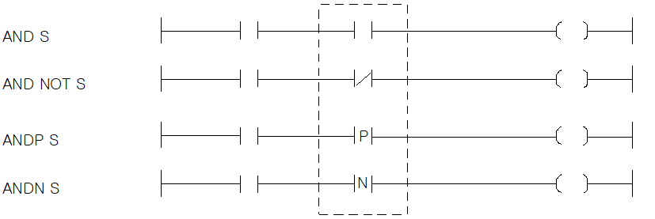

# AND NOT

Manual section(s): 4.1.2. Original Korean notes below may cover the other variants on the same page; apply the widths and execution form of `AND NOT`.

## Editing route

Use `edit_ladder_cell` after calling `describe_operation` for its current schema.
Set the replacement element kind to `NormallyClosed`. `AND NOT` describes `series` placement; it is represented by a physical cell rather than an application opcode.
Inspect the CPU/project and target cells first. Use the inspected revision and positions, preserve expected values, dry-run when useful, then save and inspect the result. See the [editing skill](../../SKILL.md) and [ladder workflow](../ladder.md).

## Operands

| 오퍼랜드 | 설명 | 데이터 타입 |
| --- | --- | --- |
| S | 비트 디바이스의 접점 / 워드 디바이스의 비트 접점 | BIT |

This source table is not a separately reviewed writer rule. Retain shared variant distinctions and let the current writer reject unsupported operands.

## CPU and acceptance

No separately reviewed CPU-model restriction is available in the current catalog; this means unknown, not universal compatibility.
Check the applicable model, firmware, modules and memory spans stated in the manual notes. Local parsing, writer validation and IL conversion do not prove native compilation or PLC behavior. Native acceptance requires XG5000 Open → Check Program → Save As → comparison.

## Manual behavior notes (Korean)

- AND, AND NOT
- AND는 a접점 직렬 접속 명령이고, AND NOT은 b접점 직렬 접속 명령입니다.
- 지정 접점(S) 전 단계의 연산 결과와 지정 접점(S)을 AND 혹은 AND NOT연산을 하여 그것을 연산결과로 합니다.
- ANDP, ANDN
- ANDP는 상승 펄스시 a접점 직렬 접속 명령이고, ANDN은 하강 펄스시b접점 직렬 접속 명령입니다.
- 해당 접점값이 변할 때, 즉, ANDP는 상승 펄스일때, ANDN은 하강 펄스일때, 지정 접점(S) 전 단계의 연산 결과와 지정 접점(S)을 AND 연산하여 그것을 연산결과로 합니다.

## Manual applicability and restrictions

- 적용 기종 : XGK, XGB

## Manual flag and step matrix

The shared usage table marks affected flags with `O`, and `-` where it lists no effect. Native steps are the manual's instruction size, not the number of operand arguments. Conditions for setting/clearing flags are in the behavior notes.

| Manual instruction group | Native steps | 에러 (F110) | 제로 (F111) | 캐리 (F112) |
| --- | --- | --- | --- | --- |
| AND AND NOT | 1~2 | - | - | - |
| ANDP ANDN | 2 | - | - | - |

## Additional source notes after examples

The manual places some execution restrictions and timing conditions after its example heading. Retain those checks below. Example addresses and circuit assumptions describe the source example and are not defaults for a new program.

- AND/AND NOT 명령어는 인덱스 수식을 사용하게 되면 스텝수가 1증가합니다.

## Referenced manual figures

These figures belong to the shared source topic. Read the source corrections above before using variant-specific layouts or example values.

## Provenance

Source: `XGK(B)InstructionHelp_Kr_V3.5.chm`, SHA-256 `b866d589d800addcb039f9f09b182592464d6367faa55abf6dde9ac34a1580e0`.

- `412andandnotandpandn.htm` — §4.1.2; source SHA-256 `a5464bf0b974e2a2ab9af72eda47e62cc748e18e63974fdbc2f30b73e49d64a3`.
