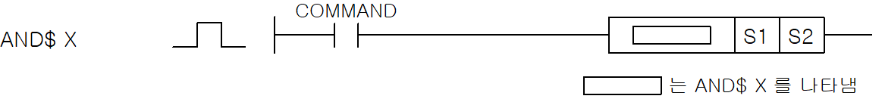
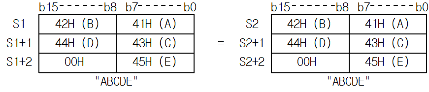

# AND$>=

Combine the current circuit result with an AND comparison: AND$>=.

Manual section(s): 4.15.8. Original Korean notes below may cover the other variants on the same page; apply the widths and execution form of `AND$>=`.

## Editing route

Use `get_ir` → `apply_patch` for this instruction edit. `insert_ladder_comparison` is the internal writer route, not a separate MCP tool. Preserve the exported revision and native constraints.
The writer mnemonic is `$>=`; the catalog records opcode `1401` and `2` operands in order.
Inspect the CPU/project and target cells first. Use the inspected revision and positions, preserve expected values, dry-run when useful, then save and inspect the result. See the [editing skill](../../SKILL.md) and [ladder workflow](../ladder.md).

## Behavior

- Compare the strings identified by S1 and S2 using >=. The manual compares character codes internally as hexadecimal and gives priority to leading characters and string length.
- Combine the comparison result with the current bit result (BR) using AND.

## Instruction constraints

- Use the device string encoding described by the manual; do not substitute host Unicode collation.

## Operands

| Order | Operand | Description (Korean manual) | Reviewed types | Device areas | Constant |
| --- | --- | --- | --- | --- | --- |
| 1 | S1 | 비교하고자 하는 문자열 혹은 문자열이 저장되어 있는 디바이스 번호 | STRING | PMK, F, L, T, C, Z, U, N, D, R | Allowed |
| 2 | S2 | 비교하고자 하는 문자열 혹은 문자열이 저장되어 있는 디바이스 번호 | STRING | PMK, F, L, T, C, Z, U, N, D, R | Allowed |

These are the current library's reviewed operand rules. A shared type union is not a per-variant type choice; use the manual behavior to select the required width. Missing permissions stay unknown.

## CPU and acceptance

No separately reviewed CPU-model restriction is available in the current catalog; this means unknown, not universal compatibility.
Check the applicable model, firmware, modules and memory spans stated in the manual notes. Local parsing, writer validation and IL conversion do not prove native compilation or PLC behavior. Native acceptance requires XG5000 Open → Check Program → Save As → comparison.

## Manual behavior notes (Korean)

- AND$ X ($=,$>,$<,$>=,$<=,$<>)
- 아래의 X조건을 만족할 경우 해당 비교 결과 On합니다.
- 캐릭터 코드 비교는 내부적으로16진수로 비교 후 해당 비교 결과 On 또는 Off합니다.
- 단, 문자열 앞자리와 문자열 길이를 우선으로 비교합니다.)
- 이 결과와 현재의 연산결과를 AND하여 새로운 연산결과로 취합니다.

| X조건 | 조건 | 비교결과 |
| --- | --- | --- |
| = | S1 = S2 | On |
| <= | S1 ￡ S2 | On |
| >= | S1 ³ S2 | On |
| < > | S1 ¹ S2 | On |
| < | S1 < S2 | On |
| > | S1 > S2 | On |

## Manual applicability and restrictions

- 적용 기종 : XGK, XGB

## Manual flag and step matrix

The shared usage table marks affected flags with `O`, and `-` where it lists no effect. Native steps are the manual's instruction size, not the number of operand arguments. Conditions for setting/clearing flags are in the behavior notes.

| Manual instruction group | Native steps | 에러 (F110) | 제로 (F111) | 캐리 (F112) |
| --- | --- | --- | --- | --- |
| AND$ X | 2~17 | - | - | - |

## Referenced manual figures

These figures belong to the shared source topic. Read the source corrections above before using variant-specific layouts or example values.

## Provenance

Source: `XGK(B)InstructionHelp_Kr_V3.5.chm`, SHA-256 `b866d589d800addcb039f9f09b182592464d6367faa55abf6dde9ac34a1580e0`.

- `4158andx.htm` — §4.15.8; source SHA-256 `2c7c8a9b27701d6cafa72f7a60828c347f359358aab73e45cf069b9635bfcd4e`.
- Additional behavior/operand evidence: `344.htm`, `4157loadx.htm`.
