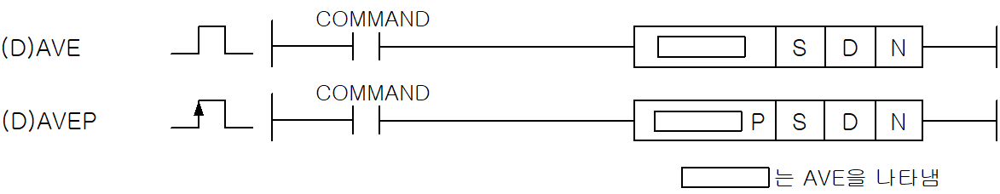
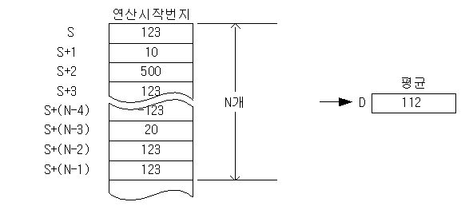
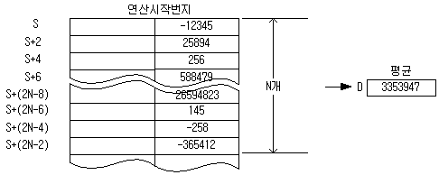

# AVEP

Manual section(s): 4.24.14. Original Korean notes below may cover the other variants on the same page; apply the widths and execution form of `AVEP`.

Execution form: the source explicitly pairs this command as `(P)`; `AVEP` is the pulse-type P form. Manual §2.4.2 defines `P` as pulse-type notation. Select the paired forms deliberately and retain the instruction's actual execution conditions; unrelated mnemonics ending in P are not classified by suffix alone.

## Editing route

Use `insert_ladder_instruction` after calling `describe_operation` for its current schema.
The writer mnemonic is `AVEP`; the catalog records opcode `650` and `3` operands in order.
Inspect the CPU/project and target cells first. Use the inspected revision and positions, preserve expected values, dry-run when useful, then save and inspect the result. See the [editing skill](../../SKILL.md) and [ladder workflow](../ladder.md).

## Operands

| Order | Operand | Description (Korean manual) | Reviewed types | Device areas | Constant |
| --- | --- | --- | --- | --- | --- |
| 1 | S | AVE연산을 시작할 데이터의 주소 | INT/DINT | PMK, F, L, T, C, Z, U, N, D, R | Not allowed |
| 2 | D | AVE연산결과를 저장할 주소 | INT/DINT | PMK, L, T, C, Z, U, N, D, R | Not allowed |
| 3 | N | S로부터 AVE연산을 실행할 워드 개수 | WORD | PMK, F, L, T, C, Z, U, N, D, R | Allowed |

These are the current library's reviewed operand rules. A shared type union is not a per-variant type choice; use the manual behavior to select the required width. Missing permissions stay unknown.

## CPU and acceptance

No separately reviewed CPU-model restriction is available in the current catalog; this means unknown, not universal compatibility.
Check the applicable model, firmware, modules and memory spans stated in the manual notes. Local parsing, writer validation and IL conversion do not prove native compilation or PLC behavior. Native acceptance requires XG5000 Open → Check Program → Save As → comparison.

## Manual flags

- AVE (Word Average)
- S로부터 N개의 워드 데이터를 모두 더한 후 N으로 나눈 결과값(평균)을 D에 저장합니다.
- 워드 데이터 D에 저장되는 값은 INT형입니다.
- 연산 결과가 제로이면 제로 플래그를 셋(Set)합니다.
- N 개의 데이터의 합이 N으로 나누어 떨어지지 않을 때 소수점 이하는 무시합니다.
- DAVE (Double Word Average)
- S로부터 N개의 더블 워드 데이터를 모두 더한 후 N으로 나눈 결과값(평균)을 D에 저장합니다.
- DWORD 데이터 D에 저장되는 값은 DINT형입니다.

| 플래그 | 내 용 | 디바이스 번호 |
| --- | --- | --- |
| 에러 | N값이 해당 디바이스의 범위를 벗어날 때 | F110 |
| 제로 | 연산 결과가 제로이면 셋(Set)합니다. | F111 |

## Manual applicability and restrictions

- 적용 기종 : XGK, XGB

## Manual flag and step matrix

The shared usage table marks affected flags with `O`, and `-` where it lists no effect. Native steps are the manual's instruction size, not the number of operand arguments. Conditions for setting/clearing flags are in the behavior notes.

| Manual instruction group | Native steps | 에러 (F110) | 제로 (F111) | 캐리 (F112) |
| --- | --- | --- | --- | --- |
| AVE(P) DAVE(P) | 4~6 | O | O | - |

## Referenced manual figures

These figures belong to the shared source topic. Read the source corrections above before using variant-specific layouts or example values.

## Provenance

Source: `XGK(B)InstructionHelp_Kr_V3.5.chm`, SHA-256 `b866d589d800addcb039f9f09b182592464d6367faa55abf6dde9ac34a1580e0`.

- `42414aveavepdavedavep.htm` — §4.24.14; source SHA-256 `ce5eef92493394bfd7e12d9cd44f98712135efc63a46d2a5040a09d96d9caef6`.
- Additional behavior/operand evidence: `42414aveavepdavedavep.htm`, `245.htm`.
