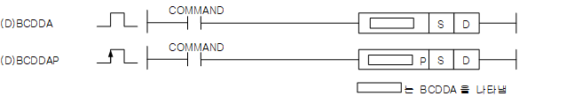
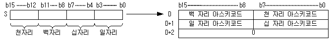
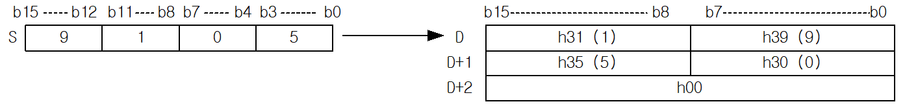
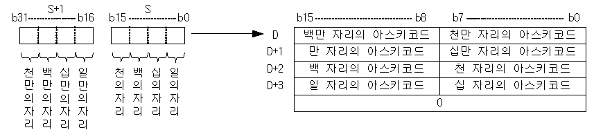

# BCDDA

Manual section(s): 4.26.3. Original Korean notes below may cover the other variants on the same page; apply the widths and execution form of `BCDDA`.

Execution form: the source explicitly pairs this command as `(P)`; `BCDDA` is the non-P partner. Manual §2.4.2 defines `P` as pulse-type notation. Select the paired forms deliberately and retain the instruction's actual execution conditions; unrelated mnemonics ending in P are not classified by suffix alone.

## Editing route

Use `insert_ladder_instruction` after calling `describe_operation` for its current schema.
The writer mnemonic is `BCDDA`; the catalog records opcode `291` and `2` operands in order.
Inspect the CPU/project and target cells first. Use the inspected revision and positions, preserve expected values, dry-run when useful, then save and inspect the result. See the [editing skill](../../SKILL.md) and [ladder workflow](../ladder.md).

## Operands

| Order | Operand | Description (Korean manual) | Reviewed types | Device areas | Constant |
| --- | --- | --- | --- | --- | --- |
| 1 | S | ASCII변환을 실시할 BCD 데이터 또는 주소 | WORD/DWORD | PMK, F, L, T, C, Z, U, N, D, R | Allowed |
| 2 | D | 연산 결과를 저장하게 되는 주소 | STRING | PMK, L, T, C, Z, U, N, D, R | Not allowed |

These are the current library's reviewed operand rules. A shared type union is not a per-variant type choice; use the manual behavior to select the required width. Missing permissions stay unknown.

## CPU and acceptance

No separately reviewed CPU-model restriction is available in the current catalog; this means unknown, not universal compatibility.
Check the applicable model, firmware, modules and memory spans stated in the manual notes. Local parsing, writer validation and IL conversion do not prove native compilation or PLC behavior. Native acceptance requires XG5000 Open → Check Program → Save As → comparison.

## Manual flags

- BCDDA( BCD to Decimal ASCII )
- BCD 입력값을 10진수로 나타냈을 때의 각 자리수를 상위부터 차례로 ASCII값으로 변환합니다.
- ASCII변환 된 값들을 D에서부터 한 워드당 2자리씩 차례로 저장합니다.
- BCDDA에서 연산 범위는 h0000 부터 h9999까지입니다. BCD 데이터 범위를 넘어선 값에 대해서는 에러를 셋 합니다.
- 예를 들면, S 에 h9105를 지정한 경우, D 이후에는 다음과 같이 저장됩니다.
- DBCDDA( Double BCD to Decimal ASCII )
- ASCII변환된 값들을 D에서부터 한 워드당 2자리씩 차례로 저장합니다.
- DBCDDA에서 연산 범위는 h00000000부터 h99999999까지입니다.

| 플래그 | 내 용 | 디바이스 번호 |
| --- | --- | --- |
| 에러 | 입력된 BCD 데이터가 연산 범위를 넘었을 때 | F110 |

## Manual applicability and restrictions

- 적용 기종 : XGK, XGB

## Manual flag and step matrix

The shared usage table marks affected flags with `O`, and `-` where it lists no effect. Native steps are the manual's instruction size, not the number of operand arguments. Conditions for setting/clearing flags are in the behavior notes.

| Manual instruction group | Native steps | 에러 (F110) | 제로 (F111) | 캐리 (F112) |
| --- | --- | --- | --- | --- |
| BCDDA(P) DBCDDA(P) | 2~4 | O | - | - |

## Referenced manual figures

These figures belong to the shared source topic. Read the source corrections above before using variant-specific layouts or example values.

## Provenance

Source: `XGK(B)InstructionHelp_Kr_V3.5.chm`, SHA-256 `b866d589d800addcb039f9f09b182592464d6367faa55abf6dde9ac34a1580e0`.

- `4263bcddabcddapdbcddadbcddap.htm` — §4.26.3; source SHA-256 `80258bcddefbfc1a1e971b99a72174474b6e6b3b59b88b9c002b7b9f67982d79`.
- Additional behavior/operand evidence: `4263bcddabcddapdbcddadbcddap.htm`, `245.htm`.
