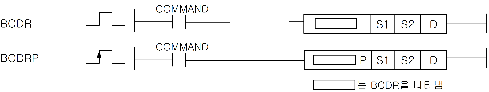
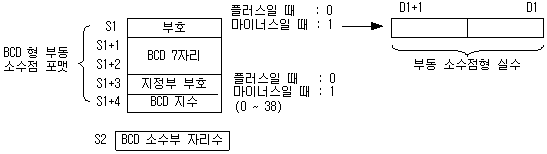
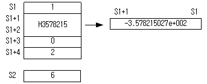

# BCDR

Manual section(s): 4.26.19. Original Korean notes below may cover the other variants on the same page; apply the widths and execution form of `BCDR`.

Execution form: the source explicitly pairs this command as `(P)`; `BCDR` is the non-P partner. Manual §2.4.2 defines `P` as pulse-type notation. Select the paired forms deliberately and retain the instruction's actual execution conditions; unrelated mnemonics ending in P are not classified by suffix alone.

## Editing route

Use `get_ir` → `apply_patch` for this instruction edit. `insert_ladder_instruction` is the internal writer route, not a separate MCP tool. Preserve the exported revision and native constraints.
The writer mnemonic is `BCDR`; the catalog records opcode `317` and `3` operands in order.
Inspect the CPU/project and target cells first. Use the inspected revision and positions, preserve expected values, dry-run when useful, then save and inspect the result. See the [editing skill](../../SKILL.md) and [ladder workflow](../ladder.md).

## Operands

| Order | Operand | Description (Korean manual) | Reviewed types | Device areas | Constant |
| --- | --- | --- | --- | --- | --- |
| 1 | S1 | BCD부동소수점 포맷의 데이터 | WORD | PMK, L, Z, U, N, D, R | Not allowed |
| 2 | S2 | BCD 부동소수점 포맷의 소수부 자리수 | WORD | PMK, F, L, T, C, Z, U, N, D, R | Allowed |
| 3 | D | 결과 저장 디바이스 | REAL/LREAL | PMK, L, Z, U, N, D, R | Not allowed |

These are the current library's reviewed operand rules. A shared type union is not a per-variant type choice; use the manual behavior to select the required width. Missing permissions stay unknown.

## CPU and acceptance

No separately reviewed CPU-model restriction is available in the current catalog; this means unknown, not universal compatibility.
Check the applicable model, firmware, modules and memory spans stated in the manual notes. Local parsing, writer validation and IL conversion do not prove native compilation or PLC behavior. Native acceptance requires XG5000 Open → Check Program → Save As → comparison.

## Manual flags

- BCDR (BCD to Real)
- S1으로 지정된 디바이스에 저장되어 있는 BCD형 부동 소수점 포맷의 데이터를 부동 소수점형 단장형 실수 데이터로 변환하여 D로 지정된 디바이스 번호 이후에 저장합니다.
- S1+4 에 지정되는 BCD 지수의 범위는0~38 입니다. BCD 형 부동 소수점 포맷의 지수부 범위가 허용 범위를 넘으면 에러가 셋(Set) 됩니다.
- S2 에 지정되는 BCD형 부동 소수점 포맷의 소수부 자리수는 0~7 입니다.
- BCDL (BCD to Long Real)
- S1로 지정된 디바이스에 저장되어 있는 BCD형 부동 소수점 포맷의 데이터를 S2로 지정된 디바이스에 저장되어 있는 소수부를 기준으로 부동 소수점형 배장형 실수 데이터로 변환하여 D로 지정된 디바이스 번호 이후에 저장합니다.
- S1+4에 지정되는 BCD형 배장형 부동소수점 포맷의 지수부 범위는 0~290 입니다. BCD 형 부동 소수점 포맷의 지수부 범위가 허용 범위를 넘으면 에러가 셋(Set) 됩니다.

| 플래그 | 내 용 | 디바이스 번호 |
| --- | --- | --- |
| 에러 | 1.지정한 S1영역의 데이터 포맷이 맞지 않을 경우. 2.S1+4 영역이 해당 디바이스의 범위를 벗어날 경우. 3.S2에 지정된 소수부 자리수가 0~7 이외의 값일 때 4.BCD 지수가 허용 범위를 넘었을 때( BCDR(P) : 38, BCDL(P) : 290 ) | F110 |

## Manual applicability and restrictions

- 적용 기종 : XGK, XGB(XBC-U, XBM-H/H2/HP)

## Manual flag and step matrix

The shared usage table marks affected flags with `O`, and `-` where it lists no effect. Native steps are the manual's instruction size, not the number of operand arguments. Conditions for setting/clearing flags are in the behavior notes.

| Manual instruction group | Native steps | 에러 (F110) | 제로 (F111) | 캐리 (F112) |
| --- | --- | --- | --- | --- |
| BCDR(P) BCDL(P) | 4 | O | - | - |

## Referenced manual figures

These figures belong to the shared source topic. Read the source corrections above before using variant-specific layouts or example values.

## Provenance

Source: `XGK(B)InstructionHelp_Kr_V3.5.chm`, SHA-256 `b866d589d800addcb039f9f09b182592464d6367faa55abf6dde9ac34a1580e0`.

- `42619bcdrbcdrpbcdlbcdlp.htm` — §4.26.19; source SHA-256 `dcc4725268ba57552e60f3b723dc3299f64673451d703a7a00323597b4bc1827`.
- Additional behavior/operand evidence: `42619bcdrbcdrpbcdlbcdlp.htm`, `245.htm`.
