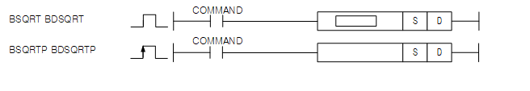
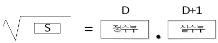
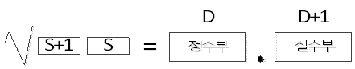

# BDSQRT

Manual section(s): 4.27.10. Original Korean notes below may cover the other variants on the same page; apply the widths and execution form of `BDSQRT`.

Execution form: the source explicitly pairs this command as `(P)`; `BDSQRT` is the non-P partner. Manual §2.4.2 defines `P` as pulse-type notation. Select the paired forms deliberately and retain the instruction's actual execution conditions; unrelated mnemonics ending in P are not classified by suffix alone.

## Editing route

Use `get_ir` → `apply_patch` for this instruction edit. `insert_ladder_instruction` is the internal writer route, not a separate MCP tool. Preserve the exported revision and native constraints.
The writer mnemonic is `BDSQRT`; the catalog records opcode `1534` and `2` operands in order.
Inspect the CPU/project and target cells first. Use the inspected revision and positions, preserve expected values, dry-run when useful, then save and inspect the result. See the [editing skill](../../SKILL.md) and [ladder workflow](../ladder.md).

## Operands

| Order | Operand | Description (Korean manual) | Reviewed types | Device areas | Constant |
| --- | --- | --- | --- | --- | --- |
| 1 | S | BCD타입의 데이터가 저장되어 있는 디바이스 번호 | WORD/DWORD | PMK, L, Z, U, N, D, R | Not allowed |
| 2 | D | 제곱근 연산 결과를 BCD 타입으로 저장할 디바이스 번호 | WORD/WORD | PMK, U, D, R | Not allowed |

These are the current library's reviewed operand rules. A shared type union is not a per-variant type choice; use the manual behavior to select the required width. Missing permissions stay unknown.

## CPU and acceptance

No separately reviewed CPU-model restriction is available in the current catalog; this means unknown, not universal compatibility.
Check the applicable model, firmware, modules and memory spans stated in the manual notes. Local parsing, writer validation and IL conversion do not prove native compilation or PLC behavior. Native acceptance requires XG5000 Open → Check Program → Save As → comparison.

## Manual flags

- BSQRT(P) (BCD Square Root)
- S로 지정된 영역의 BCD 데이터를 제곱근 연산을 해서 D에 저장합니다. 이때, S와 D는 BCD 타입입니다.
- S로 지정된 값은 BCD타입으로 0~9999의 값을 가질 수 있습니다.
- D, D+1의 연산 결과도 각각 BCD 값으로 0~9999의 값을 가질 수 있습니다.
- 실수부 연산결과 값은 소수점 5번째 자리를 반올림한 값이 저장되며, 오차는 ±1정도 발생할 수 있습니다.
- BDSQRT(P) (BCD Double Square Root)
- S로 지정된 영역의 BCD(DWORD) 데이터를 제곱근 연산을 해서 D에 저장합니다. 이때, S와 D는 BCD(DWORD) 타입입니다.
- S로 지정된 값은 BCD타입으로 0~99999999의 값을 가질 수 있습니다.

| 플래그 | 내 용 | 디바이스 번호 |
| --- | --- | --- |
| 에러 | - SQRT(P)의 경우, S 의 값이 0~9999(h270F)가 아닌경우89+ - BDSQRT(P)의 경우, S+1,S 의 값이 0~99999999(h5F5E0FF) 이외일 때 - 입력된 값이 BCD 타입이 아닌경우 예)h000a, h999f - S값에 h0~9 이외에 ha~f값이 들어갈 경우 | F110 |

## Manual applicability and restrictions

- 적용 기종 : XGK, XGB(XBC-U, XBM-H/H2/HP)

## Manual flag and step matrix

The shared usage table marks affected flags with `O`, and `-` where it lists no effect. Native steps are the manual's instruction size, not the number of operand arguments. Conditions for setting/clearing flags are in the behavior notes.

| Manual instruction group | Native steps | 에러 (F110) | 제로 (F111) | 캐리 (F112) |
| --- | --- | --- | --- | --- |
| BSQRT(P) BDSQRT(P) | 4~7 | O | - | - |

## Referenced manual figures

These figures belong to the shared source topic. Read the source corrections above before using variant-specific layouts or example values.

## Provenance

Source: `XGK(B)InstructionHelp_Kr_V3.5.chm`, SHA-256 `b866d589d800addcb039f9f09b182592464d6367faa55abf6dde9ac34a1580e0`.

- `42710bsqrtbsqrtpbdsqrtbdsqrtp.htm` — §4.27.10; source SHA-256 `35fdbedd6030645c8ceb9bb4ad8532adcf98c83988b709191857e7ce83594c14`.
- Additional behavior/operand evidence: `42710bsqrtbsqrtpbdsqrtbdsqrtp.htm`, `245.htm`.
