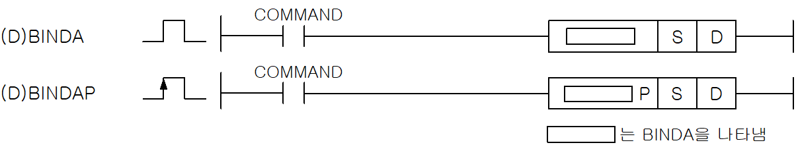
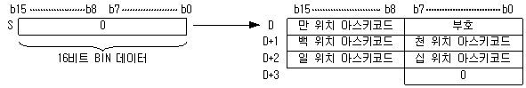
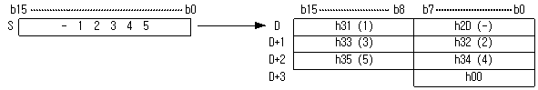
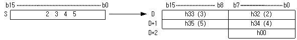
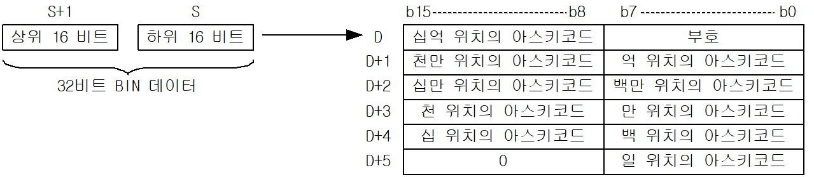

# BINDAP

Manual section(s): 4.26.1. Original Korean notes below may cover the other variants on the same page; apply the widths and execution form of `BINDAP`.

Execution form: the source explicitly pairs this command as `(P)`; `BINDAP` is the pulse-type P form. Manual §2.4.2 defines `P` as pulse-type notation. Select the paired forms deliberately and retain the instruction's actual execution conditions; unrelated mnemonics ending in P are not classified by suffix alone.

## Editing route

Use `get_ir` → `apply_patch` for this instruction edit. `insert_ladder_instruction` is the internal writer route, not a separate MCP tool. Preserve the exported revision and native constraints.
The writer mnemonic is `BINDAP`; the catalog records opcode `672` and `2` operands in order.
Inspect the CPU/project and target cells first. Use the inspected revision and positions, preserve expected values, dry-run when useful, then save and inspect the result. See the [editing skill](../../SKILL.md) and [ladder workflow](../ladder.md).

## Operands

| Order | Operand | Description (Korean manual) | Reviewed types | Device areas | Constant |
| --- | --- | --- | --- | --- | --- |
| 1 | S | ASCII변환을 실시할 데이터 또는 주소 | INT/DINT | PMK, F, L, T, C, Z, U, N, D, R | Allowed |
| 2 | D | 연산 결과를 저장하게 되는 주소 | STRING | PMK, L, T, C, Z, U, N, D, R | Not allowed |

These are the current library's reviewed operand rules. A shared type union is not a per-variant type choice; use the manual behavior to select the required width. Missing permissions stay unknown.

## CPU and acceptance

No separately reviewed CPU-model restriction is available in the current catalog; this means unknown, not universal compatibility.
Check the applicable model, firmware, modules and memory spans stated in the manual notes. Local parsing, writer validation and IL conversion do not prove native compilation or PLC behavior. Native acceptance requires XG5000 Open → Check Program → Save As → comparison.

## Manual behavior notes (Korean)

- BINDA (Binary to Decimal ASCII)
- Bin 입력값 16비트 데이터를 10진수로 나타냈을 때의 각 자리수를 상위부터 차례로 ASCII값으로 변환합니다.
- ASCII변환 된 값들을 D에서부터 한 워드당 2자리씩 차례로 저장합니다.
- S 가 음수일 때 D의 첫번째 바이트에는 부호값인 ‘-‘(h2D)를 먼저 출력합니다.
- 데이터 S는 Signed로 취급됩니다.
- BINDA에서 연산 범위는 ?32768(h8000)부터 32767(h7FFF)까지입니다.
- 예를 들면, S 에 ?12345를 지정했을 경우, D 이후에는 다음과 같이 저장됩니다.
- DBINDA( Double Binary to Decimal ASCII )
- BIN 입력값 32비트를 10진수로 나타냈을 때의 각 자리수를 상위부터 차례로 ASCII값으로 변환합니다.
- ASCII변환된 값들을 D에서부터 한 워드당 2자리씩 차례로 저장합니다.
- S가 음수일 경우D의 첫번째 바이트에는 부호값인 ‘?‘를 먼저 출력합니다.
- DBINDA에서 연산 범위는 ?2147483648(h80000000) 부터 2147483647(h7FFFFFFF)까지입니다.

## Manual applicability and restrictions

- 적용 기종 : XGK, XGB

## Manual flag and step matrix

The shared usage table marks affected flags with `O`, and `-` where it lists no effect. Native steps are the manual's instruction size, not the number of operand arguments. Conditions for setting/clearing flags are in the behavior notes.

| Manual instruction group | Native steps | 에러 (F110) | 제로 (F111) | 캐리 (F112) |
| --- | --- | --- | --- | --- |
| BINDA(P) DBINDA(P) | 2~4 | - | - | - |

## Referenced manual figures

These figures belong to the shared source topic. Read the source corrections above before using variant-specific layouts or example values.

## Provenance

Source: `XGK(B)InstructionHelp_Kr_V3.5.chm`, SHA-256 `b866d589d800addcb039f9f09b182592464d6367faa55abf6dde9ac34a1580e0`.

- `4261bindabindapdbindadbindap.htm` — §4.26.1; source SHA-256 `bf095f42aa23ff7e97ffa86f9580fe59b169254bc95a0d80f6ee6d32f6e75aee`.
- Additional behavior/operand evidence: `4261bindabindapdbindadbindap.htm`, `245.htm`.
