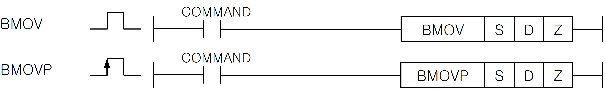
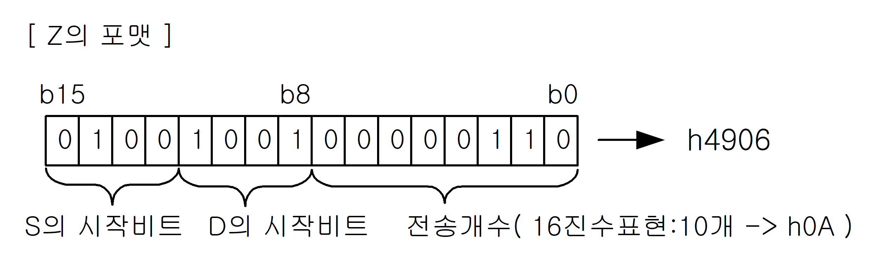

# BMOV

Copy a selected bit field according to a control word.

Manual section(s): 4.11.6. Original Korean notes below may cover the other variants on the same page; apply the widths and execution form of `BMOV`.

Execution form: the source explicitly pairs this command as `(P)`; `BMOV` is the non-P partner. Manual §2.4.2 defines `P` as pulse-type notation. Select the paired forms deliberately and retain the instruction's actual execution conditions; unrelated mnemonics ending in P are not classified by suffix alone.

## Editing route

Use `get_ir` → `apply_patch` for this instruction edit. `insert_ladder_instruction` is the internal writer route, not a separate MCP tool. Preserve the exported revision and native constraints.
The writer mnemonic is `BMOV`; the catalog records opcode `155` and `3` operands in order.
Inspect the CPU/project and target cells first. Use the inspected revision and positions, preserve expected values, dry-run when useful, then save and inspect the result. See the [editing skill](../../SKILL.md) and [ladder workflow](../ladder.md).

## Behavior

- Z defines source/destination bit positions and a bit count; the count field accepts h00..h10 (0..16).
- The inspected Z-format diagram assigns bits 15..12 to the source start bit, bits 11..8 to the destination start bit, and bits 7..0 to the transfer-bit count.

## Instruction constraints

- Z is a packed format, not a plain count. Use source-start and destination-start fields (4 bits each) plus the low-byte count (0..16). Destination range overflow sets F110 and suppresses processing.

## Source corrections

- Z-format image lib/NewItem2688.png is inspected: its bit pattern and h4906 label mean source bit 4, destination bit 9, count 6; its explanatory count caption uses a separate count-10/h0A illustration and must not be read as the h4906 count.

## Operands

| Order | Operand | Description (Korean manual) | Reviewed types | Device areas | Constant |
| --- | --- | --- | --- | --- | --- |
| 1 | S | 데이터가 저장되어 있는 디바이스 번호 | WORD | PMK, F, L, T, C, Z, U, N, D, R | Allowed |
| 2 | D | Destination영역의 디바이스 번호 | WORD | PMK, L, T, C, Z, U, N, D, R | Not allowed |
| 3 | Z | BMOV(P)를 실행하는 포맷 | WORD | PMK, F, L, T, C, Z, U, N, D, R | Allowed |

These are the current library's reviewed operand rules. A shared type union is not a per-variant type choice; use the manual behavior to select the required width. Missing permissions stay unknown.

## CPU and acceptance

No separately reviewed CPU-model restriction is available in the current catalog; this means unknown, not universal compatibility.
Check the applicable model, firmware, modules and memory spans stated in the manual notes. Local parsing, writer validation and IL conversion do not prove native compilation or PLC behavior. Native acceptance requires XG5000 Open → Check Program → Save As → comparison.

## Manual behavior notes (Korean)

- Z에 설정된 포맷에 의해 워드데이터 S로부터 지정된 개수의 비트를 D로 전송합니다.
- Z의 전송 비트 개수 : h00 ~ h10까지 기능
- D+Z의 결과 영역 초과시 에러 플래그(F110)를 셋(Set)시키며 결과 처리를 하지 않습니다.

## Manual flags

| 플래그 | 내 용 | 디바이스 번호 |
| --- | --- | --- |
| 에러 | Z의 범위가 지정 영역을 초과할 경우 셋(Set). 해당 명령어 결과는 처리되지 않음. | F110 |

## Manual applicability and restrictions

- 적용 기종 : XGK, XGB

## Manual flag and step matrix

The shared usage table marks affected flags with `O`, and `-` where it lists no effect. Native steps are the manual's instruction size, not the number of operand arguments. Conditions for setting/clearing flags are in the behavior notes.

| Manual instruction group | Native steps | 에러 (F110) | 제로 (F111) | 캐리 (F112) |
| --- | --- | --- | --- | --- |
| BMOV(P) | 4~6 | O | - | - |

## Referenced manual figures

These figures belong to the shared source topic. Read the source corrections above before using variant-specific layouts or example values.

## Provenance

Source: `XGK(B)InstructionHelp_Kr_V3.5.chm`, SHA-256 `b866d589d800addcb039f9f09b182592464d6367faa55abf6dde9ac34a1580e0`.

- `4116bmovbmovp1.htm` — §4.11.6; source SHA-256 `e9b178b609be7be3aa70ea14bc1ccdd02da5ecc33655c843bca8a748a7a0245f`.
- Additional behavior/operand evidence: `4116bmovbmovp1.htm`, `245.htm`.
