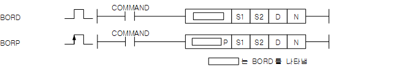
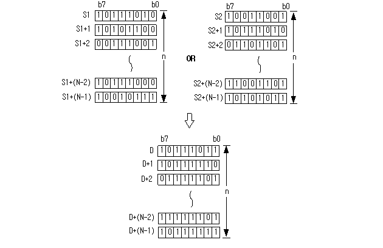
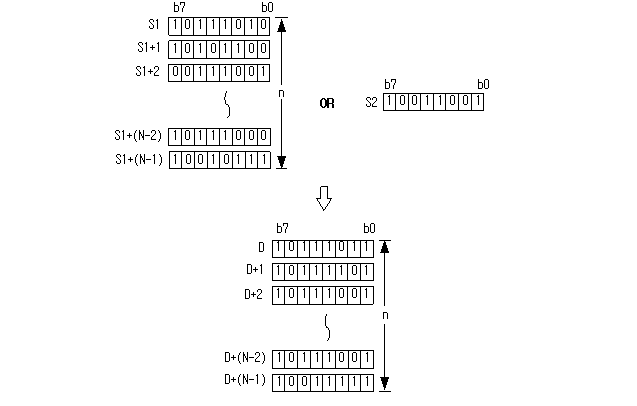

# BORP

Manual section(s): 4.22.10. Original Korean notes below may cover the other variants on the same page; apply the widths and execution form of `BORP`.

Execution form: the source explicitly pairs this command as `(P)`; `BORP` is the pulse-type P form. Manual §2.4.2 defines `P` as pulse-type notation. Select the paired forms deliberately and retain the instruction's actual execution conditions; unrelated mnemonics ending in P are not classified by suffix alone.

## Editing route

Use `insert_ladder_instruction` after calling `describe_operation` for its current schema.
The writer mnemonic is `BORP`; the catalog records opcode `1480` and `4` operands in order.
Inspect the CPU/project and target cells first. Use the inspected revision and positions, preserve expected values, dry-run when useful, then save and inspect the result. See the [editing skill](../../SKILL.md) and [ladder workflow](../ladder.md).

## Operands

| Order | Operand | Description (Korean manual) | Reviewed types | Device areas | Constant |
| --- | --- | --- | --- | --- | --- |
| 1 | S1 | S2와 BOR연산을 시작하게 되는 데이터의 주소 | BYTE | PMK, L, D.x, R.x, U | Not allowed |
| 2 | S2 | S1과 BOR연산을 시작하게 되는 데이터의 주소 | BYTE | PMK, L, D.x, R.x, U | Allowed |
| 3 | D | BOR연산의 결과를 저장할 주소 | BYTE | PMK, L, D.x, R.x, U | Not allowed |
| 4 | N | 바이트데이터끼리의 AND연산을 하는 개수 | WORD | PMK, L, T, C, Z, U, N, D, R | Allowed |

These are the current library's reviewed operand rules. A shared type union is not a per-variant type choice; use the manual behavior to select the required width. Missing permissions stay unknown.

## CPU and acceptance

No separately reviewed CPU-model restriction is available in the current catalog; this means unknown, not universal compatibility.
Check the applicable model, firmware, modules and memory spans stated in the manual notes. Local parsing, writer validation and IL conversion do not prove native compilation or PLC behavior. Native acceptance requires XG5000 Open → Check Program → Save As → comparison.

## Manual flags

- BOR (Group Byte OR)
- S1과 S2에서 부터 바이트단위로 논리합(OR)을 N번 실행하여 그 결과들을 D에 차례로 저장합니다.
- S2에는 -128~127 (BIN 8비트)의 정수를 지정할 수 있습니다.

| 플래그 | 내 용 | 디바이스 번호 |
| --- | --- | --- |
| 에러 | N의 범위가 지정 영역을 초과할 경우 셋(Set). 해당 명령어 결과는 처리되지 않음. | F110 |

## Manual applicability and restrictions

- 적용 기종 : XGK, XGB(XBC-U, XBM-H/H2/HP)

## Manual flag and step matrix

The shared usage table marks affected flags with `O`, and `-` where it lists no effect. Native steps are the manual's instruction size, not the number of operand arguments. Conditions for setting/clearing flags are in the behavior notes.

| Manual instruction group | Native steps | 에러 (F110) | 제로 (F111) | 캐리 (F112) |
| --- | --- | --- | --- | --- |
| BOR(P) | 6~8 | O | - | - |

## Referenced manual figures

These figures belong to the shared source topic. Read the source corrections above before using variant-specific layouts or example values.

## Provenance

Source: `XGK(B)InstructionHelp_Kr_V3.5.chm`, SHA-256 `b866d589d800addcb039f9f09b182592464d6367faa55abf6dde9ac34a1580e0`.

- `42210borborp1.htm` — §4.22.10; source SHA-256 `02b646fe99373a1ddf83776faa714f718ae1d3d1f082e0be845160f6ec7d9077`.
- Additional behavior/operand evidence: `42210borborp1.htm`, `245.htm`.
