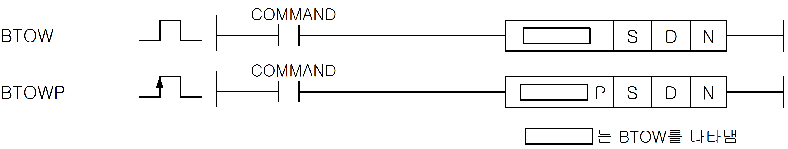
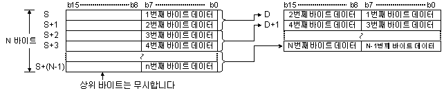

# BTOWP

Manual section(s): 4.24.8. Original Korean notes below may cover the other variants on the same page; apply the widths and execution form of `BTOWP`.

Execution form: the source explicitly pairs this command as `(P)`; `BTOWP` is the pulse-type P form. Manual §2.4.2 defines `P` as pulse-type notation. Select the paired forms deliberately and retain the instruction's actual execution conditions; unrelated mnemonics ending in P are not classified by suffix alone.

## Editing route

Use `insert_ladder_instruction` after calling `describe_operation` for its current schema.
The writer mnemonic is `BTOWP`; the catalog records opcode `454` and `3` operands in order.
Inspect the CPU/project and target cells first. Use the inspected revision and positions, preserve expected values, dry-run when useful, then save and inspect the result. See the [editing skill](../../SKILL.md) and [ladder workflow](../ladder.md).

## Operands

| Order | Operand | Description (Korean manual) | Reviewed types | Device areas | Constant |
| --- | --- | --- | --- | --- | --- |
| 1 | S | BYTE데이터가 저장되어진 영역번호 또는 BYTE데이터 | WORD | PMK, F, L, T, C, Z, U, N, D, R | Allowed |
| 2 | D | WORD형으로 변환된 데이터를 저장할 영역 | WORD | PMK, L, T, C, Z, U, N, D, R | Not allowed |
| 3 | N | 결합할 BYTE의 개수 | WORD | PMK, F, L, T, C, Z, U, N, D, R | Not allowed |

These are the current library's reviewed operand rules. A shared type union is not a per-variant type choice; use the manual behavior to select the required width. Missing permissions stay unknown.

## CPU and acceptance

No separately reviewed CPU-model restriction is available in the current catalog; this means unknown, not universal compatibility.
Check the applicable model, firmware, modules and memory spans stated in the manual notes. Local parsing, writer validation and IL conversion do not prove native compilation or PLC behavior. Native acceptance requires XG5000 Open → Check Program → Save As → comparison.

## Manual flags

- BTOW
- S부터 N개의 하위 바이트 데이터를 워드 데이터로 연결해서 D부터 저장합니다. 이 경우, N이 홀수일 경우에는 마지막 저장되는 디바이스의 상위는 0으로 채워집니다.
- N=0일 경우 명령을 수행하지 않습니다.

| 플래그 | 내 용 | 디바이스 번호 |
| --- | --- | --- |
| 에러 | S나 D가 해당 디바이스의 허용 범위를 초과할 경우 셋(Set)합니다. | F110 |

## Manual applicability and restrictions

- 적용 기종 : XGK, XGB

## Manual flag and step matrix

The shared usage table marks affected flags with `O`, and `-` where it lists no effect. Native steps are the manual's instruction size, not the number of operand arguments. Conditions for setting/clearing flags are in the behavior notes.

| Manual instruction group | Native steps | 에러 (F110) | 제로 (F111) | 캐리 (F112) |
| --- | --- | --- | --- | --- |
| BTOW(P) | 2~4 | O | - | - |

## Referenced manual figures

These figures belong to the shared source topic. Read the source corrections above before using variant-specific layouts or example values.

## Provenance

Source: `XGK(B)InstructionHelp_Kr_V3.5.chm`, SHA-256 `b866d589d800addcb039f9f09b182592464d6367faa55abf6dde9ac34a1580e0`.

- `4248betowbtowp.htm` — §4.24.8; source SHA-256 `a1e72e0dba3701434f9db43bfda0062538d9ec7589d5646e7086f5fa6edd90e6`.
- Additional behavior/operand evidence: `4248betowbtowp.htm`, `245.htm`.
