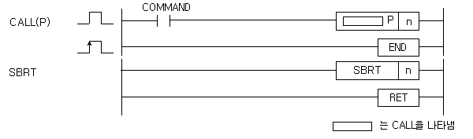

# CALLP

Invoke a named subroutine.

Manual section(s): 4.30.2. Original Korean notes below may cover the other variants on the same page; apply the widths and execution form of `CALLP`.

## Editing route

No matching public writer route is exposed for this exact instruction form. Use this file to interpret existing code; preserve its records when editing other parts of a project. Manual documentation alone does not enable insertion.

## Behavior

- Execute the matching SBRT n .. RET body and return to the caller.
- This P-suffix variant executes once when the enabling input changes from Off to On.

## Instruction constraints

- Place subroutine bodies after END. The target name is up to 16 English or 8 Korean characters.
- A CALL without matching SBRT is an error. Nested subroutine calls are limited to 16; the maximum SBRT count is 512 on XGK and 128 on XGB.

## Operands

| 오퍼랜드 | 설명 | 데이터 타입 |
| --- | --- | --- |
| n | 호출할 함수의 문자열( 영문 : 16자, 한글 : 8자 사용가능 ) | STRING |

This source table is not a separately reviewed writer rule. Retain shared variant distinctions and let the current writer reject unsupported operands.

## CPU and acceptance

No separately reviewed CPU-model restriction is available in the current catalog; this means unknown, not universal compatibility.
Check the applicable model, firmware, modules and memory spans stated in the manual notes. Local parsing, writer validation and IL conversion do not prove native compilation or PLC behavior. Native acceptance requires XG5000 Open → Check Program → Save As → comparison.

## Manual behavior notes (Korean)

- CALL
- 프로그램 수행중 입력 조건이 성립하면 CALL n 명령에 따라 SBRT n ~ RET 명령 사이의 프로그램을 수행합니다.
- CALL No.는 중첩되어 사용 가능하며 반드시 SBRT n ~ RET 명령 사이의 프로그램은 END 명령 뒤에 있어야 합니다.
- 에러 처리가 되는 조건:
- (1) 전체 SBRT의 개수가 XGK는 512개,XGB는 128개를 넘을 경우 : 프로그램 다운로드가 안됩니다.
- (2) CALL n이 있고 SBRT n이 없는 경우
- SBRT내에서 다른 SBRT를 Call하는 것이 가능하며, 16회까지 가능합니다.
- SBRT내에서 CALL문은 END다음에 위치할 수 있습니다.

## Manual applicability and restrictions

- 적용 기종 : XGK, XGB

## Manual flag and step matrix

The shared usage table marks affected flags with `O`, and `-` where it lists no effect. Native steps are the manual's instruction size, not the number of operand arguments. Conditions for setting/clearing flags are in the behavior notes.

| Manual instruction group | Native steps | 에러 (F110) | 제로 (F111) | 캐리 (F112) |
| --- | --- | --- | --- | --- |
| CALL(P) | 1 | - | - | - |
| SBRT | 5 | - | - | - |

## Referenced manual figures

These figures belong to the shared source topic. Read the source corrections above before using variant-specific layouts or example values.

## Provenance

Source: `XGK(B)InstructionHelp_Kr_V3.5.chm`, SHA-256 `b866d589d800addcb039f9f09b182592464d6367faa55abf6dde9ac34a1580e0`.

- `4302callcallpsbrtret.htm` — §4.30.2; source SHA-256 `19b6074d4b91bc6856bf28c9f0ab39801cd6750fcede2048305b4c0d2857ac71`.
- Additional behavior/operand evidence: `33.htm`.
