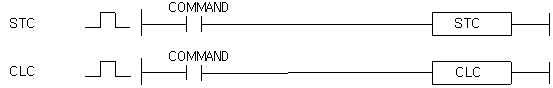

# CLC

Manual section(s): 4.32.1. Original Korean notes below may cover the other variants on the same page; apply the widths and execution form of `CLC`.

## Editing route

Use `insert_ladder_instruction` after calling `describe_operation` for its current schema.
The writer mnemonic is `CLC`; the catalog records opcode `935` and `0` operands in order.
Inspect the CPU/project and target cells first. Use the inspected revision and positions, preserve expected values, dry-run when useful, then save and inspect the result. See the [editing skill](../../SKILL.md) and [ladder workflow](../ladder.md).

## Operands

This catalog form is operandless.

## CPU and acceptance

No separately reviewed CPU-model restriction is available in the current catalog; this means unknown, not universal compatibility.
Check the applicable model, firmware, modules and memory spans stated in the manual notes. Local parsing, writer validation and IL conversion do not prove native compilation or PLC behavior. Native acceptance requires XG5000 Open → Check Program → Save As → comparison.

## Manual flags

- STC (Set Carry Flag)
- 입력조건이 On하면 캐리 플래그(F112)를 셋(On)시킵니다.
- CLC (Clear Carry Flag)
- 입력조건이 On하면 캐리 플래그(F112)를 클리어(Off)시킵니다.

| 플래그 | 내 용 | 디바이스 번호 |
| --- | --- | --- |
| 캐리 | STC일 때는 실행조건이 On이면 셋(Set) CLC일 때는 실행조건이 On이면 리셋(Reset) STC나 CLC 실행조건이 Off이면 변화없음 | F112 |

## Manual applicability and restrictions

- 적용 기종 : XGK, XGB

## Manual flag and step matrix

The shared usage table marks affected flags with `O`, and `-` where it lists no effect. Native steps are the manual's instruction size, not the number of operand arguments. Conditions for setting/clearing flags are in the behavior notes.

| Manual instruction group | Native steps | 에러 (F110) | 제로 (F111) | 캐리 (F112) |
| --- | --- | --- | --- | --- |
| STC / CLC | 1 | - | - | O |

## Referenced manual figures

These figures belong to the shared source topic. Read the source corrections above before using variant-specific layouts or example values.

## Provenance

Source: `XGK(B)InstructionHelp_Kr_V3.5.chm`, SHA-256 `b866d589d800addcb039f9f09b182592464d6367faa55abf6dde9ac34a1580e0`.

- `4321stcclc.htm` — §4.32.1; source SHA-256 `88f000fdd05b4a67d0180e416fed0774b37ce6ca4992d26390cced0e4d92d0cd`.
