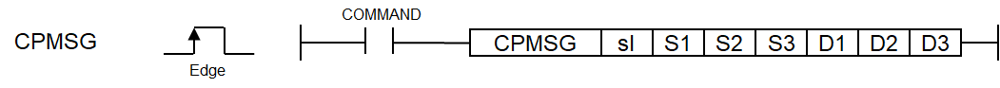

# CPMSG

Manual section(s): 4.40.23. Original Korean notes below may cover the other variants on the same page; apply the widths and execution form of `CPMSG`.

## Editing route

Use `get_ir` → `apply_patch` for this instruction edit. `insert_ladder_instruction` is the internal writer route, not a separate MCP tool. Preserve the exported revision and native constraints.
The writer mnemonic is `CPMSG`; the catalog records opcode `1787` and `7` operands in order.
Inspect the CPU/project and target cells first. Use the inspected revision and positions, preserve expected values, dry-run when useful, then save and inspect the result. See the [editing skill](../../SKILL.md) and [ladder workflow](../ladder.md).

## Operands

| Order | Operand | Description (Korean manual) | Reviewed types | Device areas | Constant |
| --- | --- | --- | --- | --- | --- |
| 1 | sl | 통신 모듈이 장착된 베이스(x) 및 슬롯(y) 번호 : h00xy | WORD | None | Allowed |
| 2 | S1 | 보낼 DATA가 저장된 시작 디바이스 번호 | WORD | PMK, L, Z, U, N, D, R | Not allowed |
| 3 | S2 | 보낼 DATA의 사이즈(최대 1500Byte) | WORD | PMK, L, Z, U, N, D, R | Allowed |
| 4 | S3 | Tiemout 설정 값(ms) | WORD | PMK, L, Z, U, N, D, R | Allowed |
| 5 | D1 | 받을 DATA가 저장될 시작 디바이스 번호 | WORD | PMK, L, Z, U, N, D, R | Not allowed |
| 6 | D2 | 받은 DATA의 사이즈(최대 1500 Byte) | WORD | PMK, L, Z, U, N, D, R | Not allowed |
| 7 | D3 | 명령어 내부에서 사용될 임시 디바이스 번호 | WORD | PMK, L, Z, U, N, D, R | Not allowed |

These are the current library's reviewed operand rules. A shared type union is not a per-variant type choice; use the manual behavior to select the required width. Missing permissions stay unknown.

## CPU and acceptance

Reviewed XGK model table: XGK-CPUUN, XGK-CPUHN, XGK-CPUSN (`44023cp_msg.htm`).
Check the applicable model, firmware, modules and memory spans stated in the manual notes. Local parsing, writer validation and IL conversion do not prove native compilation or PLC behavior. Native acceptance requires XG5000 Open → Check Program → Save As → comparison.

## Manual behavior notes (Korean)

- 이 명령은 통신 모듈의 객체 데이터를 읽거나 쓰기 위해 사용하는 명령입니다.
- sl은 현재 통신 모듈이 장착된 베이스와 슬롯 번호를 입력하면 됩니다.
- S1는 통신 모듈로 전달할 메시지가 저장된 시작 영역 주소를 나타냅니다.
- S2는 전달할 메시지의 사이즈를 나타내며 S1로 지정된 영역부터 S2개 만큼의 데이터를 송신합니다.
- 최대 1500개를 전송할 수 있으며 단위는 Byte입니다.
- S3은 timeout 설정 값이며, 10ms 부터 설정이 가능합니다. (10ms 미만으로 설정시 timeout설정 에러 발생)
- D1은 결과값을 수신할 시작 영역 주소를 의미합니다.
- D2는 수신한 메시지의 사이즈를 나타냅니다.
- D3는 명령어 정보를 저장하는 임시 영역으로 사용되는 디바이스 영역이며, 크기는 8워드(D3+0 D3+7)입니다.
- [상태정보]
- 상태 정보 20번 초과 시 통신 모듈에서 발생된 에러로, 해당 모듈의 사용 설명서를 참고하십시오.
- D3에 지정한 디바이스 D3+1 D3+7은 명령어에서 사용하는 각종 임시 정보들이 저장되는 공간입니다.
- 따라서 사용자가 해당 영역의 값을 임의로 변경해서는 안됩니다. 해당 영역의 값을 임의로 변경할 경우 명령어가 정상적으로 동작하지 않습니다.

| CPU영역 | 데이터 크기 | 상태종류 |
| --- | --- | --- |
| D3 | WORD | 상태 코드 |
| D3+1 | WORD | 예약영역(사용금지) |
| D3+2 | WORD | 예약영역(사용금지) |
| D3+3 | WORD | 예약영역(사용금지) |
| D3+4 | WORD | 예약영역(사용금지) |
| D3+5 | WORD | 예약영역(사용금지) |
| D3+6 | WORD | 예약영역(사용금지) |
| D3+7 | WORD | 예약영역(사용금지) |

| 상태코드 | 상태 정보 | 의미 |
| --- | --- | --- |
| 00 | 초기상태 | 명령어 수행 전 |
| 01 | 완료 | 명령어가 정상적으로 수행된 경우 |
| 02 | 버전 호환 오류 | 통신 모듈 버전이 V6.0미만인 경우 |
| 03 | 송신 데이터 사이즈설정 에러 | 송신 데이터 사이즈가 0이거나 1500를 초과한 경우 |
| 04 | 타임아웃 설정 에러 | 설정한 타임아웃 값이 10ms 미만인 경우 |
| 05 | 정주기 태스크 수행 에러 | 정주기 태스크에서 수행되는 경우 |
| 06 | 타임아웃 에러 | 통신모듈 이상으로 명령어에 대한 응답시간이 S3설정값을 초과하는 경우 |
| 07 | 모듈탈락 | 지정된 베이스/슬롯 통신 모듈이 탈락된 경우 |
| 08 | 모듈스킵 | 지정된 베이스/슬롯 통신 모듈이 스킵설정된 경우 |
| 09 | 버퍼 풀 | 통신모듈과의 인터페이스 버퍼가 FULL인 경우 |

## Manual flags

| 플래그 | 내 용 | 디바이스 번호 |
| --- | --- | --- |
| 에러 | S1로 지정된 영역으로부터 S2에 지정된 사이즈가 디바이스 범위를 초과하는 경우 D1로 지정된 영역 + 최대 사이즈 1500byte 가 디바이스 범위를 초과하는 경우 | F110 |

## Manual applicability and restrictions

| 지원 기종 | XGK | XGK | XGK | XGK | XGK | XGK-N | XGK-N | XGK-N | XBC-U | XBC-U | XBC-U | XBC-U | XBM | XBM |
| --- | --- | --- | --- | --- | --- | --- | --- | --- | --- | --- | --- | --- | --- | --- |
| 지원 기종 | U | H | A | S | E | UN | HN | SN | U(내장) | H | SU | E | S | H(P)(내장) |
| 지원 기종 | X | X | X | X | X | O | O | O | X | X | X | X | X | X |

## Manual flag and step matrix

The shared usage table marks affected flags with `O`, and `-` where it lists no effect. Native steps are the manual's instruction size, not the number of operand arguments. Conditions for setting/clearing flags are in the behavior notes.

| Manual instruction group | Native steps | 에러 (F110) | 제로 (F111) | 캐리 (F112) |
| --- | --- | --- | --- | --- |
| CPMSG | 4~7 | - | - | - |

## Referenced manual figures

These figures belong to the shared source topic. Read the source corrections above before using variant-specific layouts or example values.

## Provenance

Source: `XGK(B)InstructionHelp_Kr_V3.5.chm`, SHA-256 `b866d589d800addcb039f9f09b182592464d6367faa55abf6dde9ac34a1580e0`.

- `44023cp_msg.htm` — §4.40.23; source SHA-256 `791fcf4c0407cafc8bb08bdd55f956be3df09325ba24eac9d7691ef2cdc0ecde`.
- Additional behavior/operand evidence: `44023cp_msg.htm`.
