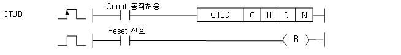

# CTUD

Count separate up and down rising pulses.

Manual section(s): 4.10.4. Original Korean notes below may cover the other variants on the same page; apply the widths and execution form of `CTUD`.

## Editing route

Use `get_ir` → `apply_patch` for this instruction edit. `insert_ladder_instruction` is the internal writer route, not a separate MCP tool. Preserve the exported revision and native constraints.
The writer mnemonic is `CTUD`; the catalog records opcode `927` and `4` operands in order.
Inspect the CPU/project and target cells first. Use the inspected revision and positions, preserve expected values, dry-run when useful, then save and inspect the result. See the [editing skill](../../SKILL.md) and [ladder workflow](../ladder.md).

## Behavior

- A rising U increments the count; a rising D decrements it. Simultaneous rising U and D leave the count unchanged.
- The contact is On when the current value reaches or exceeds N. RST resets the count to zero.
- The instruction enable must remain On for up/down counting.

## Instruction constraints

- C selects a counter device; U and D are BIT operands; N is a WORD preset in 0..65,535.

## Source corrections

- A decrement symbol in the Korean body is corrupted as ?1; the D operand description and example identify decrement by one.

## Operands

| Order | Operand | Description (Korean manual) | Reviewed types | Device areas | Constant |
| --- | --- | --- | --- | --- | --- |
| 1 | C | 사용하고자 하는 카운터 접점 | WORD | C | Not allowed |
| 2 | U | 현재치를 +1하는 신호 | BIT | PMK, F, L, T, C, D.x, U | Not allowed |
| 3 | D | 현재치를 -1하는 신호 | BIT | PMK, F, L, T, C, D.x, U | Not allowed |
| 4 | N | 설정치 (0 ~ 65,535) | WORD | PMK, U, D | Allowed |

These are the current library's reviewed operand rules. A shared type union is not a per-variant type choice; use the manual behavior to select the required width. Missing permissions stay unknown.

## CPU and acceptance

No separately reviewed CPU-model restriction is available in the current catalog; this means unknown, not universal compatibility.
Check the applicable model, firmware, modules and memory spans stated in the manual notes. Local parsing, writer validation and IL conversion do not prove native compilation or PLC behavior. Native acceptance requires XG5000 Open → Check Program → Save As → comparison.

## Manual behavior notes (Korean)

- U로 지정된 디바이스에 상승 신호가 입력될 때마다 현재치를 +1하며, 현재치가 설정치 이상이면 출력을 On하고 카운터 최대치(65,535)까지 Count 합니다.
- D로 지정된 디바이스에 상승 신호가 입력될 때마다 현재치를 ?1합니다.
- 리셋(Reset) 신호가 On하면 현재치는 0이 됩니다.
- U, D로 지정된 디바이스에 펄스가 동시에 On하면 현재치는 변하지 않습니다.
- Count 동작허용신호는 On된 상태를 유지하고 있어야 Up-Down카운트가 가능합니다.

## Manual applicability and restrictions

- 적용 기종 : XGK, XGB

## Manual flag and step matrix

The shared usage table marks affected flags with `O`, and `-` where it lists no effect. Native steps are the manual's instruction size, not the number of operand arguments. Conditions for setting/clearing flags are in the behavior notes.

| Manual instruction group | Native steps | 에러 (F110) | 제로 (F111) | 캐리 (F112) |
| --- | --- | --- | --- | --- |
| CTUD | 2~3 | - | - | - |

## Referenced manual figures

These figures belong to the shared source topic. Read the source corrections above before using variant-specific layouts or example values.

## Provenance

Source: `XGK(B)InstructionHelp_Kr_V3.5.chm`, SHA-256 `b866d589d800addcb039f9f09b182592464d6367faa55abf6dde9ac34a1580e0`.

- `4104ctud.htm` — §4.10.4; source SHA-256 `198c05ef3bc057940f14b2e4c2a89a48526d4eb18f95a3a60b96fe09a74159b7`.
- Additional behavior/operand evidence: `4104ctud.htm`.
