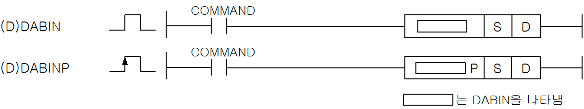
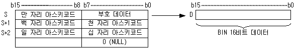
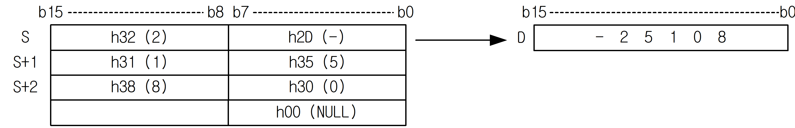
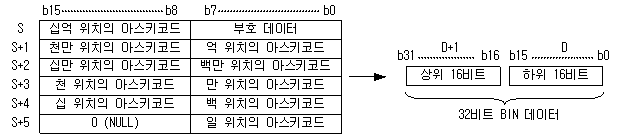

# DDABIN

Manual section(s): 4.26.4. Original Korean notes below may cover the other variants on the same page; apply the widths and execution form of `DDABIN`.

Execution form: the source explicitly pairs this command as `(P)`; `DDABIN` is the non-P partner. Manual §2.4.2 defines `P` as pulse-type notation. Select the paired forms deliberately and retain the instruction's actual execution conditions; unrelated mnemonics ending in P are not classified by suffix alone.

## Editing route

Use `get_ir` → `apply_patch` for this instruction edit. `insert_ladder_instruction` is the internal writer route, not a separate MCP tool. Preserve the exported revision and native constraints.
The writer mnemonic is `DDABIN`; the catalog records opcode `294` and `2` operands in order.
Inspect the CPU/project and target cells first. Use the inspected revision and positions, preserve expected values, dry-run when useful, then save and inspect the result. See the [editing skill](../../SKILL.md) and [ladder workflow](../ladder.md).

## Operands

| Order | Operand | Description (Korean manual) | Reviewed types | Device areas | Constant |
| --- | --- | --- | --- | --- | --- |
| 1 | S | BIN값으로 변환할 10진 ASCII 데이터가 저장되어 있는 주소 | STRING | PMK, F, L, T, C, Z, U, N, D, R | Not allowed |
| 2 | D | 변환값을 저장할 위치 | INT/DINT | PMK, L, T, C, Z, U, N, D, R | Not allowed |

These are the current library's reviewed operand rules. A shared type union is not a per-variant type choice; use the manual behavior to select the required width. Missing permissions stay unknown.

## CPU and acceptance

No separately reviewed CPU-model restriction is available in the current catalog; this means unknown, not universal compatibility.
Check the applicable model, firmware, modules and memory spans stated in the manual notes. Local parsing, writer validation and IL conversion do not prove native compilation or PLC behavior. Native acceptance requires XG5000 Open → Check Program → Save As → comparison.

## Manual flags

- DABIN (Decimal ASCII to Binary)
- ASCII로 저장된 10진수값을 Bin값으로 변환하여 D에 저장합니다.
- ASCII 문자열의 끝에는 반드시 NULL 이 있어야 합니다.
- 입력된 ASCII값의 첫번째 워드 하위바이트는 Bin값의 부호를 결정합니다.
- 부호값은 ‘-‘ (h2D) 또는 ‘+’(h2B)로 받게 됩니다.
- 부호 ‘+’(h2B) 는 생략 가능합니다.
- 데이터 D는 Signed로 저장됩니다.
- DABIN에서 연산 범위는 ?32768(h8000) 부터 32767(h7FFF)까지입니다.
- 입력 가능한 ASCII 문자는 부호, ‘0’~’9’에 해당하는 ASCII 값이며 이 이외의 값이 들어올 때 에러를 셋(Set) 합니다.
- DDABIN (Double Decimal ASCII to Binary)
- 입력된 ASCII값의 첫번째 워드 하위바이트는Bin값의 부호를 결정합니다.
- 부호값은 ‘-‘(h2D) 또는 ‘+’(h2B)로 받게 됩니다.
- DDABIN에서 연산 범위는 -2147483648(h80000000) 부터 2147483647(h7FFFFFFF)까지입니다.
- 입력 가능한 ASCII 문자는 부호, 0~9에 해당하는 ASCII 값이며 이 이외의 값이 들어올 때 에러를 셋(Set) 합니다.

| 플래그 | 내 용 | 디바이스 번호 |
| --- | --- | --- |
| 에러 | 입력된 ASCII 데이터가 연산 범위를 벗어날 때 셋(Set) 합니다. 입력된 ASCII 문자열 길이가 최대 문자열 길이(31)을 넘으면 셋(Set) 합니다. 입력된 ASCII 문자열에 부호, ‘0’~’9’ 이외의 문자가 있을 때 셋(Set) 합니다. | F110 |

## Manual applicability and restrictions

- 적용 기종 : XGK, XGB

## Manual flag and step matrix

The shared usage table marks affected flags with `O`, and `-` where it lists no effect. Native steps are the manual's instruction size, not the number of operand arguments. Conditions for setting/clearing flags are in the behavior notes.

| Manual instruction group | Native steps | 에러 (F110) | 제로 (F111) | 캐리 (F112) |
| --- | --- | --- | --- | --- |
| DABIN(P) DDABIN(P) | 2~4 | O | - | - |

## Referenced manual figures

These figures belong to the shared source topic. Read the source corrections above before using variant-specific layouts or example values.

## Provenance

Source: `XGK(B)InstructionHelp_Kr_V3.5.chm`, SHA-256 `b866d589d800addcb039f9f09b182592464d6367faa55abf6dde9ac34a1580e0`.

- `4264dabindabinpddabinddabinp.htm` — §4.26.4; source SHA-256 `65a97ee11b2b6f3e08a13f052e54f1f447f3aac31269f16e86200d1a05b13b3d`.
- Additional behavior/operand evidence: `4264dabindabinpddabinddabinp.htm`, `245.htm`.
