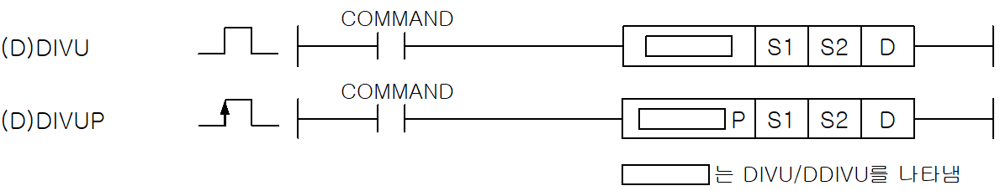

# DDIVUP

Divide two unsigned 32-bit integers and retain the remainder.

Manual section(s): 4.20.8. Original Korean notes below may cover the other variants on the same page; apply the widths and execution form of `DDIVUP`.

Execution form: the source explicitly pairs this command as `(P)`; `DDIVUP` is the pulse-type P form. Manual §2.4.2 defines `P` as pulse-type notation. Select the paired forms deliberately and retain the instruction's actual execution conditions; unrelated mnemonics ending in P are not classified by suffix alone.

## Editing route

Use `insert_ladder_instruction` after calling `describe_operation` for its current schema.
The writer mnemonic is `DDIVUP`; the catalog records opcode `554` and `3` operands in order.
Inspect the CPU/project and target cells first. Use the inspected revision and positions, preserve expected values, dry-run when useful, then save and inspect the result. See the [editing skill](../../SKILL.md) and [ladder workflow](../ladder.md).

## Behavior

- For 32-bit operands, the quotient is stored in (D+1,D) and the remainder in (D+3,D+2).
- This P-suffix variant executes once when the enabling input changes from Off to On.

## Instruction constraints

- A zero divisor S2 sets F110.
- Reserve 4 consecutive destination WORDs.
- A zero result sets F111.

## Operands

| Order | Operand | Description (Korean manual) | Reviewed types | Device areas | Constant |
| --- | --- | --- | --- | --- | --- |
| 1 | S1 | S2와 나눗셈연산을 실행할 데이터 | WORD/DWORD | PMK, F, L, T, C, Z, U, N, D, R | Allowed |
| 2 | S2 | S1과 나눗셈연산을 실행할 데이터 | WORD/DWORD | PMK, F, L, T, C, Z, U, N, D, R | Allowed |
| 3 | D | 연산결과를 저장할 주소 | WORD/DWORD | PMK, L, T, C, Z, U, N, D, R | Not allowed |

These are the current library's reviewed operand rules. A shared type union is not a per-variant type choice; use the manual behavior to select the required width. Missing permissions stay unknown.

## CPU and acceptance

No separately reviewed CPU-model restriction is available in the current catalog; this means unknown, not universal compatibility.
Check the applicable model, firmware, modules and memory spans stated in the manual notes. Local parsing, writer validation and IL conversion do not prove native compilation or PLC behavior. Native acceptance requires XG5000 Open → Check Program → Save As → comparison.

## Manual flags

- DIVU (Unsigned Binary Divide)
- 워드데이터 S1을 S2로 나눈 후 몫을 D(16bit)에 나머지를 D+1에 저장합니다.
- 이 때 Unsigned연산을 실행합니다.
- DDIVU (Unsigned Binary Double Divide)
- (S1+1,S1)을 (S2+1,S2)로 나눈 후 몫을 (D+1,D)에, 나머지를 (D+3,D+2)에 저장합니다.

| 플래그 | 내 용 | 디바이스 번호 |
| --- | --- | --- |
| 에러 | S2의 값이 0일 때 셋(Set)합니다 | F110 |
| 제로 | 연산결과가 제로이면 셋(Set)합니다 | F111 |

## Manual applicability and restrictions

- 적용 기종 : XGK, XGB

## Manual flag and step matrix

The shared usage table marks affected flags with `O`, and `-` where it lists no effect. Native steps are the manual's instruction size, not the number of operand arguments. Conditions for setting/clearing flags are in the behavior notes.

| Manual instruction group | Native steps | 에러 (F110) | 제로 (F111) | 캐리 (F112) |
| --- | --- | --- | --- | --- |
| DIVU(P) DDIVU(P) | 4~6 | O | O | - |

## Referenced manual figures

These figures belong to the shared source topic. Read the source corrections above before using variant-specific layouts or example values.

## Provenance

Source: `XGK(B)InstructionHelp_Kr_V3.5.chm`, SHA-256 `b866d589d800addcb039f9f09b182592464d6367faa55abf6dde9ac34a1580e0`.

- `4208divudivupddivuddivup.htm` — §4.20.8; source SHA-256 `998cbec49cf0843fa050e014cbed899cc6a468e1f4955579cdcabac8891e9b50`.
- Additional behavior/operand evidence: `33.htm`, `4208divudivupddivuddivup.htm`, `245.htm`.
