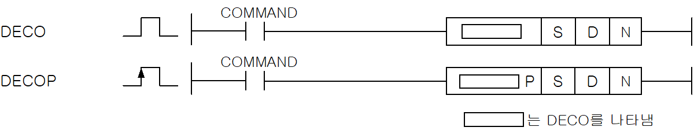
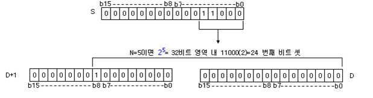

# DECO

Manual section(s): 4.24.4. Original Korean notes below may cover the other variants on the same page; apply the widths and execution form of `DECO`.

Execution form: the source explicitly pairs this command as `(P)`; `DECO` is the non-P partner. Manual §2.4.2 defines `P` as pulse-type notation. Select the paired forms deliberately and retain the instruction's actual execution conditions; unrelated mnemonics ending in P are not classified by suffix alone.

## Editing route

Use `get_ir` → `apply_patch` for this instruction edit. `insert_ladder_instruction` is the internal writer route, not a separate MCP tool. Preserve the exported revision and native constraints.
The writer mnemonic is `DECO`; the catalog records opcode `264` and `3` operands in order.
Inspect the CPU/project and target cells first. Use the inspected revision and positions, preserve expected values, dry-run when useful, then save and inspect the result. See the [editing skill](../../SKILL.md) and [ladder workflow](../ladder.md).

## Operands

| Order | Operand | Description (Korean manual) | Reviewed types | Device areas | Constant |
| --- | --- | --- | --- | --- | --- |
| 1 | S | DECO연산을 실행할 데이터 주소 | WORD | PMK, F, L, T, C, Z, U, N, D, R | Allowed |
| 2 | D | 연산 결과를 저장할 주소 | WORD | PMK, L, T, C, Z, U, N, D, R | Not allowed |
| 3 | N | DECO할 비트의 승수 | WORD | PMK, F, L, T, C, Z, U, N, D, R | Allowed |

These are the current library's reviewed operand rules. A shared type union is not a per-variant type choice; use the manual behavior to select the required width. Missing permissions stay unknown.

## CPU and acceptance

No separately reviewed CPU-model restriction is available in the current catalog; this means unknown, not universal compatibility.
Check the applicable model, firmware, modules and memory spans stated in the manual notes. Local parsing, writer validation and IL conversion do not prove native compilation or PLC behavior. Native acceptance requires XG5000 Open → Check Program → Save As → comparison.

## Manual flags

- DECO (Decode)
- S로 지정된 디바이스에 저장된 데이터 중에서 하위 N개의 비트를 디코드하여 그 결과를 D로 지정한 디바이스부터 2N 의 비트 영역내에 저장하고, 나머지 비트는 0으로 지웁니다. (8비트를 256비트로 디코드)
- N은 1~8까지 지정 가능합니다.
- N = 0일 때 기존의 D의 내용은 변화하지 않습니다.

| 플래그 | 내 용 | 디바이스 번호 |
| --- | --- | --- |
| 제로 | 유효 비트수 N이 0 ~ 8이외의 값일 때 D부터 시작된 2N 개의 유효 비트수가 디바이스 영역을 초과했을 때 | F110 |

## Manual applicability and restrictions

- 적용 기종 : XGK, XGB

## Manual flag and step matrix

The shared usage table marks affected flags with `O`, and `-` where it lists no effect. Native steps are the manual's instruction size, not the number of operand arguments. Conditions for setting/clearing flags are in the behavior notes.

| Manual instruction group | Native steps | 에러 (F110) | 제로 (F111) | 캐리 (F112) |
| --- | --- | --- | --- | --- |
| DECO(P) | 4~6 | O | - | - |

## Referenced manual figures

These figures belong to the shared source topic. Read the source corrections above before using variant-specific layouts or example values.

## Provenance

Source: `XGK(B)InstructionHelp_Kr_V3.5.chm`, SHA-256 `b866d589d800addcb039f9f09b182592464d6367faa55abf6dde9ac34a1580e0`.

- `4244decodecop.htm` — §4.24.4; source SHA-256 `764bc6b46205d1b1b78d1d65531187926594dc251b43890bd8c59de29cf38031`.
- Additional behavior/operand evidence: `4244decodecop.htm`, `245.htm`.
