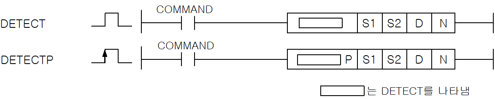
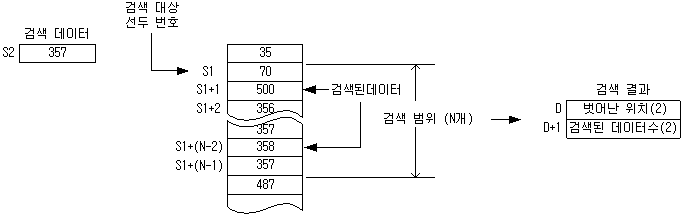

# DETECTP

Manual section(s): 4.24.16. Original Korean notes below may cover the other variants on the same page; apply the widths and execution form of `DETECTP`.

Execution form: the source explicitly pairs this command as `(P)`; `DETECTP` is the pulse-type P form. Manual §2.4.2 defines `P` as pulse-type notation. Select the paired forms deliberately and retain the instruction's actual execution conditions; unrelated mnemonics ending in P are not classified by suffix alone.

## Editing route

Use `get_ir` → `apply_patch` for this instruction edit. `insert_ladder_instruction` is the internal writer route, not a separate MCP tool. Preserve the exported revision and native constraints.
The writer mnemonic is `DETECTP`; the catalog records opcode `658` and `4` operands in order.
Inspect the CPU/project and target cells first. Use the inspected revision and positions, preserve expected values, dry-run when useful, then save and inspect the result. See the [editing skill](../../SKILL.md) and [ladder workflow](../ladder.md).

## Operands

| Order | Operand | Description (Korean manual) | Reviewed types | Device areas | Constant |
| --- | --- | --- | --- | --- | --- |
| 1 | S1 | 감시할 데이터 시작위치 | WORD | PMK, F, L, T, C, Z, U, N, D, R | Not allowed |
| 2 | S2 | 허용치 | WORD | PMK, F, L, T, C, Z, U, N, D, R | Allowed |
| 3 | D | 변경된 첫번째 위치 및 검색된 개수 | WORD | PMK, L, T, C, Z, U, N, D, R | Not allowed |
| 4 | N | 범위 | WORD | PMK, F, L, T, C, Z, U, N, D, R | Allowed |

These are the current library's reviewed operand rules. A shared type union is not a per-variant type choice; use the manual behavior to select the required width. Missing permissions stay unknown.

## CPU and acceptance

No separately reviewed CPU-model restriction is available in the current catalog; this means unknown, not universal compatibility.
Check the applicable model, firmware, modules and memory spans stated in the manual notes. Local parsing, writer validation and IL conversion do not prove native compilation or PLC behavior. Native acceptance requires XG5000 Open → Check Program → Save As → comparison.

## Manual flags

- DETECT
- S1부터 N개의 데이터 중에 그 값이 허용치(S2)보다 클 경우(Signed 연산, 허용치와 같을 때는 검색 안됨) D에 허용치를 벗어난 첫번째 값의 위치를 저장하고, D+1에 S1 보다 큰 데이터 개수를 저장합니다.
- N이 0이면 명령어를 실행하지 않습니다.

| 플래그 | 내 용 | 디바이스 번호 |
| --- | --- | --- |
| 에러 | N값이 해당 디바이스의 범위를 벗어날 때 | F110 |
| 제로 | 검색 결과 S2에 지정된 허용치를 넘는 데이터가 없을 때 셋(Set) 합니다. | F111 |

## Manual applicability and restrictions

- 적용 기종 : XGK, XGB

## Manual flag and step matrix

The shared usage table marks affected flags with `O`, and `-` where it lists no effect. Native steps are the manual's instruction size, not the number of operand arguments. Conditions for setting/clearing flags are in the behavior notes.

| Manual instruction group | Native steps | 에러 (F110) | 제로 (F111) | 캐리 (F112) |
| --- | --- | --- | --- | --- |
| DETECT(P) | 4~6 | O | O | - |

## Referenced manual figures

These figures belong to the shared source topic. Read the source corrections above before using variant-specific layouts or example values.

## Provenance

Source: `XGK(B)InstructionHelp_Kr_V3.5.chm`, SHA-256 `b866d589d800addcb039f9f09b182592464d6367faa55abf6dde9ac34a1580e0`.

- `42416detectdetectp1.htm` — §4.24.16; source SHA-256 `a7bb04d759627e4cb6b3b814455dcc533fc124bd49ef98b30bfbe742660f4378`.
- Additional behavior/operand evidence: `42416detectdetectp1.htm`, `245.htm`.
