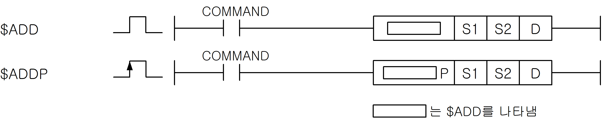
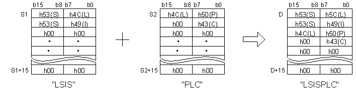

# $ADD

Manual section(s): 4.20.13. Original Korean notes below may cover the other variants on the same page; apply the widths and execution form of `$ADD`.

Execution form: the source explicitly pairs this command as `(P)`; `$ADD` is the non-P partner. Manual §2.4.2 defines `P` as pulse-type notation. Select the paired forms deliberately and retain the instruction's actual execution conditions; unrelated mnemonics ending in P are not classified by suffix alone.

## Editing route

Use `get_ir` → `apply_patch` for this instruction edit. `insert_ladder_instruction` is the internal writer route, not a separate MCP tool. Preserve the exported revision and native constraints.
The writer mnemonic is `$ADD`; the catalog records opcode `236` and `3` operands in order.
Inspect the CPU/project and target cells first. Use the inspected revision and positions, preserve expected values, dry-run when useful, then save and inspect the result. See the [editing skill](../../SKILL.md) and [ladder workflow](../ladder.md).

## Operands

| Order | Operand | Description (Korean manual) | Reviewed types | Device areas | Constant |
| --- | --- | --- | --- | --- | --- |
| 1 | S1 | 문자열 데이터가 들어있는 디바이스 번호 또는 문자열 | STRING | PMK, L, T, C, Z, U, N, D, R | Allowed |
| 2 | S2 | 문자열 데이터가 들어있는 디바이스 번호 또는 문자열 | STRING | PMK, L, T, C, Z, U, N, D, R | Allowed |
| 3 | D | 연산결과를 저장할 주소 | STRING | PMK, L, T, C, Z, U, N, D, R | Not allowed |

These are the current library's reviewed operand rules. A shared type union is not a per-variant type choice; use the manual behavior to select the required width. Missing permissions stay unknown.

## CPU and acceptance

No separately reviewed CPU-model restriction is available in the current catalog; this means unknown, not universal compatibility.
Check the applicable model, firmware, modules and memory spans stated in the manual notes. Local parsing, writer validation and IL conversion do not prove native compilation or PLC behavior. Native acceptance requires XG5000 Open → Check Program → Save As → comparison.

## Manual behavior notes (Korean)

- RDIV (Real Divide)
- S1으로 지정된 문자열 데이터와 S2로 지정된 문자열 데이터를 연결하여 D에 저장합니다. 이때 D로 저장되는 문자열은 문자열 데이터 크기인 영문 31자, 국문 15자를 넘지 않습니다.
- S1 문자열과 S2문자열을 합한 길이가 문자열 데이터 크기를 넘어가도 에러는 발생하지 않습니다. 이 경우 D에 저장되는 값은 S1값부터 시작된 문자열 데이터 크기만큼 입니다.
- 문자열 데이터의 처리는 문자열 길이와 관계없이 16워드 데이터로 처리합니다.
- 문자열 관련 명령어를 사용할 경우 16워드 공간을 사용해도 되는 디바이스를 지정해야 합니다.

## Manual applicability and restrictions

- 적용 기종 : XGK, XGB

## Manual flag and step matrix

The shared usage table marks affected flags with `O`, and `-` where it lists no effect. Native steps are the manual's instruction size, not the number of operand arguments. Conditions for setting/clearing flags are in the behavior notes.

| Manual instruction group | Native steps | 에러 (F110) | 제로 (F111) | 캐리 (F112) |
| --- | --- | --- | --- | --- |
| $ADD(P) | 4~18 | - | - | - |

## Referenced manual figures

These figures belong to the shared source topic. Read the source corrections above before using variant-specific layouts or example values.

## Provenance

Source: `XGK(B)InstructionHelp_Kr_V3.5.chm`, SHA-256 `b866d589d800addcb039f9f09b182592464d6367faa55abf6dde9ac34a1580e0`.

- `42013addaddp.htm` — §4.20.13; source SHA-256 `25c41b1a5efaeea2eb413594057d99fac981f9bb360ee074ac093bd0e88a2991`.
- Additional behavior/operand evidence: `42013addaddp.htm`, `245.htm`.
