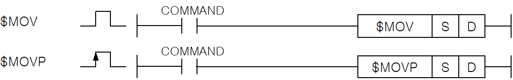
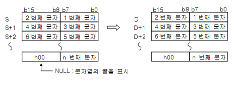
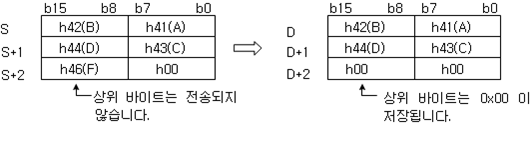

# $MOV

Copy a NULL-terminated character string.

Manual section(s): 4.11.9. Original Korean notes below may cover the other variants on the same page; apply the widths and execution form of `$MOV`.

Execution form: the source explicitly pairs this command as `(P)`; `$MOV` is the non-P partner. Manual §2.4.2 defines `P` as pulse-type notation. Select the paired forms deliberately and retain the instruction's actual execution conditions; unrelated mnemonics ending in P are not classified by suffix alone.

## Editing route

Use `insert_ladder_instruction` after calling `describe_operation` for its current schema.
The writer mnemonic is `$MOV`; the catalog records opcode `157` and `2` operands in order.
Inspect the CPU/project and target cells first. Use the inspected revision and positions, preserve expected values, dry-run when useful, then save and inspect the result. See the [editing skill](../../SKILL.md) and [ladder workflow](../ladder.md).

## Behavior

- Copy the string beginning at S to the device beginning at D. If NULL occupies the low byte of the final source WORD, the corresponding destination high byte is set to h00.

## Instruction constraints

- The manual states a maximum of 31 characters, or 15 Korean characters; this is the manual device encoding limit, not a Unicode scalar count.

## Operands

| Order | Operand | Description (Korean manual) | Reviewed types | Device areas | Constant |
| --- | --- | --- | --- | --- | --- |
| 1 | S | 전송하고자 하는 문자열 또는 문자열이 들어있는 디바이스의 선두 번호 | STRING | PMK, L, T, C, Z, U, N, D, R | Allowed |
| 2 | D | 전송된 문자열을 저장할 디바이스의 선두 번호 | STRING | PMK, L, T, C, Z, U, N, D, R | Not allowed |

These are the current library's reviewed operand rules. A shared type union is not a per-variant type choice; use the manual behavior to select the required width. Missing permissions stay unknown.

## CPU and acceptance

No separately reviewed CPU-model restriction is available in the current catalog; this means unknown, not universal compatibility.
Check the applicable model, firmware, modules and memory spans stated in the manual notes. Local parsing, writer validation and IL conversion do not prove native compilation or PLC behavior. Native acceptance requires XG5000 Open → Check Program → Save As → comparison.

## Manual behavior notes (Korean)

- $MOV(Character String Mode)
- S부터 시작되는 문자열을 D로 시작되는 디바이스에 전송합니다.
- S+n의 하위 바이트에 NULL이 저장되어 있는 경우, D+n의 상위 바이트에는 h00이 저장됩니다.
- 최대 전송할 수 있는 문자열은 31글자(한글15자)까지 가능합니다.

## Manual applicability and restrictions

- 적용 기종 : XGK, XGB

## Manual flag and step matrix

The shared usage table marks affected flags with `O`, and `-` where it lists no effect. Native steps are the manual's instruction size, not the number of operand arguments. Conditions for setting/clearing flags are in the behavior notes.

| Manual instruction group | Native steps | 에러 (F110) | 제로 (F111) | 캐리 (F112) |
| --- | --- | --- | --- | --- |
| $MOV(P) | 2~18 | O | - | - |

## Referenced manual figures

These figures belong to the shared source topic. Read the source corrections above before using variant-specific layouts or example values.

## Provenance

Source: `XGK(B)InstructionHelp_Kr_V3.5.chm`, SHA-256 `b866d589d800addcb039f9f09b182592464d6367faa55abf6dde9ac34a1580e0`.

- `4119movmovp1.htm` — §4.11.9; source SHA-256 `bca9512173e45a1e7e69ee6620f80ff188c53c727889687201d34805f1d69757`.
- Additional behavior/operand evidence: `4119movmovp1.htm`, `245.htm`.
