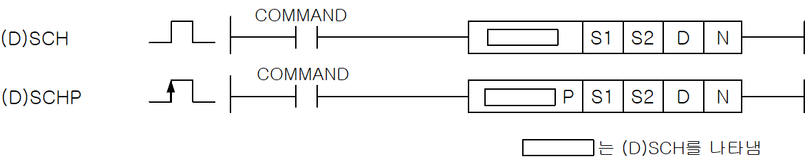
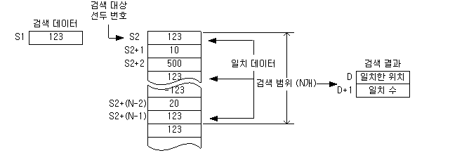
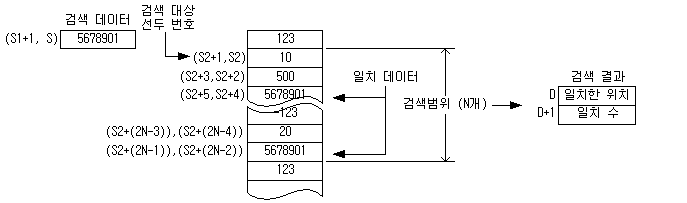

# DSCH

Manual section(s): 4.24.10. Original Korean notes below may cover the other variants on the same page; apply the widths and execution form of `DSCH`.

Execution form: the source explicitly pairs this command as `(P)`; `DSCH` is the non-P partner. Manual §2.4.2 defines `P` as pulse-type notation. Select the paired forms deliberately and retain the instruction's actual execution conditions; unrelated mnemonics ending in P are not classified by suffix alone.

## Editing route

Use `get_ir` → `apply_patch` for this instruction edit. `insert_ladder_instruction` is the internal writer route, not a separate MCP tool. Preserve the exported revision and native constraints.
The writer mnemonic is `DSCH`; the catalog records opcode `269` and `4` operands in order.
Inspect the CPU/project and target cells first. Use the inspected revision and positions, preserve expected values, dry-run when useful, then save and inspect the result. See the [editing skill](../../SKILL.md) and [ladder workflow](../ladder.md).

## Operands

| Order | Operand | Description (Korean manual) | Reviewed types | Device areas | Constant |
| --- | --- | --- | --- | --- | --- |
| 1 | S1 | 찾고자 하는 데이터 또는 주소 | WORD/DWORD | PMK, F, L, T, C, Z, U, N, D, R | Allowed |
| 2 | S2 | 찾을 영역의 시작 주소 | WORD/DWORD | PMK, L, T, C, Z, U, N, D, R | Not allowed |
| 3 | D | 일치한 위치 및 개수를 저장할 주소 | WORD | PMK, L, T, C, Z, U, N, D, R | Not allowed |
| 4 | N | SCH연산의 검색범위 | WORD | PMK, F, L, T, C, Z, U, N, D, R | Allowed |

These are the current library's reviewed operand rules. A shared type union is not a per-variant type choice; use the manual behavior to select the required width. Missing permissions stay unknown.

## CPU and acceptance

No separately reviewed CPU-model restriction is available in the current catalog; this means unknown, not universal compatibility.
Check the applicable model, firmware, modules and memory spans stated in the manual notes. Local parsing, writer validation and IL conversion do not prove native compilation or PLC behavior. Native acceptance requires XG5000 Open → Check Program → Save As → comparison.

## Manual flags

- SCH (Word Search)
- 워드 데이터 S1과 같은 값을 S2로부터 차례대로 N개의 워드 데이터 내에서 검색합니다.
- 첫번째 찾은 값의 주소를 D에 저장하고 S1과 같은 값의 총 수를 D + 1에 저장합니다.
- 찾은 값이 하나도 없으면 제로 플래그를 셋(Set)합니다.
- N이 0이면 실행을 하지 않습니다.
- 검색한 결과, 일치 데이터가 발견되지 않은 경우D, D+1로 지정된 디바이스는 0으로 됩니다.
- DSCH (Double Word Search)
- S1+1,S1) 로 지정된 디바이스의 32비트 데이터를 키워드로서 S2로 지정된 디바이스부터 32비트 단위로 N개( WORD로 2N개 )를 검색합니다.
- 검색 데이터와 일치한 개수를 D+1에 저장하고 처음에 일치한 데이터의 위치가 D로 지정된 디바이스에 저장됩니다.
- N이 0인 경우 검색을 하지 않고, 결과 데이터를 변화시키지 않습니다.
- 검색한 결과, 일치 데이터가 발견되지 않은 경우D, D +1로 지정된 디바이스는 0으로 됩니다.

| 플래그 | 내 용 | 디바이스 번호 |
| --- | --- | --- |
| 에러 | N값이 해당 S1의 영역이 디바이스의 범위를 벗어날 때 셋(Set) | F110 |
| 제로 | 일치하는 데이터가 없으면 셋(Set) | F111 |

## Manual applicability and restrictions

- 적용 기종 : XGK, XGB

## Manual flag and step matrix

The shared usage table marks affected flags with `O`, and `-` where it lists no effect. Native steps are the manual's instruction size, not the number of operand arguments. Conditions for setting/clearing flags are in the behavior notes.

| Manual instruction group | Native steps | 에러 (F110) | 제로 (F111) | 캐리 (F112) |
| --- | --- | --- | --- | --- |
| SCH(P) DSCH(P) | 4~7 | O | O | - |

## Referenced manual figures

These figures belong to the shared source topic. Read the source corrections above before using variant-specific layouts or example values.

## Provenance

Source: `XGK(B)InstructionHelp_Kr_V3.5.chm`, SHA-256 `b866d589d800addcb039f9f09b182592464d6367faa55abf6dde9ac34a1580e0`.

- `42410schschpdschdschp.htm` — §4.24.10; source SHA-256 `ad879c1fd7f64c5d407b2e82abe101b13de1bb196e89d708000e8cf08aa38e3d`.
- Additional behavior/operand evidence: `42410schschpdschdschp.htm`, `245.htm`.
