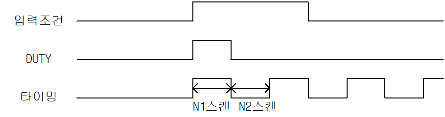

# DUTY

Manual section(s): 4.33.2. Original Korean notes below may cover the other variants on the same page; apply the widths and execution form of `DUTY`.

## Editing route

Use `get_ir` → `apply_patch` for this instruction edit. `insert_ladder_instruction` is the internal writer route, not a separate MCP tool. Preserve the exported revision and native constraints.
The writer mnemonic is `DUTY`; the catalog records opcode `932` and `3` operands in order.
Inspect the CPU/project and target cells first. Use the inspected revision and positions, preserve expected values, dry-run when useful, then save and inspect the result. See the [editing skill](../../SKILL.md) and [ladder workflow](../ladder.md).

## Operands

| Order | Operand | Description (Korean manual) | Reviewed types | Device areas | Constant |
| --- | --- | --- | --- | --- | --- |
| 1 | D | F100 ~ F107 | BIT | F | Not allowed |
| 2 | N1 | On될 스캔 수 | WORD | None | Allowed |
| 3 | N2 | Off될 스캔 수 | WORD | None | Allowed |

These are the current library's reviewed operand rules. A shared type union is not a per-variant type choice; use the manual behavior to select the required width. Missing permissions stay unknown.

## CPU and acceptance

No separately reviewed CPU-model restriction is available in the current catalog; this means unknown, not universal compatibility.
Check the applicable model, firmware, modules and memory spans stated in the manual notes. Local parsing, writer validation and IL conversion do not prove native compilation or PLC behavior. Native acceptance requires XG5000 Open → Check Program → Save As → comparison.

## Manual behavior notes (Korean)

- DUTY
- D로 지정된 User용 타이밍 펄스 F영역(F100~F107)을 N1 스캔동안 On, N2 스캔 동안 Off하는 펄스를 발생시킵니다.
- 초기 입력 조건이 Off된 때는 타이밍 펄스 (F100~F107)는 Off되어 있습니다.
- N1 = 0이면 타이밍 펄스는 항상 off
- N1 > 0, N2 = 0 이면 타이밍 펄스는 항상 On
- 입력 조건이 On되어 DUTY 명령어가 동작해서 타이밍 펄스가 발생하기 시작하면, DUTY의 입력조건이 Off되어도 타이밍 펄스는 계속해서 발생합니다.

## Manual applicability and restrictions

- 적용 기종 : XGK, XGB

## Manual flag and step matrix

The shared usage table marks affected flags with `O`, and `-` where it lists no effect. Native steps are the manual's instruction size, not the number of operand arguments. Conditions for setting/clearing flags are in the behavior notes.

| Manual instruction group | Native steps | 에러 (F110) | 제로 (F111) | 캐리 (F112) |
| --- | --- | --- | --- | --- |
| DUTY | 4 | - | - | - |

## Additional source notes after examples

The manual places some execution restrictions and timing conditions after its example heading. Retain those checks below. Example addresses and circuit assumptions describe the source example and are not defaults for a new program.

- 런중 수정을 통해 특정 타이밍 펄스에 해당하는 DUTY 명령을 제거해도 타이밍 펄스는 계속해서 동작합니다.

## Referenced manual figures

These figures belong to the shared source topic. Read the source corrections above before using variant-specific layouts or example values.

## Provenance

Source: `XGK(B)InstructionHelp_Kr_V3.5.chm`, SHA-256 `b866d589d800addcb039f9f09b182592464d6367faa55abf6dde9ac34a1580e0`.

- `4332duty.htm` — §4.33.2; source SHA-256 `017668c631c6455ace27951da97773d3e70a3510fe14c61c80ac95cd10c40ebc`.
- Additional behavior/operand evidence: `4332duty.htm`.
