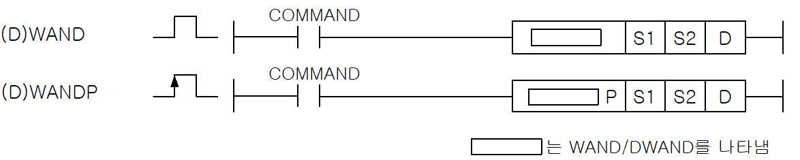
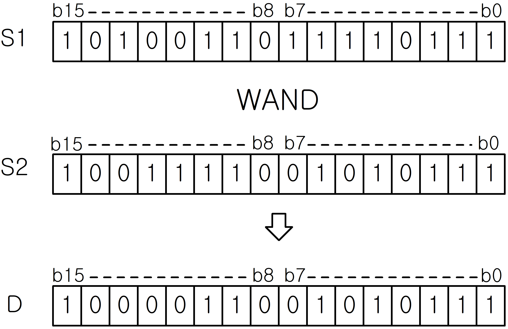
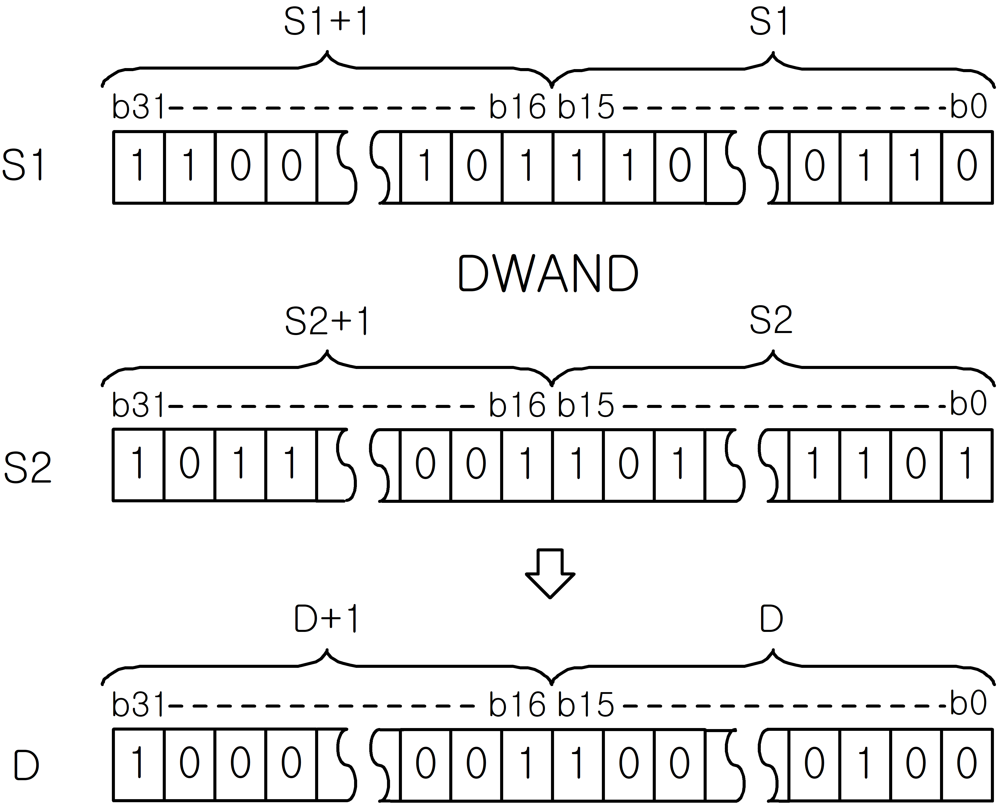
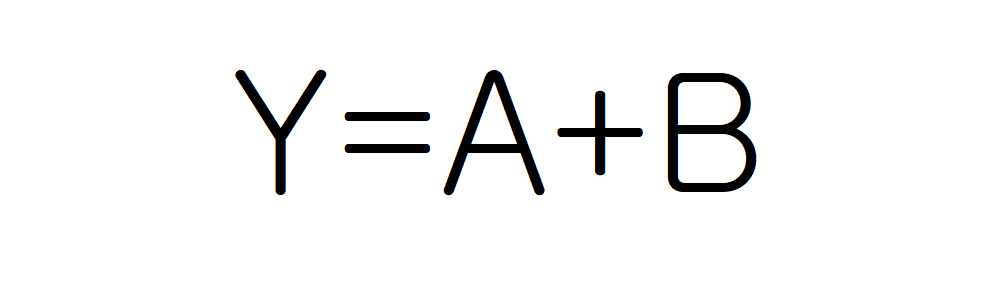
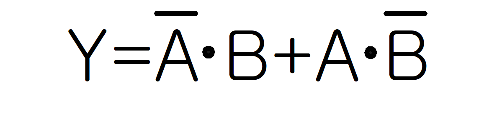
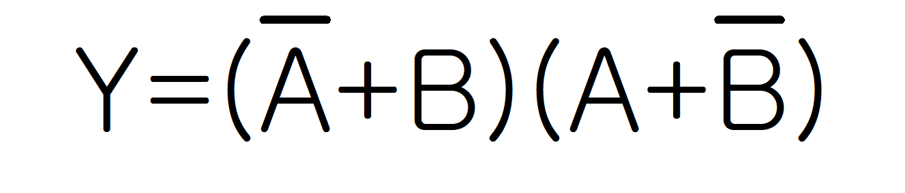

# DWANDP

Manual section(s): 4.22.1. Original Korean notes below may cover the other variants on the same page; apply the widths and execution form of `DWANDP`.

Execution form: the source explicitly pairs this command as `(P)`; `DWANDP` is the pulse-type P form. Manual §2.4.2 defines `P` as pulse-type notation. Select the paired forms deliberately and retain the instruction's actual execution conditions; unrelated mnemonics ending in P are not classified by suffix alone.

## Editing route

Use `get_ir` → `apply_patch` for this instruction edit. `insert_ladder_instruction` is the internal writer route, not a separate MCP tool. Preserve the exported revision and native constraints.
The writer mnemonic is `DWANDP`; the catalog records opcode `596` and `3` operands in order.
Inspect the CPU/project and target cells first. Use the inspected revision and positions, preserve expected values, dry-run when useful, then save and inspect the result. See the [editing skill](../../SKILL.md) and [ladder workflow](../ladder.md).

## Operands

| Order | Operand | Description (Korean manual) | Reviewed types | Device areas | Constant |
| --- | --- | --- | --- | --- | --- |
| 1 | S1 | S2와 (D)WAND연산을 하게 되는 데이터 | WORD/DWORD | PMK, F, L, T, C, Z, U, N, D, R | Allowed |
| 2 | S2 | S1과 (D)WAND 연산을 하게 되는 데이터 | WORD/DWORD | PMK, F, L, T, C, Z, U, N, D, R | Allowed |
| 3 | D | 연산결과를 저장할 주소 | WORD/DWORD | PMK, L, T, C, Z, U, N, D, R | Not allowed |

These are the current library's reviewed operand rules. A shared type union is not a per-variant type choice; use the manual behavior to select the required width. Missing permissions stay unknown.

## CPU and acceptance

No separately reviewed CPU-model restriction is available in the current catalog; this means unknown, not universal compatibility.
Check the applicable model, firmware, modules and memory spans stated in the manual notes. Local parsing, writer validation and IL conversion do not prove native compilation or PLC behavior. Native acceptance requires XG5000 Open → Check Program → Save As → comparison.

## Manual flags

- WAND (Word AND)
- 워드 데이터(16비트) S1과 S2의 각 비트를 서로 논리적(AND)하여 결과를 D에 저장합니다.
- DWAND (Double Word AND)
- 더블 워드 데이터(32비트) (S1+1,S1)과 (S2+1,S2)의 각 비트를 서로 논리적(AND)하여 결과를 (D+1, D)에 저장합니다.
- 논리 연산 테이블

| 플래그 | 내 용 | 디바이스 번호 |
| --- | --- | --- |
| 제로 | 연산결과가 제로이면 셋(Set)됩니다. | F111 |

| 분류 | 처리 내용 | 연산식 | 예 | 예 | 예 |
| --- | --- | --- | --- | --- | --- |
| 분류 | 처리 내용 | 연산식 | A | B | Y |
| 논리적(AND) | 입력A, B가 모두 1일 때에만 1로 되고, 그 이외는 0이 됩니다. |  | 0 | 0 | 0 |
| 논리적(AND) | 입력A, B가 모두 1일 때에만 1로 되고, 그 이외는 0이 됩니다. |  | 0 | 1 | 0 |
| 논리적(AND) | 입력A, B가 모두 1일 때에만 1로 되고, 그 이외는 0이 됩니다. |  | 1 | 0 | 0 |
| 논리적(AND) | 입력A, B가 모두 1일 때에만 1로 되고, 그 이외는 0이 됩니다. |  | 1 | 1 | 1 |
| 논리합(OR) | 입력 A, B가 모두 0일 때에만 0으로 되고, 그 이외는 1이 됩니다. |  | 0 | 0 | 0 |
| 논리합(OR) | 입력 A, B가 모두 0일 때에만 0으로 되고, 그 이외는 1이 됩니다. |  | 0 | 1 | 1 |
| 논리합(OR) | 입력 A, B가 모두 0일 때에만 0으로 되고, 그 이외는 1이 됩니다. |  | 1 | 0 | 1 |
| 논리합(OR) | 입력 A, B가 모두 0일 때에만 0으로 되고, 그 이외는 1이 됩니다. |  | 1 | 1 | 1 |
| 배타적 논리합 (XOR) | 입력 A와 B가 같을 때 0으로 되며, 다를 때는 1이 됩니다. |  | 0 | 0 | 0 |
| 배타적 논리합 (XOR) | 입력 A와 B가 같을 때 0으로 되며, 다를 때는 1이 됩니다. |  | 0 | 1 | 1 |
| 배타적 논리합 (XOR) | 입력 A와 B가 같을 때 0으로 되며, 다를 때는 1이 됩니다. |  | 1 | 0 | 1 |
| 배타적 논리합 (XOR) | 입력 A와 B가 같을 때 0으로 되며, 다를 때는 1이 됩니다. |  | 1 | 1 | 0 |
| 부정 배타적 논리합(XNR) | 입력 A와 B가 같을 때 1로 되며, 다를 때는 0이 됩니다. |  | 0 | 0 | 1 |
| 부정 배타적 논리합(XNR) | 입력 A와 B가 같을 때 1로 되며, 다를 때는 0이 됩니다. |  | 0 | 1 | 0 |
| 부정 배타적 논리합(XNR) | 입력 A와 B가 같을 때 1로 되며, 다를 때는 0이 됩니다. |  | 1 | 0 | 0 |
| 부정 배타적 논리합(XNR) | 입력 A와 B가 같을 때 1로 되며, 다를 때는 0이 됩니다. |  | 1 | 1 | 1 |

## Manual applicability and restrictions

- 적용 기종 : XGK, XGB

## Manual flag and step matrix

The shared usage table marks affected flags with `O`, and `-` where it lists no effect. Native steps are the manual's instruction size, not the number of operand arguments. Conditions for setting/clearing flags are in the behavior notes.

| Manual instruction group | Native steps | 에러 (F110) | 제로 (F111) | 캐리 (F112) |
| --- | --- | --- | --- | --- |
| WAND(P) DWAND(P) | 4~6 | - | O | - |

## Referenced manual figures

These figures belong to the shared source topic. Read the source corrections above before using variant-specific layouts or example values.

## Provenance

Source: `XGK(B)InstructionHelp_Kr_V3.5.chm`, SHA-256 `b866d589d800addcb039f9f09b182592464d6367faa55abf6dde9ac34a1580e0`.

- `4221wandwandpdwanddwandp1.htm` — §4.22.1; source SHA-256 `91f2f991fb72a5ed97a13ac1dc5fedaf4880b3aa1fe2502ca4215072f7214bdb`.
- Additional behavior/operand evidence: `4221wandwandpdwanddwandp1.htm`, `245.htm`.
