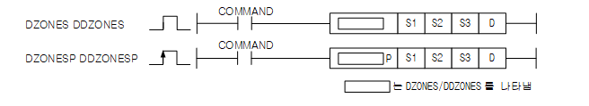
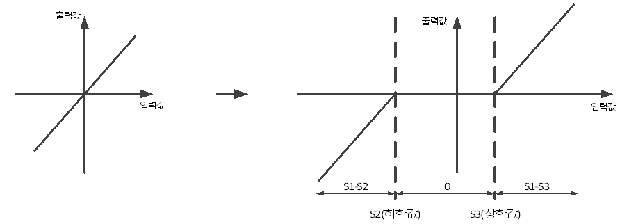

# DZONES

Manual section(s): 4.28.3. Original Korean notes below may cover the other variants on the same page; apply the widths and execution form of `DZONES`.

## Editing route

Use `insert_ladder_instruction` after calling `describe_operation` for its current schema.
The writer mnemonic is `DZONES`; the catalog records opcode `1529` and `4` operands in order.
Inspect the CPU/project and target cells first. Use the inspected revision and positions, preserve expected values, dry-run when useful, then save and inspect the result. See the [editing skill](../../SKILL.md) and [ladder workflow](../ladder.md).

## Operands

| Order | Operand | Description (Korean manual) | Reviewed types | Device areas | Constant |
| --- | --- | --- | --- | --- | --- |
| 1 | S1 | 입력값 | INT/DINT | PMK, L, Z, U, N, D, R | Not allowed |
| 2 | S2 | Dead Zone 하한값 | INT/DINT | PMK, L, Z, U, N, D, R | Not allowed |
| 3 | S3 | Dead Zone 상한값 | INT/DINT | PMK, L, Z, U, N, D, R | Not allowed |
| 4 | D | 출력값을 저장할 디바이스 번호 | INT/DINT | PMK, D, R | Not allowed |

These are the current library's reviewed operand rules. A shared type union is not a per-variant type choice; use the manual behavior to select the required width. Missing permissions stay unknown.

## CPU and acceptance

No separately reviewed CPU-model restriction is available in the current catalog; this means unknown, not universal compatibility.
Check the applicable model, firmware, modules and memory spans stated in the manual notes. Local parsing, writer validation and IL conversion do not prove native compilation or PLC behavior. Native acceptance requires XG5000 Open → Check Program → Save As → comparison.

## Manual flags

- DZONES (Dead Zone Separate)
- S1으로 지정된 입력값이 Dead Zone의 하한값과 상한값에 따라 변환되어D로 저장됩니다.
- 출력 조건:
- S2(하한값) > S1(입력값)이면, D(출력)= S1(입력값) - S2(하한값)
- S3(상한값) < S1(입력값)이면, D(출력)= S1(입력값) - S3(상한값)
- S2(하한값) <= S1(입력값) <= S3(상한값)이면, D(출력)= 0
- {S2(하한값)==S3(상한값)} < S1(입력값)이면, D(출력)= S1(입력값) - S3(상한값)
- {S2(하한값)==S3(상한값)} > S1(입력값)이면, D(출력)= S1(입력값) - S3(상한값)

| 플래그 | 내 용 | 디바이스 번호 |
| --- | --- | --- |
| 에러 | 상한 값이 하한 값 보다 작은 경우 | F110 |

## Manual applicability and restrictions

- 적용 기종 : XGK, XGB(XBC-U, XBM-H/H2/HP)

## Manual flag and step matrix

The shared usage table marks affected flags with `O`, and `-` where it lists no effect. Native steps are the manual's instruction size, not the number of operand arguments. Conditions for setting/clearing flags are in the behavior notes.

| Manual instruction group | Native steps | 에러 (F110) | 제로 (F111) | 캐리 (F112) |
| --- | --- | --- | --- | --- |
| DZONE(P) DDZONE(P) | 4~7 | O | - | - |

## Referenced manual figures

These figures belong to the shared source topic. Read the source corrections above before using variant-specific layouts or example values.

## Provenance

Source: `XGK(B)InstructionHelp_Kr_V3.5.chm`, SHA-256 `b866d589d800addcb039f9f09b182592464d6367faa55abf6dde9ac34a1580e0`.

- `4283dzonesdzonespddzonesddzonesp.htm` — §4.28.3; source SHA-256 `cb8cb1df3ddfebaf006c8b7739e96a486d66eaadcb2eb4293efd2e8698a8e10e`.
- Additional behavior/operand evidence: `4283dzonesdzonespddzonesddzonesp.htm`.
