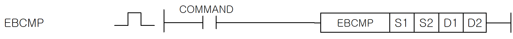
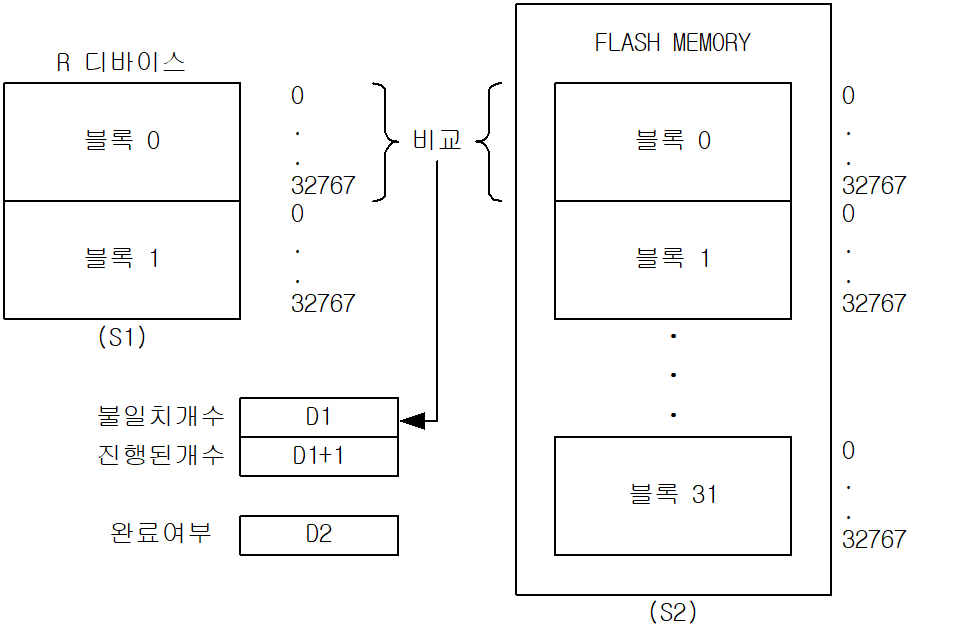

# EBCMP

Manual section(s): 4.36.5. Original Korean notes below may cover the other variants on the same page; apply the widths and execution form of `EBCMP`.

## Editing route

Use `get_ir` → `apply_patch` for this instruction edit. `insert_ladder_instruction` is the internal writer route, not a separate MCP tool. Preserve the exported revision and native constraints.
The writer mnemonic is `EBCMP`; the catalog records opcode `1037` and `4` operands in order.
Inspect the CPU/project and target cells first. Use the inspected revision and positions, preserve expected values, dry-run when useful, then save and inspect the result. See the [editing skill](../../SKILL.md) and [ladder workflow](../ladder.md).

## Operands

| Order | Operand | Description (Korean manual) | Reviewed types | Device areas | Constant |
| --- | --- | --- | --- | --- | --- |
| 1 | S1 | R디바이스의 블록번호 ( CPUH/A : 0~1, CPUS/E : 0 ) | WORD | PMK, L, Z, U, N, D | Allowed |
| 2 | S2 | 플래시 메모리의 블록 번호 ( 0~31 ) | WORD | PMK, L, Z, U, N, D | Allowed |
| 3 | D1 | D1 - 불일치 개수 ( 0~20, 20초과일 경우 더 이상 비교 동작 수행 안 함 ) D1+1 - 현재 진행된 워드 개수 | WORD | PMK, L, Z, U, N, D | Not allowed |
| 4 | D2 | 비교 동작 상태 코드 0: 명령어 수행 전 또는 비교 수행 진행 중 1: 비교 수행 완료 2: 비교 수행 불가(플래시 메모리 사용중) | WORD | PMK, L, Z, U, N, D | Not allowed |

These are the current library's reviewed operand rules. A shared type union is not a per-variant type choice; use the manual behavior to select the required width. Missing permissions stay unknown.

## CPU and acceptance

No separately reviewed CPU-model restriction is available in the current catalog; this means unknown, not universal compatibility.
Check the applicable model, firmware, modules and memory spans stated in the manual notes. Local parsing, writer validation and IL conversion do not prove native compilation or PLC behavior. Native acceptance requires XG5000 Open → Check Program → Save As → comparison.

## Manual behavior notes (Korean)

- EBCMP (EEPROM BLOCK COMPARE)
- 입력 접점이 On되어 있는 동안 R디바이스의 한 블록(S1)과 플래시 메모리의 한 블록(S2)의 내용을 비교하여 일치여부를 확인하는 명령어 입니다.
- 일치여부는 D2로 지정된 디바이스의 값이 1이고, D1의 값이 0일 경우 완전히 일치함을 알 수 있습니다.
- 불일치할 경우에는 D1에 불일치 개수를 저장합니다. 불일치한 위치는 저장되지 않습니다.
- 다른 프로세스에서 플래시 메모리를 이미 점유하고 있어 비교 명령어를 실행할 수 없는 경우 비교 동작 상태 코드 D2의 값은 2가 됩니다.
- 제품별 지원 가능 버전
- (1) XGK-CPUE/A/S/H/U/UN: O/S V4.70 이상
- (2) XGK-CPUSN/UN/HN: O/S V1.40 이상
- (3) XBC-DN/DP32U: O/S V1.9 이상
- (4) XBC-DN/DPxxH: O/S V3.3 이상
- (5) XBC-DN/DPxxSU: O/S V2.2 이상

## Manual applicability and restrictions

- 적용 기종 : XGK, XGB(XBC-SU/H/U)

## Manual flag and step matrix

The shared usage table marks affected flags with `O`, and `-` where it lists no effect. Native steps are the manual's instruction size, not the number of operand arguments. Conditions for setting/clearing flags are in the behavior notes.

| Manual instruction group | Native steps | 에러 (F110) | 제로 (F111) | 캐리 (F112) |
| --- | --- | --- | --- | --- |
| EBCMP | 4~7 | - | - | - |

## Referenced manual figures

These figures belong to the shared source topic. Read the source corrections above before using variant-specific layouts or example values.

## Provenance

Source: `XGK(B)InstructionHelp_Kr_V3.5.chm`, SHA-256 `b866d589d800addcb039f9f09b182592464d6367faa55abf6dde9ac34a1580e0`.

- `4365ebcmp.htm` — §4.36.5; source SHA-256 `90ac5582c01c087691fa4c5cca5fd946ea5a963d2371425b2c6b778313f89315`.
- Additional behavior/operand evidence: `4365ebcmp.htm`.
