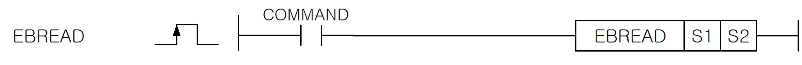
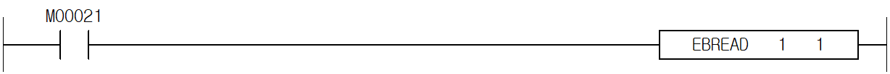
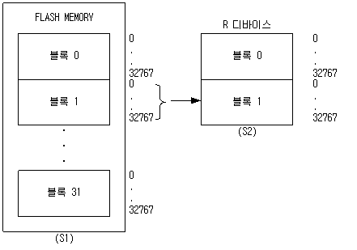

# EBREAD

Manual section(s): 4.36.3. Original Korean notes below may cover the other variants on the same page; apply the widths and execution form of `EBREAD`.

## Editing route

Use `get_ir` → `apply_patch` for this instruction edit. `insert_ladder_instruction` is the internal writer route, not a separate MCP tool. Preserve the exported revision and native constraints.
The writer mnemonic is `EBREAD`; the catalog records opcode `1033` and `2` operands in order.
Inspect the CPU/project and target cells first. Use the inspected revision and positions, preserve expected values, dry-run when useful, then save and inspect the result. See the [editing skill](../../SKILL.md) and [ladder workflow](../ladder.md).

## Operands

| Order | Operand | Description (Korean manual) | Reviewed types | Device areas | Constant |
| --- | --- | --- | --- | --- | --- |
| 1 | S1 | 플래시 영역의 블록번호 ( 0 ~ 31 ) | WORD | PMK, L, Z, U, N, D | Allowed |
| 2 | S2 | 저장할 R디바이스의 블록 번호 ( 0 ~ 1 ) | WORD | PMK, L, Z, U, N, D | Allowed |

These are the current library's reviewed operand rules. A shared type union is not a per-variant type choice; use the manual behavior to select the required width. Missing permissions stay unknown.

## CPU and acceptance

No separately reviewed CPU-model restriction is available in the current catalog; this means unknown, not universal compatibility.
Check the applicable model, firmware, modules and memory spans stated in the manual notes. Local parsing, writer validation and IL conversion do not prove native compilation or PLC behavior. Native acceptance requires XG5000 Open → Check Program → Save As → comparison.

## Manual behavior notes (Korean)

- EBREAD (플래시 메모리 블록 읽기)
- S1으로 지정된 플래시내의 1개의 블록 내용을 S2에 해당하는 내부램내의 블록으로 읽어 옵니다.
- 수행 완료여부는 해당 블록번호에 해당하는 읽기 플래그를 확인하면 알 수 있습니다.

## Manual applicability and restrictions

- 적용 기종 : XGK, XGB(XBC-SU/H/U)

## Manual flag and step matrix

The shared usage table marks affected flags with `O`, and `-` where it lists no effect. Native steps are the manual's instruction size, not the number of operand arguments. Conditions for setting/clearing flags are in the behavior notes.

| Manual instruction group | Native steps | 에러 (F110) | 제로 (F111) | 캐리 (F112) |
| --- | --- | --- | --- | --- |
| EBREAD | 2~4 | - | - | - |

## Referenced manual figures

These figures belong to the shared source topic. Read the source corrections above before using variant-specific layouts or example values.

## Provenance

Source: `XGK(B)InstructionHelp_Kr_V3.5.chm`, SHA-256 `b866d589d800addcb039f9f09b182592464d6367faa55abf6dde9ac34a1580e0`.

- `4363ebread.htm` — §4.36.3; source SHA-256 `64dab88e410653b6778e34fd9d7b4fab634b0762fd5a7f98b68315ce1da5001f`.
- Additional behavior/operand evidence: `4363ebread.htm`.
