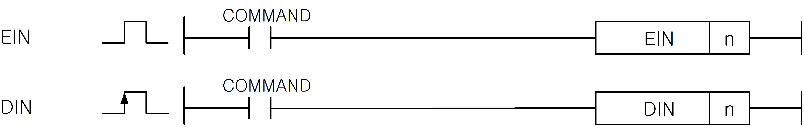
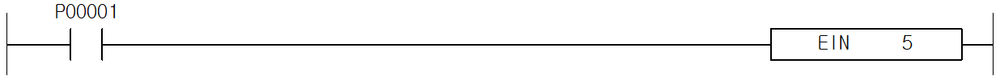
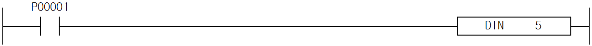

# EIN

Manual section(s): 4.34.2. Original Korean notes below may cover the other variants on the same page; apply the widths and execution form of `EIN`.

## Editing route

Use `get_ir` → `apply_patch` for this instruction edit. `insert_ladder_instruction` is the internal writer route, not a separate MCP tool. Preserve the exported revision and native constraints.
The writer mnemonic is `EIN`; the catalog records opcode `909` and `1` operands in order.
Inspect the CPU/project and target cells first. Use the inspected revision and positions, preserve expected values, dry-run when useful, then save and inspect the result. See the [editing skill](../../SKILL.md) and [ladder workflow](../ladder.md).

## Operands

| Order | Operand | Description (Korean manual) | Reviewed types | Device areas | Constant |
| --- | --- | --- | --- | --- | --- |
| 1 | n | 지정하고자 하는 태스크 번호 | WORD | None | Allowed |

These are the current library's reviewed operand rules. A shared type union is not a per-variant type choice; use the manual behavior to select the required width. Missing permissions stay unknown.

## CPU and acceptance

No separately reviewed CPU-model restriction is available in the current catalog; this means unknown, not universal compatibility.
Check the applicable model, firmware, modules and memory spans stated in the manual notes. Local parsing, writer validation and IL conversion do not prove native compilation or PLC behavior. Native acceptance requires XG5000 Open → Check Program → Save As → comparison.

## Manual behavior notes (Korean)

- EIN
- n으로 지정된 태스크 프로그램을 실행시킵니다.
- 인터럽트5 인에이블 시:
- DIN
- n으로 지정된 태스크 프로그램을 중지시킵니다.
- 인터럽트5 디스에이블 시:
- 태스크 번호는 다음과 같습니다.

| 태스크 | XGK | XGB |
| --- | --- | --- |
| 정주기 태스크 | 0 ~ 31 | 0 ~ 7 |
| 외부접점 태스크 | 32 ~ 63 (XGK시리즈에서는 설정 불가) | 8 ~ 15 |
| 내부접점 태스크 | 64 ~ 95 | 16 ~ 23 |

## Manual applicability and restrictions

- 적용 기종 : XGK, XGB

## Manual flag and step matrix

The shared usage table marks affected flags with `O`, and `-` where it lists no effect. Native steps are the manual's instruction size, not the number of operand arguments. Conditions for setting/clearing flags are in the behavior notes.

| Manual instruction group | Native steps | 에러 (F110) | 제로 (F111) | 캐리 (F112) |
| --- | --- | --- | --- | --- |
| EIN / DIN | 1 | - | - | - |

## Referenced manual figures

These figures belong to the shared source topic. Read the source corrections above before using variant-specific layouts or example values.

## Provenance

Source: `XGK(B)InstructionHelp_Kr_V3.5.chm`, SHA-256 `b866d589d800addcb039f9f09b182592464d6367faa55abf6dde9ac34a1580e0`.

- `4342eindin1.htm` — §4.34.2; source SHA-256 `ab5fa80177481a88ef75dc6148437b54b258244e2453ef2fd7cc380f5ea69df3`.
- Additional behavior/operand evidence: `4342eindin1.htm`.
