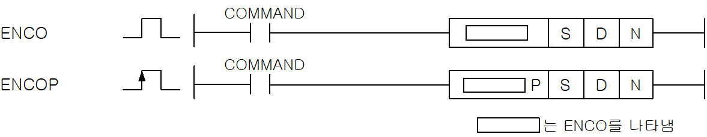
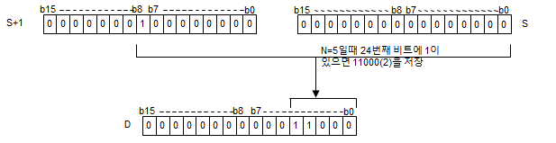

# ENCO

Manual section(s): 4.24.3. Original Korean notes below may cover the other variants on the same page; apply the widths and execution form of `ENCO`.

Execution form: the source explicitly pairs this command as `(P)`; `ENCO` is the non-P partner. Manual §2.4.2 defines `P` as pulse-type notation. Select the paired forms deliberately and retain the instruction's actual execution conditions; unrelated mnemonics ending in P are not classified by suffix alone.

## Editing route

Use `get_ir` → `apply_patch` for this instruction edit. `insert_ladder_instruction` is the internal writer route, not a separate MCP tool. Preserve the exported revision and native constraints.
The writer mnemonic is `ENCO`; the catalog records opcode `263` and `3` operands in order.
Inspect the CPU/project and target cells first. Use the inspected revision and positions, preserve expected values, dry-run when useful, then save and inspect the result. See the [editing skill](../../SKILL.md) and [ladder workflow](../ladder.md).

## Operands

| Order | Operand | Description (Korean manual) | Reviewed types | Device areas | Constant |
| --- | --- | --- | --- | --- | --- |
| 1 | S | ENCO연산을 실행할 데이터 또는 주소 | WORD | PMK, F, L, T, C, Z, U, N, D, R | Allowed |
| 2 | D | 연산 결과를 저장할 주소 | WORD | PMK, L, T, C, Z, U, N, D, R | Not allowed |
| 3 | N | ENCO할 비트의 승수로 1~8까지 지정 가능합니다. | WORD | PMK, F, L, T, C, Z, U, N, D, R | Allowed |

These are the current library's reviewed operand rules. A shared type union is not a per-variant type choice; use the manual behavior to select the required width. Missing permissions stay unknown.

## CPU and acceptance

No separately reviewed CPU-model restriction is available in the current catalog; this means unknown, not universal compatibility.
Check the applicable model, firmware, modules and memory spans stated in the manual notes. Local parsing, writer validation and IL conversion do not prove native compilation or PLC behavior. Native acceptance requires XG5000 Open → Check Program → Save As → comparison.

## Manual flags

- ENCO (Encode)
- S의 디바이스에 저장된 데이터의 유효 비트2N 개 중에서 최상위에 있는 1의 위치를 수치화 하여 D로 지정한 디바이스에 16진수로 저장합니다.
- S가 상수로 입력되면 N의 값이 4 (검색 비트수 16) 를 넘어가도 입력된 변수 값 영역에서 인코딩 됩니다.
- N = 0일 때에는 D의 내용은 변화하지 않습니다.
- 2N영역내 1이 있는 최상 접점 위치를 수치화(Hex값)하여 D에 저장합니다.

| 플래그 | 내 용 | 디바이스 번호 |
| --- | --- | --- |
| 에러 | 유효 비트수 N이 0 ~ 8이외의 값일 때 S부터 시작된 유효 비트수가 디바이스 영역을 초과했을 때 | F110 |
| 제로 | 유효 2N의 데이터가 제로일 때 | F111 |

## Manual applicability and restrictions

- 적용 기종 : XGK, XGB

## Manual flag and step matrix

The shared usage table marks affected flags with `O`, and `-` where it lists no effect. Native steps are the manual's instruction size, not the number of operand arguments. Conditions for setting/clearing flags are in the behavior notes.

| Manual instruction group | Native steps | 에러 (F110) | 제로 (F111) | 캐리 (F112) |
| --- | --- | --- | --- | --- |
| ENCO(P) | 4~6 | O | O | - |

## Referenced manual figures

These figures belong to the shared source topic. Read the source corrections above before using variant-specific layouts or example values.

## Provenance

Source: `XGK(B)InstructionHelp_Kr_V3.5.chm`, SHA-256 `b866d589d800addcb039f9f09b182592464d6367faa55abf6dde9ac34a1580e0`.

- `4243encoencop.htm` — §4.24.3; source SHA-256 `f22db5dd27efc9efa26bb853256552ab2aca4efb353d123e8377053792f057ac`.
- Additional behavior/operand evidence: `4243encoencop.htm`, `245.htm`.
