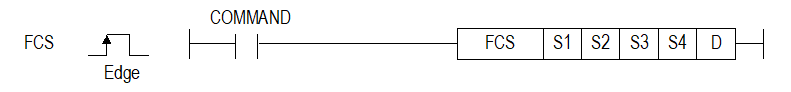

# FCS

Manual section(s): 4.40.18. Original Korean notes below may cover the other variants on the same page; apply the widths and execution form of `FCS`.

## Editing route

Use `get_ir` → `apply_patch` for this instruction edit. `insert_ladder_instruction` is the internal writer route, not a separate MCP tool. Preserve the exported revision and native constraints.
The writer mnemonic is `FCS`; the catalog records opcode `1580` and `5` operands in order.
Inspect the CPU/project and target cells first. Use the inspected revision and positions, preserve expected values, dry-run when useful, then save and inspect the result. See the [editing skill](../../SKILL.md) and [ladder workflow](../ladder.md).

## Operands

| Order | Operand | Description (Korean manual) | Reviewed types | Device areas | Constant |
| --- | --- | --- | --- | --- | --- |
| 1 | S1 | Check할 DATA가 저장된 시작 디바이스 번호 | BYTE | Unknown | Unknown |
| 2 | S2 | Check 할 DATA의 사이즈 (1~1024 byte) | WORD | Unknown | Unknown |
| 3 | S3 | Check Type (1 ~ 17) | WORD | Unknown | Unknown |
| 4 | S4 | Return Value Ascii 설정 (0: Hexa Value, 1: Ascii Value) | WORD | Unknown | Unknown |
| 5 | D | FCS Return Value | DWORD | Unknown | Unknown |

These are the current library's reviewed operand rules. A shared type union is not a per-variant type choice; use the manual behavior to select the required width. Missing permissions stay unknown.

## CPU and acceptance

Reviewed XGK model table: XGK-CPUUN, XGK-CPUHN, XGK-CPUSN (`44018fcs.htm`).
Check the applicable model, firmware, modules and memory spans stated in the manual notes. Local parsing, writer validation and IL conversion do not prove native compilation or PLC behavior. Native acceptance requires XG5000 Open → Check Program → Save As → comparison.

## Manual behavior notes (Korean)

- 이 명령은 FCS(Frame Check Sequence)실행하는 명령 입니다.
- S1은 Check할 DATA가 저장된 시작 디바이스 번호를 나타냅니다.
- S2은 Check할 DATA의 사이즈를 나타냅니다.
- S3은 FCS의 Type을 지정합니다.
- S4은 Return Value의 Ascii설정을 지정합니다.
- D는 FCS의 결과값을 저장하는 디바이스 번호를 나타냅니다.
- S1~S4의 범위가 벗어난 경우 에러 플래그(F110)가 Set됩니다.
- 오퍼랜드 S1 Byte Type인 경우 Bit로 접근하므로FCS Type중 Byte 계산의 경우 Byte Align을 맞춰 입력해야 합니다.
- EX. D00000의 다음 번지의 경우 D00000.8로 입력하며 D00000.1~D00000.7또는 D00000.9~D00000.F입력 시 에러를 발생시킵니다.
- FCS Type 중 Word단위인 경우 Word Align을 맞춰 입력해야 합니다.
- Align이 맞지 않는 경우 다음과 같이 계산합니다. (Word Align의 경우 에러를 발생시키지 않음)
- (1) 0x10번지부터 Size 5 Byte인 경우 -> 0x10번지부터 4 Byte를 계산 (1Byte 포함하지 않음)
- (2) 0x11번지부터 Size 5 Byte인 경우 -> 0x10번지부터 4 Byte를 계산 (1Byte 포함하지 않음)
- (3) 0x11번지부터 Size 4 Byte인 경우 -> 0x10번지부터 4 Byte를 계산

| FCS Type | 내용 | 단위 |
| --- | --- | --- |
| 1 | BYTE SUM | Byte |
| 2 | WORD SUM | Word |
| 3 | BYTE XOR | Byte |
| 4 | DLE AB | Byte |
| 5 | DLE SIEMENS | Byte |
| 6 | LSIS CRC | Word |
| 7 | BYTE SUM 2’s COMP | Byte |
| 8 | CRC 8 | Byte |
| 9 | CRC 16 | Word |
| 10 | BYTE SUM 1’s COMP | Byte |
| 11 | 7BIT SUM | Byte |
| 12 | 7BIT XOR | Byte |
| 13 | CRC 16 IBM | Word |
| 14 | CRC 16 CCITT | Word |
| 15 | MODBUS CRC | Word |
| 16 | MODBUS ASCII | Byte |
| 17 | BYTE SUM NIBBLE ASCII | Byte |

## Manual applicability and restrictions

| 지원 기종 | XGK | XGK | XGK | XGK | XGK | XGK-N | XGK-N | XGK-N | XBC-U | XBC-U | XBC-U | XBC-U | XBM | XBM |
| --- | --- | --- | --- | --- | --- | --- | --- | --- | --- | --- | --- | --- | --- | --- |
| 지원 기종 | U | H | A | S | E | UN | HN | SN | U | H | SU | E | S | H(P) |
| 지원 기종 | X | X | X | X | X | O | O | O | X | X | X | X | X | X |

## Manual flag and step matrix

The shared usage table marks affected flags with `O`, and `-` where it lists no effect. Native steps are the manual's instruction size, not the number of operand arguments. Conditions for setting/clearing flags are in the behavior notes.

| Manual instruction group | Native steps | 에러 (F110) | 제로 (F111) | 캐리 (F112) |
| --- | --- | --- | --- | --- |
| FCS | 4~7 | O | - | - |

## Referenced manual figures

These figures belong to the shared source topic. Read the source corrections above before using variant-specific layouts or example values.

## Provenance

Source: `XGK(B)InstructionHelp_Kr_V3.5.chm`, SHA-256 `b866d589d800addcb039f9f09b182592464d6367faa55abf6dde9ac34a1580e0`.

- `44018fcs.htm` — §4.40.18; source SHA-256 `6023da7d4f8e91acb1d38671c1fdd669dc8039584c0ff76f0b104c6c7c496cb8`.
- Additional behavior/operand evidence: `44018fcs.htm`.
