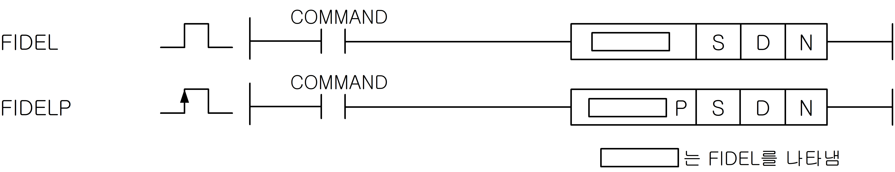
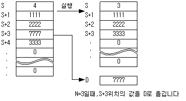

# FIDEL

Manual section(s): 4.25.5. Original Korean notes below may cover the other variants on the same page; apply the widths and execution form of `FIDEL`.

Execution form: the source explicitly pairs this command as `(P)`; `FIDEL` is the non-P partner. Manual §2.4.2 defines `P` as pulse-type notation. Select the paired forms deliberately and retain the instruction's actual execution conditions; unrelated mnemonics ending in P are not classified by suffix alone.

## Editing route

Use `get_ir` → `apply_patch` for this instruction edit. `insert_ladder_instruction` is the internal writer route, not a separate MCP tool. Preserve the exported revision and native constraints.
The writer mnemonic is `FIDEL`; the catalog records opcode `286` and `3` operands in order.
Inspect the CPU/project and target cells first. Use the inspected revision and positions, preserve expected values, dry-run when useful, then save and inspect the result. See the [editing skill](../../SKILL.md) and [ladder workflow](../ladder.md).

## Operands

| Order | Operand | Description (Korean manual) | Reviewed types | Device areas | Constant |
| --- | --- | --- | --- | --- | --- |
| 1 | S | 데이터 테이블 시작 위치 | WORD | PMK, F, L, T, C, Z, U, N, D, R | Not allowed |
| 2 | D | 삭제된 데이터 값 | WORD | PMK, L, N, D, R | Not allowed |
| 3 | N | 삭제할 데이터 위치 | WORD | PMK, F, L, T, C, Z, U, N, D, R | Allowed |

These are the current library's reviewed operand rules. A shared type union is not a per-variant type choice; use the manual behavior to select the required width. Missing permissions stay unknown.

## CPU and acceptance

No separately reviewed CPU-model restriction is available in the current catalog; this means unknown, not universal compatibility.
Check the applicable model, firmware, modules and memory spans stated in the manual notes. Local parsing, writer validation and IL conversion do not prove native compilation or PLC behavior. Native acceptance requires XG5000 Open → Check Program → Save As → comparison.

## Manual flags

- FIDEL (File Delete)
- S로 지정된 데이터 테이블의 N번째 데이터를 D로 옮깁니다. N번째 이후의 데이터들은 원래 위치에서 1 감소된 위치로 당겨집니다.
- S로 지정된 값은 데이터 테이블 내의 유효 데이터 갯수입니다.
- N이 0이면 명령어는 동작하지 않습니다.
- 데이터가 테이블에서 삭제되면 데이터 테이블 크기+1 에 있는 값은 0으로 채워집니다.

| 플래그 | 내 용 | 디바이스 번호 |
| --- | --- | --- |
| 에러 | 데이터 테이블의 범위가 해당 디바이스 범위를 벗어날 때 삭제할 데이터 위치가 테이블 데이터 크기를 넘었을 때 | F110 |

## Manual applicability and restrictions

- 적용 기종 : XGK, XGB

## Manual flag and step matrix

The shared usage table marks affected flags with `O`, and `-` where it lists no effect. Native steps are the manual's instruction size, not the number of operand arguments. Conditions for setting/clearing flags are in the behavior notes.

| Manual instruction group | Native steps | 에러 (F110) | 제로 (F111) | 캐리 (F112) |
| --- | --- | --- | --- | --- |
| FIDEL(P) | 4~6 | O | - | - |

## Referenced manual figures

These figures belong to the shared source topic. Read the source corrections above before using variant-specific layouts or example values.

## Provenance

Source: `XGK(B)InstructionHelp_Kr_V3.5.chm`, SHA-256 `b866d589d800addcb039f9f09b182592464d6367faa55abf6dde9ac34a1580e0`.

- `4255fidelfidelp1.htm` — §4.25.5; source SHA-256 `220da62eeb2bfdfe7623623bcd5b01c6ae96eeb117fb5818a0eae6435edef309`.
- Additional behavior/operand evidence: `4255fidelfidelp1.htm`, `245.htm`.
