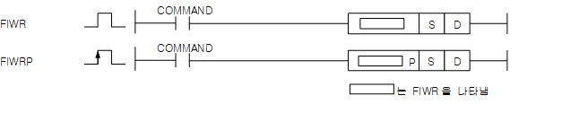
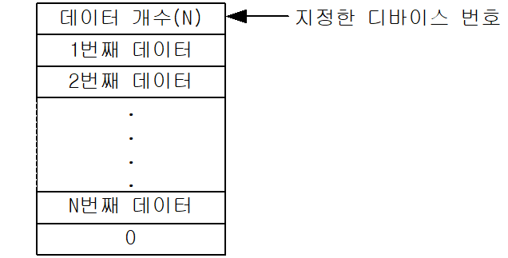
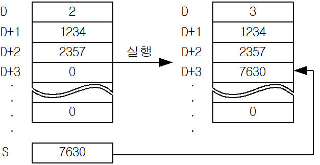

# FIWRP

Manual section(s): 4.25.1. Original Korean notes below may cover the other variants on the same page; apply the widths and execution form of `FIWRP`.

Execution form: the source explicitly pairs this command as `(P)`; `FIWRP` is the pulse-type P form. Manual §2.4.2 defines `P` as pulse-type notation. Select the paired forms deliberately and retain the instruction's actual execution conditions; unrelated mnemonics ending in P are not classified by suffix alone.

## Editing route

Use `insert_ladder_instruction` after calling `describe_operation` for its current schema.
The writer mnemonic is `FIWRP`; the catalog records opcode `662` and `2` operands in order.
Inspect the CPU/project and target cells first. Use the inspected revision and positions, preserve expected values, dry-run when useful, then save and inspect the result. See the [editing skill](../../SKILL.md) and [ladder workflow](../ladder.md).

## Operands

| Order | Operand | Description (Korean manual) | Reviewed types | Device areas | Constant |
| --- | --- | --- | --- | --- | --- |
| 1 | S | 입력할 데이터 | WORD | PMK, F, L, T, C, Z, U, N, D, R | Allowed |
| 2 | D | 테이블 시작위치 | WORD | PMK, L, N, D, R | Not allowed |

These are the current library's reviewed operand rules. A shared type union is not a per-variant type choice; use the manual behavior to select the required width. Missing permissions stay unknown.

## CPU and acceptance

No separately reviewed CPU-model restriction is available in the current catalog; this means unknown, not universal compatibility.
Check the applicable model, firmware, modules and memory spans stated in the manual notes. Local parsing, writer validation and IL conversion do not prove native compilation or PLC behavior. Native acceptance requires XG5000 Open → Check Program → Save As → comparison.

## Manual flags

- 파일 테이블 구조
- 테이블 처리 명령은 테이블의 형태가 다음과 같아야 정상적인 수행을 합니다.
- 테이블의 크기는 사용자가 어떻게 운용하느냐에 따라 결정됩니다. 데이터 테이블 처리 관련 명령어에서는 테이블 시작 위치로 지정된 디바이스에 저장된 데이터 개수를 보고 데이터 테이블의 크기를 판단합니다.
- 테이블을 사용하고자 한다면 테이블의 초기화가 필요합니다. 테이블의 크기가 해당 디바이스의 범위를 벗어나면 에러가 발생됩니다.
- 모든 테이블 처리 명령어는 테이블의 끝에 NULL(0) 을 붙여줍니다. 그러나 테이블의 끝을 인식하는 방법을 테이블 시작 주소에 지정된 데이터 개수만을 보고 판단합니다.
- 모든 테이블 내의 데이터는 WORD 형으로 인식이 됩니다. 테이블에 INT 형이나 BYTE 형 데이터를 저장하고자 할 때에는 MOVE 명령어 등을 통해 디바이스 데이터 타입 변경을 해주어야 합니다.
- DWORD 데이터를 저장하기 위해서는 삽입, 삭제 동작을 반복하여 사용해야 합니다.
- 데이터 테이블의 크기 제한은 지정되어 있지 않습니다. 그러나 테이블은 디바이스 영역을 벗어날 수 없으므로 테이블의 최대 크기는 테이블이 위치하는 디바이스의 크기에서 테이블 시작 주소를 뺀 값이 됩니다.
- 모든 테이블 관련 명령어는 데이터 개수를 변경 가능하지만 데이터 개수의 변경에 대한 오류는 검사하지 못합니다.
- 사용자가 임의로 데이터 개수를 변경시켜도 테이블 처리 명령어는 이를 알지 못하고 정상으로 처리합니다.
- 사용자는 사전에 충분한 테이블 영역과 테이블 크기를 확보하고 테이블 명령을 사용하기 전에 영역 검사를 할 것을 권장합니다.
- FIWR (File Write)
- D로 지정된 데이터 테이블에 S로 지정된 데이터를 저장합니다. 이때 저장 위치는 지정한 D위치부터 (현재 데이터 개수+1) 워드 위치에 저장됩니다.
- D로 지정된 값은 데이터 테이블 내의 유효 데이터 개수입니다.

| 플래그 | 내 용 | 디바이스 번호 |
| --- | --- | --- |
| 에러 | 데이터가 추가된 후의 데이터 테이블의 범위가 해당 디바이스 범위를 벗어날 때 | F110 |

## Manual applicability and restrictions

- 적용 기종 : XGK, XGB

## Manual flag and step matrix

The shared usage table marks affected flags with `O`, and `-` where it lists no effect. Native steps are the manual's instruction size, not the number of operand arguments. Conditions for setting/clearing flags are in the behavior notes.

| Manual instruction group | Native steps | 에러 (F110) | 제로 (F111) | 캐리 (F112) |
| --- | --- | --- | --- | --- |
| FIWR(P) | 2~4 | O | - | - |

## Referenced manual figures

These figures belong to the shared source topic. Read the source corrections above before using variant-specific layouts or example values.

## Provenance

Source: `XGK(B)InstructionHelp_Kr_V3.5.chm`, SHA-256 `b866d589d800addcb039f9f09b182592464d6367faa55abf6dde9ac34a1580e0`.

- `4251fiwrfiwrp1.htm` — §4.25.1; source SHA-256 `9508011ac036d7d6d58596211637b1f2cb0798c16124d1fa1434cb77a6f8fc6a`.
- Additional behavior/operand evidence: `4251fiwrfiwrp1.htm`, `245.htm`.
