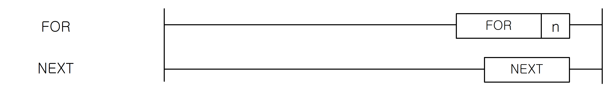

# FOR

Repeat the enclosed FOR..NEXT instructions n times in the scan.

Manual section(s): 4.31.1. Original Korean notes below may cover the other variants on the same page; apply the widths and execution form of `FOR`.

## Editing route

Use `insert_ladder_instruction` after calling `describe_operation` for its current schema.
The writer mnemonic is `FOR`; the catalog records opcode `6` and `1` operands in order.
Inspect the CPU/project and target cells first. Use the inspected revision and positions, preserve expected values, dry-run when useful, then save and inspect the result. See the [editing skill](../../SKILL.md) and [ladder workflow](../ladder.md).

## Behavior

- Execute the loop body n times, then continue after NEXT. BREAK can leave the loop.

## Instruction constraints

- n is in 0..65,535. Nesting is limited to 16. Account for increased scan time and the configured watchdog.

## Operands

| Order | Operand | Description (Korean manual) | Reviewed types | Device areas | Constant |
| --- | --- | --- | --- | --- | --- |
| 1 | n | FOR~NEXT를 수행할 횟수 | WORD | PMK, L, T, C, Z, U, N, D, R | Allowed |

These are the current library's reviewed operand rules. A shared type union is not a per-variant type choice; use the manual behavior to select the required width. Missing permissions stay unknown.

## CPU and acceptance

No separately reviewed CPU-model restriction is available in the current catalog; this means unknown, not universal compatibility.
Check the applicable model, firmware, modules and memory spans stated in the manual notes. Local parsing, writer validation and IL conversion do not prove native compilation or PLC behavior. Native acceptance requires XG5000 Open → Check Program → Save As → comparison.

## Manual behavior notes (Korean)

- FOR~NEXT
- PLC가 RUN 모드에서 FOR를 만나면 FOR~NEXT 명령간의 처리를 n회 실행한 후 NEXT 명령의 다음 스텝을 실행합니다.
- n은 0 ~ 65535까지 지정 가능합니다.
- FOR~NEXT의 가능한 NESTING 개수는 16개까지 입니다. 이를 초과시에는 프로그램 다운로드가 되지 않습니다.
- FOR~NEXT 루프를 빠져 나오는 다른 방법은 BREAK 명령을 사용합니다.
- 스캔 시간이 길어질 수 있으므로, WDT 명령을 사용하여 WDT 설정치를 넘지 않도록 주의하여 주십시오.

## Manual applicability and restrictions

- 적용 기종 : XGK, XGB

## Manual flag and step matrix

The shared usage table marks affected flags with `O`, and `-` where it lists no effect. Native steps are the manual's instruction size, not the number of operand arguments. Conditions for setting/clearing flags are in the behavior notes.

| Manual instruction group | Native steps | 에러 (F110) | 제로 (F111) | 캐리 (F112) |
| --- | --- | --- | --- | --- |
| FOR | 2 | O | - | - |
| NEXT | 1 | O | - | - |

## Referenced manual figures

These figures belong to the shared source topic. Read the source corrections above before using variant-specific layouts or example values.

## Provenance

Source: `XGK(B)InstructionHelp_Kr_V3.5.chm`, SHA-256 `b866d589d800addcb039f9f09b182592464d6367faa55abf6dde9ac34a1580e0`.

- `4311fornext.htm` — §4.31.1; source SHA-256 `384710c96d1b83820f6d6b6aea11ed27a63625903be21283a93ceebe26e0acd3`.
- Additional behavior/operand evidence: `4311fornext.htm`.
