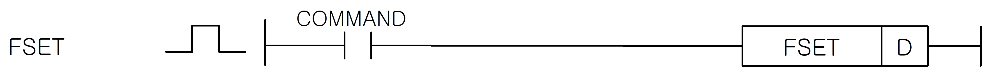

# FSET

Manual section(s): 4.37.1. Original Korean notes below may cover the other variants on the same page; apply the widths and execution form of `FSET`.

## Editing route

Use `get_ir` → `apply_patch` for this instruction edit. `insert_ladder_instruction` is the internal writer route, not a separate MCP tool. Preserve the exported revision and native constraints.
The writer mnemonic is `FSET`; the catalog records opcode `1061` and `1` operands in order.
Inspect the CPU/project and target cells first. Use the inspected revision and positions, preserve expected values, dry-run when useful, then save and inspect the result. See the [editing skill](../../SKILL.md) and [ladder workflow](../ladder.md).

## Operands

| Order | Operand | Description (Korean manual) | Reviewed types | Device areas | Constant |
| --- | --- | --- | --- | --- | --- |
| 1 | D | F영역 중 XGK는 F10240 ~ F2047F 영역/XGB는 F2000 ~ F255F | BIT | F | Not allowed |

These are the current library's reviewed operand rules. A shared type union is not a per-variant type choice; use the manual behavior to select the required width. Missing permissions stay unknown.

## CPU and acceptance

No separately reviewed CPU-model restriction is available in the current catalog; this means unknown, not universal compatibility.
Check the applicable model, firmware, modules and memory spans stated in the manual notes. Local parsing, writer validation and IL conversion do not prove native compilation or PLC behavior. Native acceptance requires XG5000 Open → Check Program → Save As → comparison.

## Manual behavior notes (Korean)

- FSET
- 이 명령은 특수 릴레이 영역인 F영역 중 F10240~F2047F 사이의 비트를 셋(Set)하는 명령입니다.
- 이 명령으로 제어 가능한 F영역은 다음과 같습니다.
- 접점 용도
- F10240(XGB는 지원안함) : 시계 정보 데이터 영역인 F1034~F1037에 각 영역에 맞는 시계 데이터를 옮긴 후 F10240 비트를 FSET명령을 이용해 On 시키면 F1034~F1037영역의 시계 데이터가 PLC의 RTC값으로 반영됩니다.
- 이때, 셋(Set)되었던 F10240비트는 RTC에 데이터가 반영된 이후 자동리셋 됩니다.
- F10241(XGB:F2001) : _SCAN_MAX, _SCAN_MIN, _SCAN_CUR 값을 초기화시킵니다.
- F10242(XGB:F2002) : 이 비트가 셋(Set)되면 F1026영역에 있는 값이 0이 아닐경우, 중고장 에러가 발생합니다. 중고장 에러가 발생하면 PLC 운전상태는 에러상태가 됩니다.
- F10243(XGB:F2003) : F10242 비트와 마찬가지로 이 비트가 셋(Set)되면 F1027영역에 있는 값이 0이 아닐경우, 경고장 경고가 발생합니다.
- 경고장 경고가 발생하면, CPU모듈의 P.S. LED와 CHK LED가 On됩니다. 이 경고를 해제할려면 F1027영역에 0을 쓰고 다시 F10242비트를 셋(Set)시키면 해제됩니다.
- F10242, F10243에 대한 자세한 설명은 CPU설명서 6.7장을 참조하시기 바랍니다.

| 플래그 이름 | 데이터 크기 | 접점 | 접점 | 용도 | 비고 |
| --- | --- | --- | --- | --- | --- |
| 플래그 이름 | 데이터 크기 | XGK | XGB | 용도 | 비고 |
| _RTC_WR | BIT | F10240 | - | RTC에 데이터 쓰기 | XGB:미지원 |
| _SCAN_WR | BIT | F10241 | F2001 | 스캔 값 초기화 |  |
| _CHK_ANC_ERR | BIT | F10242 | F2002 | 외부 기기 중고장 검출 요청 |  |
| _CHK_ANC_WAR | BIT | F10243 | F2003 | 외부 기기 경고장 검출 요청 |  |
| _INIT_DONE | BIT | F10250 | F2010 | 초기화 태스크 수행 완료 |  |
| _ANC_ERR[n] | WORD | F1026 | F0202 | 외부 기기의 중고장 정보 |  |
| _ANC_WAR[n] | WORD | F1027 | F0203 | 외부 기기의 경고장 정보 |  |
| _MON_YEAR_DT | WORD | F1034 | - | 시계 정보 데이터(월/년) | XGB:미지원 |
| _TIME_DAY_DT | WORD | F1035 | - | 시계 정보 데이터(시/일) | XGB:미지원 |
| _SEC_MIN_DT | WORD | F1036 | - | 시계 정보 데이터(초/분) | XGB:미지원 |
| _HUND_WK_DT | WORD | F1037 | - | 시계 정보 데이터(백년/요일) | XGB:미지원 |

## Manual applicability and restrictions

- 적용 기종 : XGK, XGB

## Manual flag and step matrix

The shared usage table marks affected flags with `O`, and `-` where it lists no effect. Native steps are the manual's instruction size, not the number of operand arguments. Conditions for setting/clearing flags are in the behavior notes.

| Manual instruction group | Native steps | 에러 (F110) | 제로 (F111) | 캐리 (F112) |
| --- | --- | --- | --- | --- |
| FSET | 2 | - | - | - |

## Referenced manual figures

These figures belong to the shared source topic. Read the source corrections above before using variant-specific layouts or example values.

## Provenance

Source: `XGK(B)InstructionHelp_Kr_V3.5.chm`, SHA-256 `b866d589d800addcb039f9f09b182592464d6367faa55abf6dde9ac34a1580e0`.

- `4371fset.htm` — §4.37.1; source SHA-256 `3b6b70e4bbd2d1e2ba7ca2a183363c70262f8d28c5d2739f4724a80f06ef8ac8`.
- Additional behavior/operand evidence: `4371fset.htm`.
