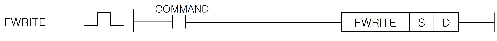

# FWRITE

Manual section(s): 4.37.3. Original Korean notes below may cover the other variants on the same page; apply the widths and execution form of `FWRITE`.

## Editing route

Use `get_ir` → `apply_patch` for this instruction edit. `insert_ladder_instruction` is the internal writer route, not a separate MCP tool. Preserve the exported revision and native constraints.
The writer mnemonic is `FWRITE`; the catalog records opcode `1063` and `2` operands in order.
Inspect the CPU/project and target cells first. Use the inspected revision and positions, preserve expected values, dry-run when useful, then save and inspect the result. See the [editing skill](../../SKILL.md) and [ladder workflow](../ladder.md).

## Operands

| Order | Operand | Description (Korean manual) | Reviewed types | Device areas | Constant |
| --- | --- | --- | --- | --- | --- |
| 1 | S | 데이터 또는 디바이스 번호 | WORD | PMK, F, L, T, C, Z, U, N, D | Allowed |
| 2 | D | F영역 중 XGK는F1024 ~ F2047, XGB는 F200 ~ F255 영역 | WORD | F | Not allowed |

These are the current library's reviewed operand rules. A shared type union is not a per-variant type choice; use the manual behavior to select the required width. Missing permissions stay unknown.

## CPU and acceptance

No separately reviewed CPU-model restriction is available in the current catalog; this means unknown, not universal compatibility.
Check the applicable model, firmware, modules and memory spans stated in the manual notes. Local parsing, writer validation and IL conversion do not prove native compilation or PLC behavior. Native acceptance requires XG5000 Open → Check Program → Save As → comparison.

## Manual behavior notes (Korean)

- FWRITE
- 이 명령은 특수 릴레이 영역인 F영역 중 F1024~F2047 워드에 임의의 값을 저장하는 명령어입니다.
- FWRITE로 저장된 값은 전원을 Off하면 지워집니다.
- 외부기기 중고장 검출이나 외부기기 경고장 검출시 워드 데이터를 각각의 영역에 저장하는데 사용될 수 있습니다.

## Manual applicability and restrictions

- 적용 기종 : XGK, XGB

## Manual flag and step matrix

The shared usage table marks affected flags with `O`, and `-` where it lists no effect. Native steps are the manual's instruction size, not the number of operand arguments. Conditions for setting/clearing flags are in the behavior notes.

| Manual instruction group | Native steps | 에러 (F110) | 제로 (F111) | 캐리 (F112) |
| --- | --- | --- | --- | --- |
| FWRITE | 2~3 | - | - | - |

## Referenced manual figures

These figures belong to the shared source topic. Read the source corrections above before using variant-specific layouts or example values.

## Provenance

Source: `XGK(B)InstructionHelp_Kr_V3.5.chm`, SHA-256 `b866d589d800addcb039f9f09b182592464d6367faa55abf6dde9ac34a1580e0`.

- `4373fwrite.htm` — §4.37.3; source SHA-256 `9c6ea154157adfd27af4f60e95ca8812f3d8abd546d55441822a77c79ceb4c0b`.
- Additional behavior/operand evidence: `4373fwrite.htm`.
