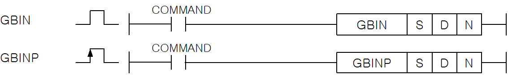

# GBIN

Manual section(s): 4.12.6. Original Korean notes below may cover the other variants on the same page; apply the widths and execution form of `GBIN`.

Execution form: the source explicitly pairs this command as `(P)`; `GBIN` is the non-P partner. Manual §2.4.2 defines `P` as pulse-type notation. Select the paired forms deliberately and retain the instruction's actual execution conditions; unrelated mnemonics ending in P are not classified by suffix alone.

## Editing route

Use `get_ir` → `apply_patch` for this instruction edit. `insert_ladder_instruction` is the internal writer route, not a separate MCP tool. Preserve the exported revision and native constraints.
The writer mnemonic is `GBIN`; the catalog records opcode `164` and `3` operands in order.
Inspect the CPU/project and target cells first. Use the inspected revision and positions, preserve expected values, dry-run when useful, then save and inspect the result. See the [editing skill](../../SKILL.md) and [ladder workflow](../ladder.md).

## Operands

| Order | Operand | Description (Korean manual) | Reviewed types | Device areas | Constant |
| --- | --- | --- | --- | --- | --- |
| 1 | S | BIN변환하고자 하는 BCD데이터 또는 그 데이터가 들어있는 디바이스 번호 | WORD | PMK, L, T, C, U, N, D, R | Not allowed |
| 2 | D | 변환된 BIN데이터를 저장할 디바이스 번호 | WORD | PMK, L, T, C, U, N, D, R | Not allowed |
| 3 | N | BIN변환을 하고자하는 총 데이터 개수 | WORD | PMK, L, T, C, U, N, D, R | Allowed |

These are the current library's reviewed operand rules. A shared type union is not a per-variant type choice; use the manual behavior to select the required width. Missing permissions stay unknown.

## CPU and acceptance

No separately reviewed CPU-model restriction is available in the current catalog; this means unknown, not universal compatibility.
Check the applicable model, firmware, modules and memory spans stated in the manual notes. Local parsing, writer validation and IL conversion do not prove native compilation or PLC behavior. Native acceptance requires XG5000 Open → Check Program → Save As → comparison.

## Manual behavior notes (Korean)

- S로 지정된 워드 데이터 N개의 BCD 값을 BIN데이터로 변환하여 각각을 D부터 순서대로 저장합니다.
- S로 지정된 디바이스의 BCD데이터(h0 ~ h9999)를 N으로 지정된 n개의 갯수만큼 GBIN로 변환하여 D에 저장합니다.
- S로 지정된 디바이스의 값이 BCD형태(h0 ~ h9999) 이외일때, 에러 플래그(F110)가 셋(Set)됩니다.

## Manual flags

| 플래그 | 내 용 | 디바이스 번호 |
| --- | --- | --- |
| 에러 | N개의 데이터 중에 그 값이 하나라도 BCD형태(h0~h9999)가 아닐 경우. N의 범위가 지정 영역을 초과할 경우 셋(Set). | F110 |

## Manual applicability and restrictions

- 적용 기종 : XGK, XGB

## Manual flag and step matrix

The shared usage table marks affected flags with `O`, and `-` where it lists no effect. Native steps are the manual's instruction size, not the number of operand arguments. Conditions for setting/clearing flags are in the behavior notes.

| Manual instruction group | Native steps | 에러 (F110) | 제로 (F111) | 캐리 (F112) |
| --- | --- | --- | --- | --- |
| GBIN(P) | 4~6 | O | - | - |

## Additional source notes after examples

The manual places some execution restrictions and timing conditions after its example heading. Retain those checks below. Example addresses and circuit assumptions describe the source example and are not defaults for a new program.

- 기본 파라미터에서 연산에러시 속행을 선택했을 경우, S로 지정된 N개 데이터 중 BCD형태가 아닌 값이 있으면 n개의 데이터 모두 무처리합니다.

## Referenced manual figures

These figures belong to the shared source topic. Read the source corrections above before using variant-specific layouts or example values.

## Provenance

Source: `XGK(B)InstructionHelp_Kr_V3.5.chm`, SHA-256 `b866d589d800addcb039f9f09b182592464d6367faa55abf6dde9ac34a1580e0`.

- `4126gbingbinp.htm` — §4.12.6; source SHA-256 `ee4df5714f2502f622b2e1859a8ddbfe9f377655dfa8e88079f4dccc1d0fd435`.
- Additional behavior/operand evidence: `4126gbingbinp.htm`, `245.htm`.
