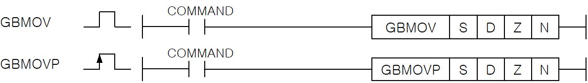
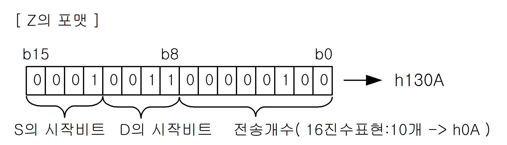

# GBMOVP

Apply the same bit-field transfer to a group of WORDs.

Manual section(s): 4.11.7. Original Korean notes below may cover the other variants on the same page; apply the widths and execution form of `GBMOVP`.

Execution form: the source explicitly pairs this command as `(P)`; `GBMOVP` is the pulse-type P form. Manual §2.4.2 defines `P` as pulse-type notation. Select the paired forms deliberately and retain the instruction's actual execution conditions; unrelated mnemonics ending in P are not classified by suffix alone.

## Editing route

Use `get_ir` → `apply_patch` for this instruction edit. `insert_ladder_instruction` is the internal writer route, not a separate MCP tool. Preserve the exported revision and native constraints.
The writer mnemonic is `GBMOVP`; the catalog records opcode `420` and `4` operands in order.
Inspect the CPU/project and target cells first. Use the inspected revision and positions, preserve expected values, dry-run when useful, then save and inspect the result. See the [editing skill](../../SKILL.md) and [ladder workflow](../ladder.md).

## Behavior

- Z defines the bit-field format and N is the number of WORDs.
- The manual example Z=h130A copies ten bits beginning at source bit 1 to destination bit 3 for each of N WORDs.
- This P-suffix variant executes once when the enabling input changes from Off to On.
- The inspected Z-format diagram assigns bits 15..12 to the source start bit, bits 11..8 to the destination start bit, and bits 7..0 to the transfer-bit count.

## Instruction constraints

- N is in 0..32,767. Out-of-range Z/N sets F110; use the packed source-bit/destination-bit/count fields.

## Source corrections

- Z-format image lib/NewItem2692.png labels h130A but draws low byte 00000100 (4). The h130A label, body and count caption agree on count 10 (h0A); do not copy the erroneous low-byte bit drawing.

## Operands

| Order | Operand | Description (Korean manual) | Reviewed types | Device areas | Constant |
| --- | --- | --- | --- | --- | --- |
| 1 | S | 데이터가 저장되어 있는 디바이스 번호 | WORD | PMK, F, L, T, C, Z, U, N, D, R | Allowed |
| 2 | D | Destination영역의 디바이스 번호 | WORD | PMK, L, T, C, Z, U, N, D, R | Not allowed |
| 3 | Z | GBMOV(P)를 실행하는 포맷 | WORD | PMK, F, L, T, C, Z, U, N, D, R | Allowed |
| 4 | N | GBMOV(P)를 실행하고자 하는 개수 (0 ~ 32,767) | WORD | PMK, F, L, Z, U, N, D, R | Allowed |

These are the current library's reviewed operand rules. A shared type union is not a per-variant type choice; use the manual behavior to select the required width. Missing permissions stay unknown.

## CPU and acceptance

No separately reviewed CPU-model restriction is available in the current catalog; this means unknown, not universal compatibility.
Check the applicable model, firmware, modules and memory spans stated in the manual notes. Local parsing, writer validation and IL conversion do not prove native compilation or PLC behavior. Native acceptance requires XG5000 Open → Check Program → Save As → comparison.

## Manual behavior notes (Korean)

- Z로 설정된 포맷에 의해 S의 데이터부터 N개 워드를 D로부터 차례로 그룹전송시킵니다.
- Z가 h130A일 경우 S의 1번 비트에서부터 총 10개의 비트 데이터를 D의 3번 비트에 차례로 N으로 지정된 워드수만큼 그룹전송시킵니다.
- 실행도중 영역의 초과가 발생할 경우 에러 플래그를 셋(Set)합니다.

## Manual flags

| 플래그 | 내 용 | 디바이스 번호 |
| --- | --- | --- |
| 에러 | Z의 범위가 지정 영역을 초과할 경우 셋(Set). 해당 명령어 결과는 처리되지 않음. N의 범위가 지정 영역을 초과할 경우 셋(Set). | F110 |

## Manual applicability and restrictions

- 적용 기종 : XGK, XGB

## Manual flag and step matrix

The shared usage table marks affected flags with `O`, and `-` where it lists no effect. Native steps are the manual's instruction size, not the number of operand arguments. Conditions for setting/clearing flags are in the behavior notes.

| Manual instruction group | Native steps | 에러 (F110) | 제로 (F111) | 캐리 (F112) |
| --- | --- | --- | --- | --- |
| GBMOV(P) | 4~7 | O | - | - |

## Referenced manual figures

These figures belong to the shared source topic. Read the source corrections above before using variant-specific layouts or example values.

## Provenance

Source: `XGK(B)InstructionHelp_Kr_V3.5.chm`, SHA-256 `b866d589d800addcb039f9f09b182592464d6367faa55abf6dde9ac34a1580e0`.

- `4117gbmovgbmovp1.htm` — §4.11.7; source SHA-256 `31fd14fd92f1bab9c4abfe78c853eac11ae8a8ca51fce6bf21a3aff5be4c3f06`.
- Additional behavior/operand evidence: `33.htm`, `4117gbmovgbmovp1.htm`, `245.htm`.
