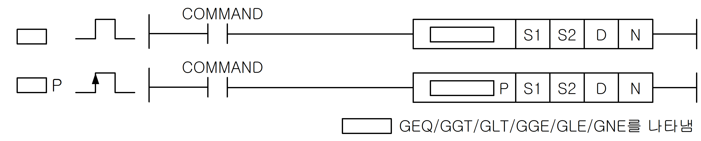
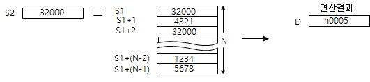

# GDGE

Manual section(s): 4.14.4. Original Korean notes below may cover the other variants on the same page; apply the widths and execution form of `GDGE`.

## Editing route

Use `insert_ladder_instruction` after calling `describe_operation` for its current schema.
The writer mnemonic is `GDGE`; the catalog records opcode `367` and `4` operands in order.
Inspect the CPU/project and target cells first. Use the inspected revision and positions, preserve expected values, dry-run when useful, then save and inspect the result. See the [editing skill](../../SKILL.md) and [ladder workflow](../ladder.md).

## Operands

| Order | Operand | Description (Korean manual) | Reviewed types | Device areas | Constant |
| --- | --- | --- | --- | --- | --- |
| 1 | S1 | S2와 비교하게 되는 데이터나 데이터 주소 | WORD | PMK, F, L, T, C, Z, U, D, R | Not allowed |
| 2 | S2 | S1과 비교하게 되는 데이터 주소 | WORD | PMK, F, L, T, C, Z, U, D, R | Allowed |
| 3 | D | 결과를 저장할 디바이스 영역(1워드) | WORD | PMK, L, T, C, Z, U, D, R | Not allowed |
| 4 | N | 비교 명령을 수행할 개수 (0 ~ 16) | WORD | PMK, F, L, T, C, Z, U, D, R | Allowed |

These are the current library's reviewed operand rules. A shared type union is not a per-variant type choice; use the manual behavior to select the required width. Missing permissions stay unknown.

## CPU and acceptance

No separately reviewed CPU-model restriction is available in the current catalog; this means unknown, not universal compatibility.
Check the applicable model, firmware, modules and memory spans stated in the manual notes. Local parsing, writer validation and IL conversion do not prove native compilation or PLC behavior. Native acceptance requires XG5000 Open → Check Program → Save As → comparison.

## Manual flags

- 워드 데이터 그룹 비교 명령
- 비교 데이터로 지정된 S1과 S2로 시작되는 워드 데이터 N개를 1대1 비교를 하여 비교 결과를D로 지정된 번호의 하위 비트부터 N번째 비트까지 비교결과를 저장합니다.
- 비교 조건을 만족하는 경우에는 D의 해당 비트에 1을 저장합니다.
- 비교 조건을 만족하지 않는 경우에는 D의 해당 비트에 0을 저장합니다.
- S1에는 0~65,535의 상수값을 입력할 수 있습니다. 이때 명령어의 동작은 다음과 같습니다.

| 플래그 | 내 용 | 디바이스 번호 |
| --- | --- | --- |
| 에러 | N의 범위가 지정 영역을 초과할 경우 셋(Set). | F110 |

## Manual applicability and restrictions

- 적용 기종 : XGK, XGB

## Manual flag and step matrix

The shared usage table marks affected flags with `O`, and `-` where it lists no effect. Native steps are the manual's instruction size, not the number of operand arguments. Conditions for setting/clearing flags are in the behavior notes.

| Manual instruction group | Native steps | 에러 (F110) | 제로 (F111) | 캐리 (F112) |
| --- | --- | --- | --- | --- |
| G X(P) GD X(P) | 4~6 | O | - | - |

## Referenced manual figures

These figures belong to the shared source topic. Read the source corrections above before using variant-specific layouts or example values.

## Provenance

Source: `XGK(B)InstructionHelp_Kr_V3.5.chm`, SHA-256 `b866d589d800addcb039f9f09b182592464d6367faa55abf6dde9ac34a1580e0`.

- `4144geqgeqpggtggtpgltgltpggeggep.htm` — §4.14.4; source SHA-256 `8ef9cdb4a75177433dcd22eba5cedf5e6c8386737fd3b267faca962af5635d4d`.
- Additional behavior/operand evidence: `4144geqgeqpggtggtpgltgltpggeggep.htm`.
