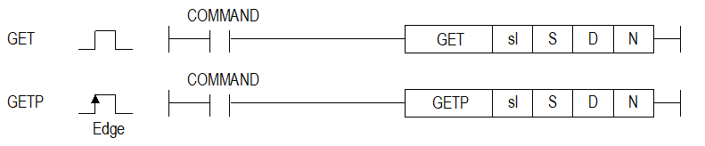
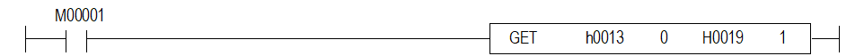
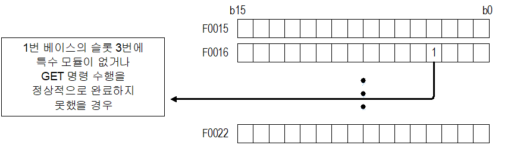

# GET

Read successive WORDs in a special module internal memory.

Manual section(s): 4.39.1. Original Korean notes below may cover the other variants on the same page; apply the widths and execution form of `GET`.

Execution form: the source explicitly pairs this command as `(P)`; `GET` is the non-P partner. Manual §2.4.2 defines `P` as pulse-type notation. Select the paired forms deliberately and retain the instruction's actual execution conditions; unrelated mnemonics ending in P are not classified by suffix alone.

## Editing route

Use `insert_ladder_instruction` after calling `describe_operation` for its current schema.
The writer mnemonic is `GET`; the catalog records opcode `344` and `4` operands in order.
Inspect the CPU/project and target cells first. Use the inspected revision and positions, preserve expected values, dry-run when useful, then save and inspect the result. See the [editing skill](../../SKILL.md) and [ladder workflow](../ladder.md).

## Behavior

- Read N WORDs from module address S into CPU device D.
- sl uses h00xy, where x is the base and y the slot.

## Instruction constraints

- Check the module-specific internal memory map and CPU base/slot limit. Module/access failures set the matching PUT/GET flag bits (XGK F0015..F0022, XGB F0015).
- An absent module sets only PUT/GET flags; other described failures also set F110/F115.

## Operands

| Order | Operand | Description (Korean manual) | Reviewed types | Device areas | Constant |
| --- | --- | --- | --- | --- | --- |
| 1 | sl | 특수 모듈이 장착된 베이스(x) 및 슬롯(y)번호 : h00xy | WORD | None | Allowed |
| 2 | S | 특수 모듈의 내부 메모리의 시작 번지 | WORD | None | Allowed |
| 3 | D | 읽을 데이터를 저장할 CPU내의 디바이스의 시작 번호 | WORD | PMK, L, U, N, D, R | Not allowed |
| 4 | N | 읽을 데이터의 개수 | WORD | PMK, L, U, N, D, R | Allowed |

These are the current library's reviewed operand rules. A shared type union is not a per-variant type choice; use the manual behavior to select the required width. Missing permissions stay unknown.

## CPU and acceptance

Reviewed XGK model table: XGK-CPUU, XGK-CPUH, XGK-CPUA, XGK-CPUS, XGK-CPUE, XGK-CPUUN, XGK-CPUHN, XGK-CPUSN (`4391getgetp.htm`).
Check the applicable model, firmware, modules and memory spans stated in the manual notes. Local parsing, writer validation and IL conversion do not prove native compilation or PLC behavior. Native acceptance requires XG5000 Open → Check Program → Save As → comparison.

## Manual behavior notes (Korean)

- 이 명령은 특수 모듈의 내부 메모리 데이터를 Read하고자 하는 경우 사용되는 명령어 입니다.
- sl(특수 모듈의 슬롯번호)로 지정된 특수 모듈의 메모리(S로 지정 : 어드레스)로부터 N개의 워드 데이터를 D로 지정된 내부 디바이스 영역으로 저장합니다.
- sl의 설정 방식은 16진수 2자리로 설정하고 아래의 프로그램과 같이 h0013인 경우 첫번째 숫자’1’은 베이스의 번호, 두번째 ‘3’는 슬롯번호를 의미합니다.

## Manual flags

| 플래그 | 내 용 | 디바이스 번호 |
| --- | --- | --- |
| PUT/GET 에러 | 지정한 베이스/슬롯에 모듈이 없거나 특수 모듈이 아닌 경우 PUT/GET 명령을 제대로 수행하지 못 했을 경우 CPU별 지원하는 max base 범위를 넘어선 경우 | F0015 ~ F0022 |

## Manual applicability and restrictions

- sl로 지정된 위치에 특수 모듈이 없거나, GET명령을 정상적으로 수행하지 못 했을 경우 PUT/GET에러 플래그인 XGK는F0015~F0022(WORD), XGB는 F0015(WORD)의 해당 위치 비트가 셋(Set)됩니다.
- 연산에러 플래그인 F110, F115도 함께 셋(Set)됩니다.
- sl로 지정된 위치에 모듈이 존재하지 않는 경우에는 PUT/GET에러 플래그 F0015~F0022만 셋(Set)되며, 연산에러 플래그 F110, F115는 셋(Set) 되지 않습니다.

| 지원 기종 | XGK | XGK | XGK | XGK | XGK | XGK-N | XGK-N | XGK-N | XBC-U | XBC-U | XBC-U | XBC-U | XBM | XBM |
| --- | --- | --- | --- | --- | --- | --- | --- | --- | --- | --- | --- | --- | --- | --- |
| 지원 기종 | U | H | A | S | E | UN | HN | SN | U | H | SU | E | S | H(P) |
| 지원 기종 | O | O | O | O | O | O | O | O | O | O | O | O | O | O |

## Manual flag and step matrix

The shared usage table marks affected flags with `O`, and `-` where it lists no effect. Native steps are the manual's instruction size, not the number of operand arguments. Conditions for setting/clearing flags are in the behavior notes.

| Manual instruction group | Native steps | 에러 (F110) | 제로 (F111) | 캐리 (F112) |
| --- | --- | --- | --- | --- |
| GET(P) | 4~7 | O | - | - |

## Referenced manual figures

These figures belong to the shared source topic. Read the source corrections above before using variant-specific layouts or example values.

## Provenance

Source: `XGK(B)InstructionHelp_Kr_V3.5.chm`, SHA-256 `b866d589d800addcb039f9f09b182592464d6367faa55abf6dde9ac34a1580e0`.

- `4391getgetp.htm` — §4.39.1; source SHA-256 `3a939440ace9d3523c642d03994be9dc51f07f5daad8e311590afd9ea52f9ade`.
- Additional behavior/operand evidence: `4391getgetp.htm`, `245.htm`.
