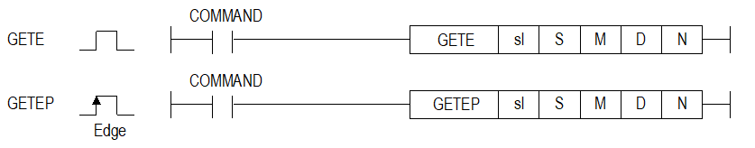
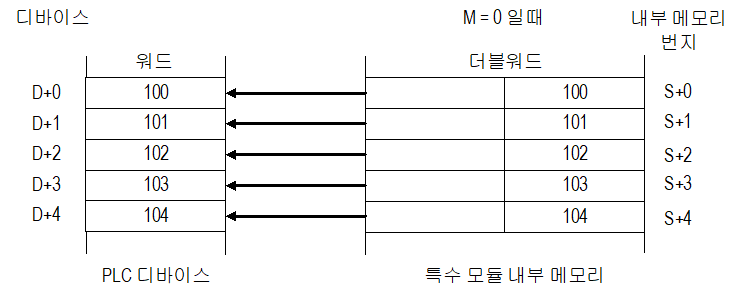
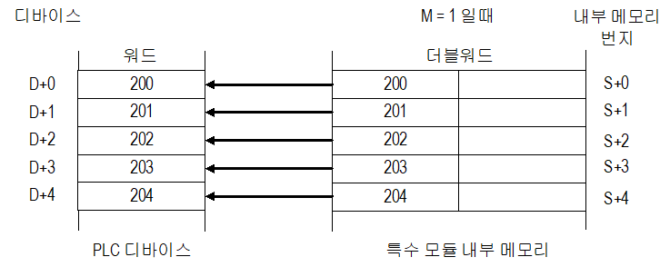

# GETEP

Manual section(s): 4.39.2. Original Korean notes below may cover the other variants on the same page; apply the widths and execution form of `GETEP`.

Execution form: the source explicitly pairs this command as `(P)`; `GETEP` is the pulse-type P form. Manual §2.4.2 defines `P` as pulse-type notation. Select the paired forms deliberately and retain the instruction's actual execution conditions; unrelated mnemonics ending in P are not classified by suffix alone.

## Editing route

Use `get_ir` → `apply_patch` for this instruction edit. `insert_ladder_instruction` is the internal writer route, not a separate MCP tool. Preserve the exported revision and native constraints.
The writer mnemonic is `GETEP`; the catalog records opcode `1243` and `5` operands in order.
Inspect the CPU/project and target cells first. Use the inspected revision and positions, preserve expected values, dry-run when useful, then save and inspect the result. See the [editing skill](../../SKILL.md) and [ladder workflow](../ladder.md).

## Operands

| Order | Operand | Description (Korean manual) | Reviewed types | Device areas | Constant |
| --- | --- | --- | --- | --- | --- |
| 1 | sl | 모듈이 장착된 베이스(x) 및 슬롯(y)번호 : h00xy | WORD | Unknown | Unknown |
| 2 | S | 모듈 내부 메모리 주소 : 0 ~ 1,023 | WORD | Unknown | Unknown |
| 3 | M | 내부 메모리 주소의 상위 또는 하위 워드: 1 또는 0 | WORD | Unknown | Unknown |
| 4 | D | 모듈에서 읽은 데이터를 저장할 디바이스 | WORD | Unknown | Unknown |
| 5 | N | 모듈에서 읽을 데이터 워드 갯수: 1 ~ 64 | WORD | Unknown | Unknown |

These are the current library's reviewed operand rules. A shared type union is not a per-variant type choice; use the manual behavior to select the required width. Missing permissions stay unknown.

## CPU and acceptance

Reviewed XGK model table: XGK-CPUU, XGK-CPUH, XGK-CPUA, XGK-CPUS, XGK-CPUE, XGK-CPUUN, XGK-CPUHN, XGK-CPUSN (`4392getegetepxgf-rd8a.htm`).
Check the applicable model, firmware, modules and memory spans stated in the manual notes. Local parsing, writer validation and IL conversion do not prove native compilation or PLC behavior. Native acceptance requires XG5000 Open → Check Program → Save As → comparison.

## Manual behavior notes (Korean)

- 이 명령은 특수 모듈(XGF-RD8A)의 메모리로부터 데이터를 Read하는 경우 사용하는 명령어입니다.
- sl로 지정한 슬롯에 장착된 모듈의 메모리(S에 지정한 주소)로부터 N개의 워드 데이터를 D로 지정한 PLC 내부 디바이스 영역에 Read합니다.
- S로 지정하는 모듈 내부 메모리는 더블 워드 단위의 메모리입니다.
- S로 지정한 더블 워드 메모리를 오퍼랜드 M을 이용하여 워드 단위로 메모리를 선택할 수 있습니다.
- D에 지정한 디바이스로부터 N에 지정한 개수의 3배에 해당하는 PLC 내부 디바이스 영역을 할당하여 사용합니다.
- D로 설정한 디바이스부터 N x 3 개의 디바이스 공간이 확보되어야 합니다.
- EX. 오퍼랜드 D를 M00011로 설정하고 N을 5로 설정하는 경우, 명령어가 M00011 ~ M00026영역을 내부적으로 사용합니다.
- 명령어에서 설정한M00011 ~ M00015 이외에 M00016 ~ M00026(예약 영역)까지의 영역은 명령어가 내부적으로 사용하기 때문에 다른 프로그램과 중복되지 않도록 주의하시기 바랍니다.

## Manual flags

| 플래그 | 내 용 | 디바이스 번호 |
| --- | --- | --- |
| PUT/GET 에러 | 지정한 슬롯에 모듈이 없거나 특수 모듈이 아닌 경우 오퍼랜드 S를 1,024(h0400) 이상으로 설정한 경우 오퍼랜드 S를 64로 나눈 나머지에 오퍼랜드N을 더한 값이 64보다 클 경우 오퍼랜드 M의 값이 0 또는 1 이 아닌 경우 오퍼랜드 D에 설정한 디바이스부터 오퍼랜드 N에 설정한 워드 갯수의 3배에 해당하는 디바이스가 디바이스 최대 설정가능 영역을 벗어날 경우 오퍼랜드 N을 1에서 64까지 범위 외 값으로 설정한 경우 | F0015 ~ F0022 |

## Manual applicability and restrictions

- 이 명령은 에러가 발생하면 에러 플래그를 셋하고 모듈 Access는 실행하지 않습니다.
- 에러는 아래의 경우에 발생합니다.
- 지정한 슬롯에 모듈이 없거나 특수 모듈이 아닌 경우:
- (1) 지정한 슬롯에 모듈이 없는 경우는 에러 플래그(F0015~F0022)만 셋(Set) 됩니다.
- (2) 지정한 슬롯에 다른 모듈인 경우에는 에러 플래그(F0015~F0022)와 연산에러 플래그(F110, F115) 함께 셋(Set)됩니다.
- 오퍼랜드 S를 1,024(h0400) 이상으로 설정한 경우
- 오퍼랜드 S를 64로 나눈 나머지에 오퍼랜드N을 더한 값이 64보다 클 경우
- (1) 내부 메모리는 64워드씩 하나의 블록으로 구성되어 있습니다. (0 ~ 63 / 64 ~ 127 / … / 960 ~ 1,023)
- (2) 명령어에서 한번에 읽을 수 있는 데이터는 한 블록(64워드) 기준입니다.
- (3) 오퍼랜드 S를 64로 나눈 나머지에 오퍼랜드 N을 더한 값이 64보다 크면 읽을 데이터 영역이 1블록 단위를 초과하게 되어 에러가 발생합니다.
- EX. 내부 메모리의 60 ~ 69번지까지 10개 워드를 한 명령에 읽는 경우, 1블록 단위인 0~63을 초과하기 때문에 에러가 발생합니다.
- 오퍼랜드 M의 값이 0 또는 1 이 아닌 경우
- 오퍼랜드 D에 설정한 디바이스로 부터 오퍼랜드 N에 설정한 갯수의 3배만큼의 디바이스가 해당 디바이스 최대 설정가능 영역을 벗어날 경우
- 오퍼랜드 N을 1에서 64까지 범위 외 값으로 설정한 경우

| 지원 기종 | XGK | XGK | XGK | XGK | XGK | XGK-N | XGK-N | XGK-N | XBC-U | XBC-U | XBC-U | XBC-U | XBM | XBM |
| --- | --- | --- | --- | --- | --- | --- | --- | --- | --- | --- | --- | --- | --- | --- |
| 지원 기종 | U | H | A | S | E | UN | HN | SN | U | H | SU | E | S | H(P) |
| 지원 기종 | O | O | O | O | O | O | O | O | - | - | - | - | - | - |

## Manual flag and step matrix

The shared usage table marks affected flags with `O`, and `-` where it lists no effect. Native steps are the manual's instruction size, not the number of operand arguments. Conditions for setting/clearing flags are in the behavior notes.

| Manual instruction group | Native steps | 에러 (F110) | 제로 (F111) | 캐리 (F112) |
| --- | --- | --- | --- | --- |
| GETE(P) | 5 | Ο | - | - |

## Referenced manual figures

These figures belong to the shared source topic. Read the source corrections above before using variant-specific layouts or example values.

## Provenance

Source: `XGK(B)InstructionHelp_Kr_V3.5.chm`, SHA-256 `b866d589d800addcb039f9f09b182592464d6367faa55abf6dde9ac34a1580e0`.

- `4392getegetepxgf-rd8a.htm` — §4.39.2; source SHA-256 `434cf2e1b869127ed09b8762926539b2b72de19f49b7062748aa4a257bae004e`.
- Additional behavior/operand evidence: `4392getegetepxgf-rd8a.htm`, `245.htm`.
