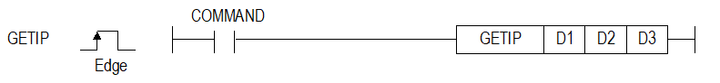
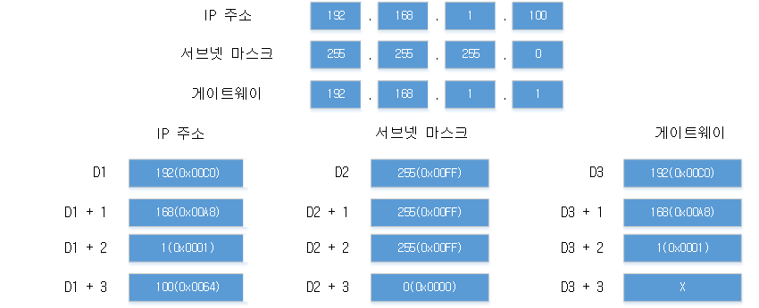

# GETIP

Manual section(s): 4.40.10. Original Korean notes below may cover the other variants on the same page; apply the widths and execution form of `GETIP`.

## Editing route

Use `get_ir` → `apply_patch` for this instruction edit. `insert_ladder_instruction` is the internal writer route, not a separate MCP tool. Preserve the exported revision and native constraints.
The writer mnemonic is `GETIP`; the catalog records opcode `1556` and `3` operands in order.
Inspect the CPU/project and target cells first. Use the inspected revision and positions, preserve expected values, dry-run when useful, then save and inspect the result. See the [editing skill](../../SKILL.md) and [ladder workflow](../ladder.md).

## Operands

| Order | Operand | Description (Korean manual) | Reviewed types | Device areas | Constant |
| --- | --- | --- | --- | --- | --- |
| 1 | D1 | IP 주소를 저장할 디바이스 번호 | WORD | PMK, L, Z, U, N, D, R | Not allowed |
| 2 | D2 | 서브넷 마스크를 저장할 디바이스 번호 | WORD | PMK, L, Z, U, N, D, R | Not allowed |
| 3 | D3 | 게이트웨이를 저장할 디바이스 번호 | WORD | PMK, L, Z, U, N, D, R | Not allowed |

These are the current library's reviewed operand rules. A shared type union is not a per-variant type choice; use the manual behavior to select the required width. Missing permissions stay unknown.

## CPU and acceptance

Reviewed XGK model table: XGK-CPUUN, XGK-CPUHN, XGK-CPUSN (`44010getip.htm`).
Check the applicable model, firmware, modules and memory spans stated in the manual notes. Local parsing, writer validation and IL conversion do not prove native compilation or PLC behavior. Native acceptance requires XG5000 Open → Check Program → Save As → comparison.

## Manual behavior notes (Korean)

- 로컬이더넷 정보를 읽어 지정된 디바이스에 저장하는 명령입니다.
- IP주소, 서브넷마스크, 게이트웨이 설정값을 각각 아래와 같이 저장합니다.각 주소는 4워드씩 할당됩니다.

## Manual flags

| 플래그 | 내 용 | 디바이스 번호 |
| --- | --- | --- |
| 에러 | 1. 로컬이더넷 파라미터 설정이 이상한 경우 2. 명령어 수행이 한 스캔에 완료되지 않은 경우( XGK-CPUSN/HN/UN) 3. IP주소, 서브넷마스크, 게이트웨이 설정값이 유효하지 않은 경우 | F110 |

## Manual applicability and restrictions

| 지원 기종 | XGK | XGK | XGK | XGK | XGK | XGK-N | XGK-N | XGK-N | XBC-U | XBC-U | XBC-U | XBC-U | XBM | XBM |
| --- | --- | --- | --- | --- | --- | --- | --- | --- | --- | --- | --- | --- | --- | --- |
| 지원 기종 | U | H | A | S | E | UN | HN | SN | U | H | SU | E | S | H(P) |
| 지원 기종 | X | X | X | X | X | O | O | O | O | X | X | X | X | O |

## Manual flag and step matrix

The shared usage table marks affected flags with `O`, and `-` where it lists no effect. Native steps are the manual's instruction size, not the number of operand arguments. Conditions for setting/clearing flags are in the behavior notes.

| Manual instruction group | Native steps | 에러 (F110) | 제로 (F111) | 캐리 (F112) |
| --- | --- | --- | --- | --- |
| GETIP | 4~7 | O | - | - |

## Referenced manual figures

These figures belong to the shared source topic. Read the source corrections above before using variant-specific layouts or example values.

## Provenance

Source: `XGK(B)InstructionHelp_Kr_V3.5.chm`, SHA-256 `b866d589d800addcb039f9f09b182592464d6367faa55abf6dde9ac34a1580e0`.

- `44010getip.htm` — §4.40.10; source SHA-256 `8b5a89eafb0b58dd29b4fa959d83fccd437ffbc8ac6fd275d7574164e5bad32f`.
- Additional behavior/operand evidence: `44010getip.htm`.
