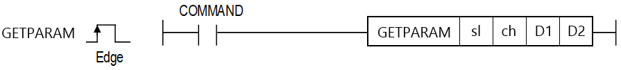

# GETPARAM

Manual section(s): 4.40.22. Original Korean notes below may cover the other variants on the same page; apply the widths and execution form of `GETPARAM`.

## Editing route

Use `insert_ladder_instruction` after calling `describe_operation` for its current schema.
The writer mnemonic is `GETPARAM`; the catalog records opcode `1783` and `4` operands in order.
Inspect the CPU/project and target cells first. Use the inspected revision and positions, preserve expected values, dry-run when useful, then save and inspect the result. See the [editing skill](../../SKILL.md) and [ladder workflow](../ladder.md).

## Operands

| Order | Operand | Description (Korean manual) | Reviewed types | Device areas | Constant |
| --- | --- | --- | --- | --- | --- |
| 1 | sl | 읽어올 슬롯 번호가 저장된 디바이스 번호 | WORD | Unknown | Unknown |
| 2 | ch | 읽어올 채널 번호가 저장된 디바이스 번호 | WORD | Unknown | Unknown |
| 3 | D1 | 읽어온 Cnet 파라미터가 저장될 디바이스 영역 | WORD | Unknown | Unknown |
| 4 | D2 | 상태코드가 저장될 디바이스 영역 | WORD | Unknown | Unknown |

These are the current library's reviewed operand rules. A shared type union is not a per-variant type choice; use the manual behavior to select the required width. Missing permissions stay unknown.

## CPU and acceptance

Reviewed XGK model table: no XGK model is allowed (`44022getparam.htm`).
Check the applicable model, firmware, modules and memory spans stated in the manual notes. Local parsing, writer validation and IL conversion do not prove native compilation or PLC behavior. Native acceptance requires XG5000 Open → Check Program → Save As → comparison.

## Manual behavior notes (Korean)

- 이 명령은 Cnet의 파라미터를 읽어 올 수 있는 명령어입니다.
- 사용조건: 제품별 OS 버전 및 XG5000 V4.60 이상
- D1 영역 파라미터 수신 값
- D2 영역
- 상태코드

| D1영역 | 파라미터 정보 | 상세 설명 |
| --- | --- | --- |
| D1 | COMM_TYPE | 통신 형태: 1(RS-232C), 2(RS-485) |
| D1+1 | BPS | 통신속도: 1(1200), 2(2400), 3(4800), 4(9600), 5(19200), 6(38400), 7(57600), 8(76800), 9(115200) |
| D1+2 | STATION | 국번: 1~31 |
| D1+3 | DATA_BIT | 데이터비트: 7, 8 |
| D1+4 | STOP_BIT | 스톱비트: 1, 2 |
| D1+5 | PARITY_BIT | 패리티비트: 1, 2, 3 |
| D1+6 | RES_TIME | 응답대기 시간: 0~50 |
| D1+7 | DELAY_TIME | 지연 시간: 0~255 |
| D1+8 | CHAR_TIME | 문자간 대기 시간: 0~255 |

| D2영역 | 내용 | 상세 설명 |
| --- | --- | --- |
| D2 | 완료비트 | 에러 발생 없이 함수 실행 시: 1 |
| D2+1 | 상태코드 | 0~3 상태코드 출력 |

| 상태코드 | 내용 | 세부 설명 |
| --- | --- | --- |
| 0 | 초기 상태 | 명령어 수행 전 |
| 1 | 정상 동작 | 명령어 실행 완료 |
| 2 | 슬롯 설정 오류 | 슬롯에 CNET모듈이 장착되지 않은 경우(0만 가능) |
| 3 | 채널 설정 오류 | 채널에 설정된 값이 1~2 이외의 값인 경우 |

## Manual flags

| 플래그 | 내 용 | 디바이스 번호 |
| --- | --- | --- |
| 에러 | 슬롯, 채널 설정이 잘못된 경우 | F110 |

## Manual applicability and restrictions

| 지원 기종 | XGK | XGK | XGK | XGK | XGK | XGK-N | XGK-N | XGK-N | XBC-U | XBC-U | XBC-U | XBC-U | XBM | XBM |
| --- | --- | --- | --- | --- | --- | --- | --- | --- | --- | --- | --- | --- | --- | --- |
| 지원 기종 | U | H | A | S | E | UN | HN | SN | U(내장) | H | SU | E | S | H(P)(내장) |
| 지원 기종 | X | X | X | X | X | X | X | X | O XBC-U: V2.2 | X | X | X | X | O XBM-H: V1.4 XBM-HP: V2.3 XBM-H2: V2.3 |

## Manual flag and step matrix

The shared usage table marks affected flags with `O`, and `-` where it lists no effect. Native steps are the manual's instruction size, not the number of operand arguments. Conditions for setting/clearing flags are in the behavior notes.

| Manual instruction group | Native steps | 에러 (F110) | 제로 (F111) | 캐리 (F112) |
| --- | --- | --- | --- | --- |
| GETPARAM | 4~7 | - | - | - |

## Referenced manual figures

These figures belong to the shared source topic. Read the source corrections above before using variant-specific layouts or example values.

## Provenance

Source: `XGK(B)InstructionHelp_Kr_V3.5.chm`, SHA-256 `b866d589d800addcb039f9f09b182592464d6367faa55abf6dde9ac34a1580e0`.

- `44022getparam.htm` — §4.40.22; source SHA-256 `4444935d6969e1bc25353d0ae2fcbbd9fc97de6941f74909d00f749d05ae4254`.
- Additional behavior/operand evidence: `44022getparam.htm`.
