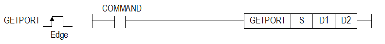

# GETPORT

Manual section(s): 4.40.20. Original Korean notes below may cover the other variants on the same page; apply the widths and execution form of `GETPORT`.

## Editing route

Use `get_ir` → `apply_patch` for this instruction edit. `insert_ladder_instruction` is the internal writer route, not a separate MCP tool. Preserve the exported revision and native constraints.
The writer mnemonic is `GETPORT`; the catalog records opcode `1743` and `3` operands in order.
Inspect the CPU/project and target cells first. Use the inspected revision and positions, preserve expected values, dry-run when useful, then save and inspect the result. See the [editing skill](../../SKILL.md) and [ladder workflow](../ladder.md).

## Operands

| Order | Operand | Description (Korean manual) | Reviewed types | Device areas | Constant |
| --- | --- | --- | --- | --- | --- |
| 1 | S | 읽어올 채널 번호가 저장된 디바이스 번호 | WORD | PMK, L, Z, U, N, D, R | Allowed |
| 2 | D1 | 읽어온 포트 번호가 저장될 디바이스 영역 | WORD | PMK, L, Z, U, N, D, R | Not allowed |
| 3 | D2 | 상태코드가 저장될 디바이스 영역 | WORD | PMK, L, Z, U, N, D, R | Not allowed |

These are the current library's reviewed operand rules. A shared type union is not a per-variant type choice; use the manual behavior to select the required width. Missing permissions stay unknown.

## CPU and acceptance

Reviewed XGK model table: no XGK model is allowed (`44020getport.htm`).
Check the applicable model, firmware, modules and memory spans stated in the manual notes. Local parsing, writer validation and IL conversion do not prove native compilation or PLC behavior. Native acceptance requires XG5000 Open → Check Program → Save As → comparison.

## Manual behavior notes (Korean)

- 이 명령은 로컬이더넷의 포트를 설정을 읽을 수 있는 명령어입니다.
- S에 설정된 디바이스 영역에 읽어올 채널 번호를 입력합니다.
- D1에 읽어온 포트 번호가 저장됩니다.
- D2에 영역에는 다음과 같은 상태 정보가 저장됩니다.
- (1) XBC-DxxxU: Ver 2.0 이상
- (2) XBC-DN32H: Ver 1.3 이상
- (3) XBC-Dx32HP/H2 Ver: 2.2 이상

| 상태코드 | 상태 정보 | 의미 |
| --- | --- | --- |
| 0 | 초기상태 | 명령어 수행 전 |
| 1 | 완료 | 명령어가 정상적으로 수행된 경우 |
| 2 | 채널 설정 에러 | 채널 설정 범위를 벗어난 경우 (정상범위: 0 ~ 14) |
| 3 | 드라이버 설정 에러 | P2P 드라이버가 사용자 프레임 정의가 아닌 경우 |

## Manual flags

| 플래그 | 내 용 | 디바이스 번호 |
| --- | --- | --- |
| 에러 | 채널 설정, 드라이버 설정이 잘못된 경우 (상태코드 2~3 발생 시) | F110 |

## Manual applicability and restrictions

- 적용제품: XGB 로컬이더넷 지원 기본유닛(XBL-EMTA에서는 사용할 수 없습니다.)

| 지원 기종 | XGK | XGK | XGK | XGK | XGK | XGK-N | XGK-N | XGK-N | XBC-U | XBC-U | XBC-U | XBC-U | XBM | XBM |
| --- | --- | --- | --- | --- | --- | --- | --- | --- | --- | --- | --- | --- | --- | --- |
| 지원 기종 | U | H | A | S | E | UN | HN | SN | U | H | SU | E | S | H(P) |
| 지원 기종 | X | X | X | X | X | X | X | X | O XBC-U: V2.3 | X | X | X | X | O XBM-H: V1.3 XBM-HP: V2.2 XBM-H2: V2.2 |

## Manual flag and step matrix

The shared usage table marks affected flags with `O`, and `-` where it lists no effect. Native steps are the manual's instruction size, not the number of operand arguments. Conditions for setting/clearing flags are in the behavior notes.

| Manual instruction group | Native steps | 에러 (F110) | 제로 (F111) | 캐리 (F112) |
| --- | --- | --- | --- | --- |
| GETPORT | 4~7 | O | - | - |

## Referenced manual figures

These figures belong to the shared source topic. Read the source corrections above before using variant-specific layouts or example values.

## Provenance

Source: `XGK(B)InstructionHelp_Kr_V3.5.chm`, SHA-256 `b866d589d800addcb039f9f09b182592464d6367faa55abf6dde9ac34a1580e0`.

- `44020getport.htm` — §4.40.20; source SHA-256 `4956ae66827cf03313b1b2b1d3e0bf5c9281e2156d94092238bda32155b61e8e`.
- Additional behavior/operand evidence: `44020getport.htm`.
