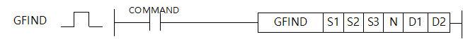
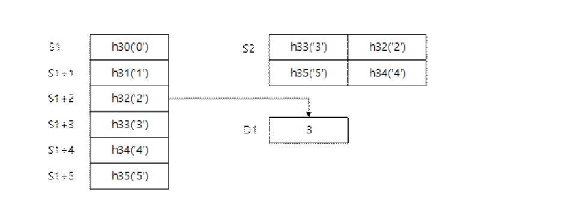

# GFIND

Manual section(s): 4.26.20. Original Korean notes below may cover the other variants on the same page; apply the widths and execution form of `GFIND`.

## Editing route

Use `get_ir` → `apply_patch` for this instruction edit. `insert_ladder_instruction` is the internal writer route, not a separate MCP tool. Preserve the exported revision and native constraints.
The writer mnemonic is `GFIND`; the catalog records opcode `1745` and `6` operands in order.
Inspect the CPU/project and target cells first. Use the inspected revision and positions, preserve expected values, dry-run when useful, then save and inspect the result. See the [editing skill](../../SKILL.md) and [ladder workflow](../ladder.md).

## Operands

| Order | Operand | Description (Korean manual) | Reviewed types | Device areas | Constant |
| --- | --- | --- | --- | --- | --- |
| 1 | S1 | 검색 대상 시작 주소 | BYTE | PMK, L, D.x, R.x | Not allowed |
| 2 | S2 | 검색할 문자열의 값 | STRING | PMK, L, Z, D, R | Not allowed |
| 3 | S3 | 검색 대상의 길이(단위 : Byte) | WORD | Unknown | Unknown |
| 4 | N | 문자열 검색을 시작할 위치(오프셋) | WORD | Unknown | Unknown |
| 5 | D1 | 찾은 문자열 위치 | WORD | Unknown | Unknown |
| 6 | D2 | 상태 코드 | WORD | PMK, L, Z, D, R | Not allowed |

These are the current library's reviewed operand rules. A shared type union is not a per-variant type choice; use the manual behavior to select the required width. Missing permissions stay unknown.

## CPU and acceptance

No separately reviewed CPU-model restriction is available in the current catalog; this means unknown, not universal compatibility.
Check the applicable model, firmware, modules and memory spans stated in the manual notes. Local parsing, writer validation and IL conversion do not prove native compilation or PLC behavior. Native acceptance requires XG5000 Open → Check Program → Save As → comparison.

## Manual behavior notes (Korean)

- S1으로 지정된 주소의 N 번째의 문자부터 S2 로 시작되는 문자열을 검색하여 첫번째로 일치 하는 문자열의 시작 위치를 D1에 저장한다.
- S3은 검색 대상인 S1의 길이를 나타냅니다.
- EX. R0.0 ~ R3.0인경우 총 8 Byte를 입력합니다.
- N은 검색 대상인 S1으로부터 N번째부터 검색을 시작합니다.
- EX. R0.0 ~ R3.0인 경우 R0.0부터 검색을 원할 경우 N은 0, R1.0부터 검색을 원할 경우 2를 입력합니다.
- 상태 코드
- EX. S1~S1+5에 해당하는 총 6 Byte 길이의 문자열에서 연속 문자열 ‘2345’를 찾는 경우 D1의 위치에 3이 저장됩니다.

| 상태 코드 번호 | 설명 |
| --- | --- |
| 0 | 초기 상태 |
| 1 | 완료 |
| 2 | N의 값이 0일 경우 |
| 3 | N에 지정된 검색 시작 위치가 S3에 입력된 길이보다 클 때 (길이가 10인 경우 N의 값은 0부터 9이하입니다.) |
| 4,5 | 일치하는 문자열이 없는 경우 |
| 6 | S1의 디바이스 주소값이 Byte 크기가 맞지 않는 경우 |

## Manual flags

| 플래그 | 내 용 | 디바이스 번호 |
| --- | --- | --- |
| 에러 | 검색 대상 시작 주소 + 길이가 디바이스 범위를 초과한 경우 | F110 |

## Manual applicability and restrictions

- 적용 기종 : XG5000 V4.51, XGK-N V1.50

## Manual flag and step matrix

The shared usage table marks affected flags with `O`, and `-` where it lists no effect. Native steps are the manual's instruction size, not the number of operand arguments. Conditions for setting/clearing flags are in the behavior notes.

| Manual instruction group | Native steps | 에러 (F110) | 제로 (F111) | 캐리 (F112) |
| --- | --- | --- | --- | --- |
| GFIND | - | O | - | - |

## Referenced manual figures

These figures belong to the shared source topic. Read the source corrections above before using variant-specific layouts or example values.

## Provenance

Source: `XGK(B)InstructionHelp_Kr_V3.5.chm`, SHA-256 `b866d589d800addcb039f9f09b182592464d6367faa55abf6dde9ac34a1580e0`.

- `42620gfind.htm` — §4.26.20; source SHA-256 `0848a1edcadf29acc37c1fa8261889cdaff275fa72708469b291f3d288d7df27`.
- Additional behavior/operand evidence: `42620gfind.htm`.
