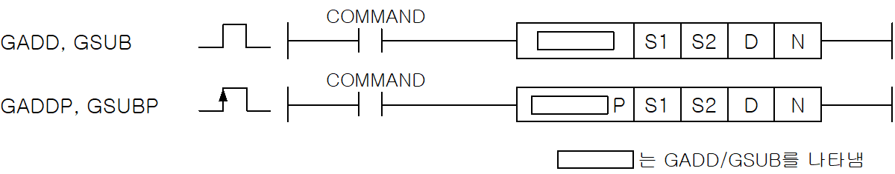
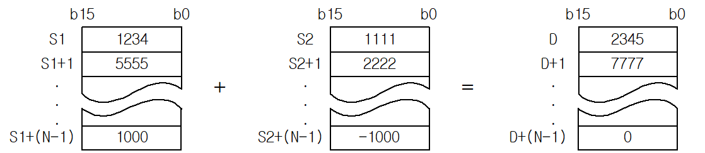
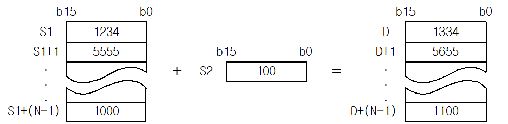
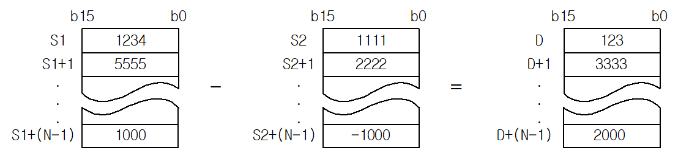
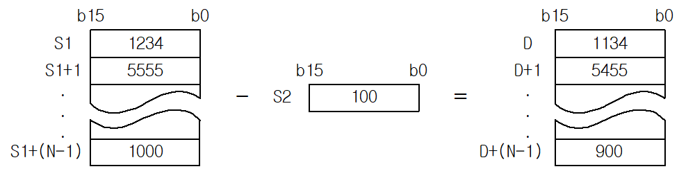

# GSUBP

Manual section(s): 4.20.14. Original Korean notes below may cover the other variants on the same page; apply the widths and execution form of `GSUBP`.

Execution form: the source explicitly pairs this command as `(P)`; `GSUBP` is the pulse-type P form. Manual §2.4.2 defines `P` as pulse-type notation. Select the paired forms deliberately and retain the instruction's actual execution conditions; unrelated mnemonics ending in P are not classified by suffix alone.

## Editing route

Use `get_ir` → `apply_patch` for this instruction edit. `insert_ladder_instruction` is the internal writer route, not a separate MCP tool. Preserve the exported revision and native constraints.
The writer mnemonic is `GSUBP`; the catalog records opcode `576` and `4` operands in order.
Inspect the CPU/project and target cells first. Use the inspected revision and positions, preserve expected values, dry-run when useful, then save and inspect the result. See the [editing skill](../../SKILL.md) and [ladder workflow](../ladder.md).

## Operands

| Order | Operand | Description (Korean manual) | Reviewed types | Device areas | Constant |
| --- | --- | --- | --- | --- | --- |
| 1 | S1 | S2와 덧셈연산을 실행할 데이터의 주소 | INT | PMK, F, L, T, C, Z, U, N, D, R | Not allowed |
| 2 | S2 | S1과 덧셈연산을 실행할 데이터의 주소 | INT | PMK, F, L, T, C, Z, U, N, D, R | Allowed |
| 3 | D | 연산결과를 저장할 주소 | INT | PMK, L, T, C, Z, U, N, D, R | Not allowed |
| 4 | N | 워드단위의 ADD를 실행할 개수 | WORD | PMK, F, L, T, C, Z, U, N, D, R | Allowed |

These are the current library's reviewed operand rules. A shared type union is not a per-variant type choice; use the manual behavior to select the required width. Missing permissions stay unknown.

## CPU and acceptance

No separately reviewed CPU-model restriction is available in the current catalog; this means unknown, not universal compatibility.
Check the applicable model, firmware, modules and memory spans stated in the manual notes. Local parsing, writer validation and IL conversion do not prove native compilation or PLC behavior. Native acceptance requires XG5000 Open → Check Program → Save As → comparison.

## Manual flags

- GADD (Group Add)
- S1으로 지정된 디바이스부터 N개의 워드 데이터와 S2로 지정된 디바이스부터 N개의 워드 데이터를 각각 더해서 D로 지정된 디바이스부터 N개의 워드 데이터에 저장합니다.
- S2에는 상수를 사용할 수 있습니다.
- N 값으로 인해 지정된 디바이스의 영역을 넘어갈 경우 에러가 발생합니다.
- GSUB (Group Subtract)
- S1으로 지정된 디바이스부터 N개의 워드 데이터와 S2로 지정된 디바이스부터 N개의 워드 데이터를 각각 빼서 D로 지정된 디바이스부터 N개의 워드 데이터에 저장합니다.

| 플래그 | 내 용 | 디바이스 번호 |
| --- | --- | --- |
| 에러 | N의 값이 지정 영역을 벗어날 때 셋(Set)됩니다. | F110 |

## Manual applicability and restrictions

- 적용 기종 : XGK, XGB

## Manual flag and step matrix

The shared usage table marks affected flags with `O`, and `-` where it lists no effect. Native steps are the manual's instruction size, not the number of operand arguments. Conditions for setting/clearing flags are in the behavior notes.

| Manual instruction group | Native steps | 에러 (F110) | 제로 (F111) | 캐리 (F112) |
| --- | --- | --- | --- | --- |
| GADD(P) GSUB(P) | 4~7 | O | - | - |

## Referenced manual figures

These figures belong to the shared source topic. Read the source corrections above before using variant-specific layouts or example values.

## Provenance

Source: `XGK(B)InstructionHelp_Kr_V3.5.chm`, SHA-256 `b866d589d800addcb039f9f09b182592464d6367faa55abf6dde9ac34a1580e0`.

- `42014gaddgaddpgsubgsubp.htm` — §4.20.14; source SHA-256 `9b29773d1bbd3999b7277cc6c7ad8fad855526dbc74f413d1381dc5dabdaa1a3`.
- Additional behavior/operand evidence: `42014gaddgaddpgsubgsubp.htm`, `245.htm`.
