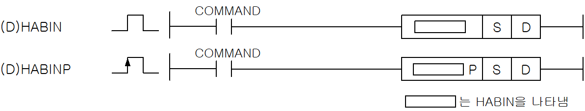
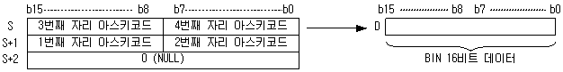
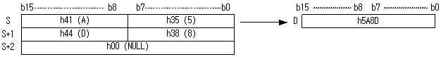
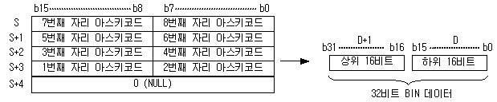

# HABINP

Manual section(s): 4.26.5. Original Korean notes below may cover the other variants on the same page; apply the widths and execution form of `HABINP`.

Execution form: the source explicitly pairs this command as `(P)`; `HABINP` is the pulse-type P form. Manual §2.4.2 defines `P` as pulse-type notation. Select the paired forms deliberately and retain the instruction's actual execution conditions; unrelated mnemonics ending in P are not classified by suffix alone.

## Editing route

Use `get_ir` → `apply_patch` for this instruction edit. `insert_ladder_instruction` is the internal writer route, not a separate MCP tool. Preserve the exported revision and native constraints.
The writer mnemonic is `HABINP`; the catalog records opcode `688` and `2` operands in order.
Inspect the CPU/project and target cells first. Use the inspected revision and positions, preserve expected values, dry-run when useful, then save and inspect the result. See the [editing skill](../../SKILL.md) and [ladder workflow](../ladder.md).

## Operands

| Order | Operand | Description (Korean manual) | Reviewed types | Device areas | Constant |
| --- | --- | --- | --- | --- | --- |
| 1 | S | BIN값으로 변환할 16진 ASCII 데이터가 저장되어 있는 주소 | STRING | PMK, F, L, T, Z, U, N, D, R | Not allowed |
| 2 | D | 변환값을 저장할 위치 | WORD/DWORD | PMK, L, T, Z, U, N, D, R | Not allowed |

These are the current library's reviewed operand rules. A shared type union is not a per-variant type choice; use the manual behavior to select the required width. Missing permissions stay unknown.

## CPU and acceptance

No separately reviewed CPU-model restriction is available in the current catalog; this means unknown, not universal compatibility.
Check the applicable model, firmware, modules and memory spans stated in the manual notes. Local parsing, writer validation and IL conversion do not prove native compilation or PLC behavior. Native acceptance requires XG5000 Open → Check Program → Save As → comparison.

## Manual flags

- HABIN (Hex ASCII to Binary)
- ASCII로 저장된 16진수값을 Bin값으로 변환하여 D에 저장합니다.
- ASCII 문자열의 끝은 NULL로 구분합니다.
- HABIN에서 연산 범위는 h0000부터 hFFFF까지입니다.
- 문자열은 ‘0’~’F’ 에 해당하는 ASCII가 허용되며, 이 이외의 값은 에러 처리됩니다.
- 첫 번째 문자로 Hex 를 나타내는 ‘h’ 또는 ‘H’ 는 허용됩니다.
- DHABIN (Double Hex ASCII to Binary)
- DHABIN에서 연산 범위는 h00000000부터 hFFFFFFFF까지입니다.
- 첫 번째 문자로 Hex 를 나타내는 ‘h’ 또는 ‘H’는 허용됩니다.

| 플래그 | 내 용 | 디바이스 번호 |
| --- | --- | --- |
| 에러 | 문자열의 길이가 최대 문자열 길이를 초과한 경우 셋(Set)합니다. 연산 범위를 벗어난 데이터를 입력한 경우 셋(Set)합니다. 문자열에 ‘0’~’F’ 이외의 문자가 존재할 경우 셋(Set)합니다. | F110 |

## Manual applicability and restrictions

- 적용 기종 : XGK, XGB

## Manual flag and step matrix

The shared usage table marks affected flags with `O`, and `-` where it lists no effect. Native steps are the manual's instruction size, not the number of operand arguments. Conditions for setting/clearing flags are in the behavior notes.

| Manual instruction group | Native steps | 에러 (F110) | 제로 (F111) | 캐리 (F112) |
| --- | --- | --- | --- | --- |
| HABIN(P) DHABIN(P) | 2~4 | O | - | - |

## Referenced manual figures

These figures belong to the shared source topic. Read the source corrections above before using variant-specific layouts or example values.

## Provenance

Source: `XGK(B)InstructionHelp_Kr_V3.5.chm`, SHA-256 `b866d589d800addcb039f9f09b182592464d6367faa55abf6dde9ac34a1580e0`.

- `4265habinhabinpdhabindhabinp.htm` — §4.26.5; source SHA-256 `6d199cba22e8b44d468412528e067b27aeddebceba18c5bfec41d61cf4a7bccc`.
- Additional behavior/operand evidence: `4265habinhabinpdhabindhabinp.htm`, `245.htm`.
