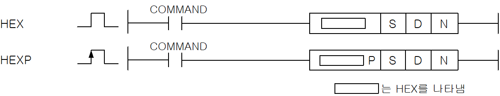
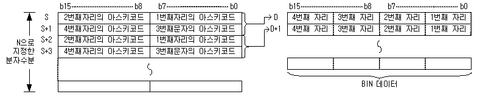
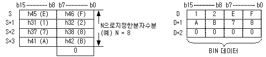

# HEXP

Manual section(s): 4.26.13. Original Korean notes below may cover the other variants on the same page; apply the widths and execution form of `HEXP`.

Execution form: the source explicitly pairs this command as `(P)`; `HEXP` is the pulse-type P form. Manual §2.4.2 defines `P` as pulse-type notation. Select the paired forms deliberately and retain the instruction's actual execution conditions; unrelated mnemonics ending in P are not classified by suffix alone.

## Editing route

Use `get_ir` → `apply_patch` for this instruction edit. `insert_ladder_instruction` is the internal writer route, not a separate MCP tool. Preserve the exported revision and native constraints.
The writer mnemonic is `HEXP`; the catalog records opcode `716` and `3` operands in order.
Inspect the CPU/project and target cells first. Use the inspected revision and positions, preserve expected values, dry-run when useful, then save and inspect the result. See the [editing skill](../../SKILL.md) and [ladder workflow](../ladder.md).

## Operands

| Order | Operand | Description (Korean manual) | Reviewed types | Device areas | Constant |
| --- | --- | --- | --- | --- | --- |
| 1 | S | HEX 데이터로 변환할 문자열 | STRING | PMK, L, Z, U, N, D, R | Not allowed |
| 2 | D | 변환된 HEX 데이터를 저장할 디바이스 주소 | WORD | PMK, L, Z, U, N, D, R | Not allowed |
| 3 | N | 변환할 문자수 | WORD | PMK, F, L, T, C, Z, U, N, D, R | Allowed |

These are the current library's reviewed operand rules. A shared type union is not a per-variant type choice; use the manual behavior to select the required width. Missing permissions stay unknown.

## CPU and acceptance

No separately reviewed CPU-model restriction is available in the current catalog; this means unknown, not universal compatibility.
Check the applicable model, firmware, modules and memory spans stated in the manual notes. Local parsing, writer validation and IL conversion do not prove native compilation or PLC behavior. Native acceptance requires XG5000 Open → Check Program → Save As → comparison.

## Manual flags

- HEX
- S로 지정된 문자부터 N개의 문자를 HEX포맷으로 변환하여 D부터 저장합니다.
- S로 지정된 디바이스 번호 이후에, N으로 지정된 문자수분에 저장되어 있는 16진 아스키 데이터를 BIN값으로 변환하여 D로 지정된 디바이스 번호 이후에 저장합니다.
- N으로 지정된 문자수와 S로 지정된 문자열의 범위 및 D로 지정된 BIN 데이터를 저장할 디바이스의 범위가 자동적으로 정해집니다.
- 변환할 아스키 데이터가 저장되어 있는 디바이스 범위와 변환한 BIN 데이터를 저장할 디바이스 범위가 중복하고 있을 경우라도 정상적으로 처리됩니다.
- N으로 지정된 문자수가 4의 배수가 아닌 경우, 변환한 BIN값을 저장할 디바이스 범위 중에, 최종 디바이스 번호의 지정 문자수분 이후의 자리수에는 자동적으로 0이 저장됩니다.
- N으로 지정된 문자수가 0일 경우에는 변환 처리를 하지 않습니다.

| 플래그 | 내 용 | 디바이스 번호 |
| --- | --- | --- |
| 에러 | S로 지정된 문자열 값이 16진수 표현 범위를 벗어날 경우. | F110 |

## Manual applicability and restrictions

- 적용 기종 : XGK, XGB

## Manual flag and step matrix

The shared usage table marks affected flags with `O`, and `-` where it lists no effect. Native steps are the manual's instruction size, not the number of operand arguments. Conditions for setting/clearing flags are in the behavior notes.

| Manual instruction group | Native steps | 에러 (F110) | 제로 (F111) | 캐리 (F112) |
| --- | --- | --- | --- | --- |
| HEX(P) | 4~6 | O | - | - |

## Referenced manual figures

These figures belong to the shared source topic. Read the source corrections above before using variant-specific layouts or example values.

## Provenance

Source: `XGK(B)InstructionHelp_Kr_V3.5.chm`, SHA-256 `b866d589d800addcb039f9f09b182592464d6367faa55abf6dde9ac34a1580e0`.

- `42613hexhexp.htm` — §4.26.13; source SHA-256 `a8aefdda0ff203b532afad7623e5072274b3795fe52b1793581c92ac63564d04`.
- Additional behavior/operand evidence: `42613hexhexp.htm`, `245.htm`.
