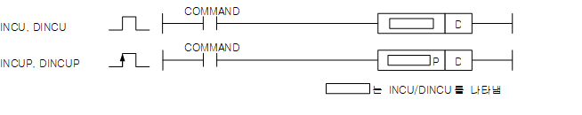

# INCU

Manual section(s): 4.16.5. Original Korean notes below may cover the other variants on the same page; apply the widths and execution form of `INCU`.

Execution form: the source explicitly pairs this command as `(P)`; `INCU` is the non-P partner. Manual §2.4.2 defines `P` as pulse-type notation. Select the paired forms deliberately and retain the instruction's actual execution conditions; unrelated mnemonics ending in P are not classified by suffix alone.

## Editing route

Use `get_ir` → `apply_patch` for this instruction edit. `insert_ladder_instruction` is the internal writer route, not a separate MCP tool. Preserve the exported revision and native constraints.
The writer mnemonic is `INCU`; the catalog records opcode `187` and `1` operands in order.
Inspect the CPU/project and target cells first. Use the inspected revision and positions, preserve expected values, dry-run when useful, then save and inspect the result. See the [editing skill](../../SKILL.md) and [ladder workflow](../ladder.md).

## Operands

| Order | Operand | Description (Korean manual) | Reviewed types | Device areas | Constant |
| --- | --- | --- | --- | --- | --- |
| 1 | D | 연산을 수행하게 될 데이터의 주소 | UINT | PMK, L, T, C, Z, U, N, D, R | Not allowed |

These are the current library's reviewed operand rules. A shared type union is not a per-variant type choice; use the manual behavior to select the required width. Missing permissions stay unknown.

## CPU and acceptance

No separately reviewed CPU-model restriction is available in the current catalog; this means unknown, not universal compatibility.
Check the applicable model, firmware, modules and memory spans stated in the manual notes. Local parsing, writer validation and IL conversion do not prove native compilation or PLC behavior. Native acceptance requires XG5000 Open → Check Program → Save As → comparison.

## Manual flags

- INCU (Increment)
- D에 1을 더한 결과를 다시 D에 저장합니다.
- Unsigned연산을 수행합니다.
- D의 값이 65,535(hFFFF)일 때 INCU(P)가 실행되면 0(h0000)을 출력하며 제로 플래그 및 캐리 플래그를 셋(Set) 합니다.
- DINCU (Double Decrement)
- D,D+1의 값에 1을 더한 결과를 다시 D,D+1에 저장합니다.
- D,D+1의 값이4,294,967,295(hFFFFFFFF)일 때 DINCU(P)가 실행되면 0(h00000000)을 출력하며 제로 플래그 및 케리 플래그를 셋(Set)합니다.

| 플래그 | 내 용 | 디바이스 번호 |
| --- | --- | --- |
| 제로 | D가 -1(FFFF 또는 FFFFFFFF)일 때 (D)INCU(P)가 실행되면 셋(Set)합니다. | F111 |
| 캐리 | D가 -1(FFFF 또는 FFFFFFFF)일 때 (D)INCU(P)가 실행되면 셋(Set)합니다. | F112 |

## Manual applicability and restrictions

- 적용 기종 : XGK, XGB

## Manual flag and step matrix

The shared usage table marks affected flags with `O`, and `-` where it lists no effect. Native steps are the manual's instruction size, not the number of operand arguments. Conditions for setting/clearing flags are in the behavior notes.

| Manual instruction group | Native steps | 에러 (F110) | 제로 (F111) | 캐리 (F112) |
| --- | --- | --- | --- | --- |
| INCU(P) DINCU(P) | 2~3 | - | O | O |

## Additional source notes after examples

The manual places some execution restrictions and timing conditions after its example heading. Retain those checks below. Example addresses and circuit assumptions describe the source example and are not defaults for a new program.

- Unsigned연산을 수행하는 MK 시리즈에서 사용되었던 INC(P), DINC(P), DEC(P), DDEC(P)의 명령어들은 XGK에서 다음과 같이 명령어 이름이 바뀌었습니다.
- XGK이전 프로그램에서 증감명령을 사용했다면 아래를 참조하여 수정하여야 합니다.
- INC(P) -> INCU(P)
- DEC(P) -> DECU(P) DINC(P) -> DINCU(P)
- DDEC(P) -> DDECU(P)

## Referenced manual figures

These figures belong to the shared source topic. Read the source corrections above before using variant-specific layouts or example values.

## Provenance

Source: `XGK(B)InstructionHelp_Kr_V3.5.chm`, SHA-256 `b866d589d800addcb039f9f09b182592464d6367faa55abf6dde9ac34a1580e0`.

- `4165incuincupdincudincup1.htm` — §4.16.5; source SHA-256 `a6c985c52a50078b7878f2417d0d7fc2466eda890ad8cd7c82ecce515b776364`.
- Additional behavior/operand evidence: `4165incuincupdincudincup1.htm`, `245.htm`.
